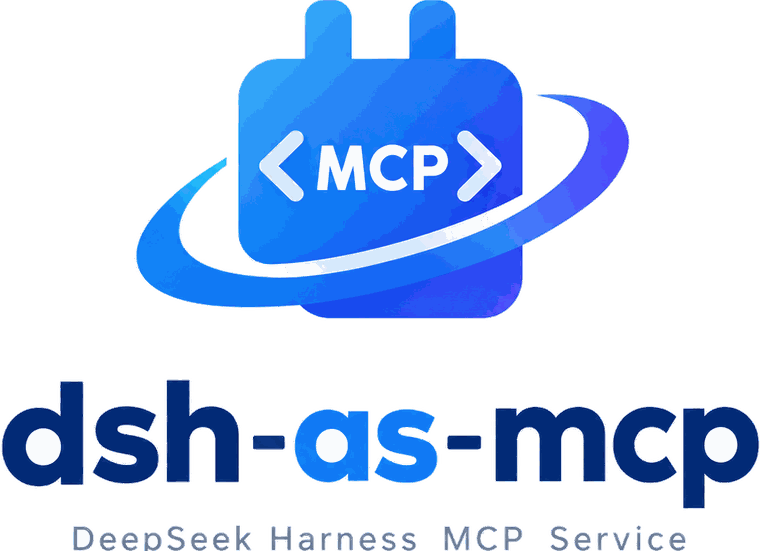
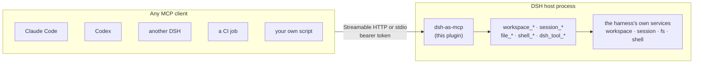

<p align="center">
  <!-- Absolute URLs on purpose: npm renders the README from the tarball and does
       not resolve relative image paths, so a relative src shows up broken there.
       Two variants because the wordmark is dark navy, which vanishes on GitHub's
       dark theme. -->
  <picture>
    <source media="(prefers-color-scheme: dark)" srcset="https://raw.githubusercontent.com/xiseliuli/dsh-as-mcp/main/assets/logo-dark.png">
    
  </picture>
</p>

<p align="center">English | <a href="README.zh.md">中文</a></p>

<p align="center">
  <a href="https://github.com/xiseliuli/dsh-as-mcp/actions/workflows/ci.yml"></a>
  <a href="https://github.com/xiseliuli/dsh-as-mcp/releases"></a>
  <a href="LICENSE"></a>
  <a href="https://www.typescriptlang.org/"></a>
  <a href="https://nodejs.org/"></a>
  <a href="https://modelcontextprotocol.io/"></a>
  <a href="https://github.com/topics/dsh-plugin"></a>
</p>

Expose a running **DeepSeek Harness** as an **MCP server**, so any other agent — Claude
Code, Codex, another DSH, a CI job, your own script — can drive it: create workspaces,
start sessions, hand the DSH agent a coding task, read and write files, run commands.

The endpoint runs *inside* the DSH host process, so a session created over MCP is a real
DSH session. It appears live in the DSH UI, runs inside the DSH sandbox, and is subject to
the same permission policy as anything you type yourself. Nothing about the agent is
reimplemented.

## How it works



---

## Install

Three channels install this bundle into a profile; pick whichever matches where you got the
package from.

**From npm:**

```bash
dsh plugin --profile <name> add dsh-as-mcp
```

From a source checkout, the equivalent is `pnpm dsh plugin --profile <name> add dsh-as-mcp`.

**From GitHub:**

```bash
dsh plugin --profile <name> add github:xiseliuli/dsh-as-mcp
```

A git install fetches source, not the built `lib/`, so pnpm must run this package's `prepare`
script (`tsdown && node scripts/build-client.mjs`) to produce it. pnpm ≥10 refuses to run that
script — and the `esbuild` postinstall the build depends on — until the profile allows them, so
the first `add` fails with `ERR_PNPM_GIT_DEP_PREPARE_NOT_ALLOWED`.

A bare package name in `allowBuilds` works for `esbuild` (a registry dependency) but never for
`dsh-as-mcp` here: pnpm only approves a git-hosted build by its exact resolved key, never by
name alone ([pnpm docs](https://pnpm.io/settings/build#allowbuilds)). The failed `add` prints
that exact key in its error; copy it verbatim into the profile's `pnpm-workspace.yaml`
(`~/.dsh/profiles/<name>/pnpm-workspace.yaml`) and re-run the `add`. Don't rely on pnpm having
written a placeholder entry for you — on this failure path it does not. The result looks like:

```yaml
allowBuilds:
  '<the exact git spec pnpm wrote, including its commit hash>': true
  esbuild: true
```

Treat that allowance as permission to run this package's code on your machine at install time;
pin a commit (`github:xiseliuli/dsh-as-mcp#<sha>`) so a later push cannot silently change what runs.
`dsh plugin add` runs the pnpm version DSH pins (v11.28.5 in DSH 0.2.1-rc.5 — its output ends with
`using pnpm v…`), so the following applies only once DSH ships a newer pnpm. If the
profile's pnpm is ≥11.19.0 (≥11.11.0 for a cloned, non-`github:` git dependency), you can instead
approve the repository itself — `'dsh-as-mcp@git+https://github.com/xiseliuli/dsh-as-mcp.git': true`, with
no `#<sha>` — so a later commit on the same repo keeps building without re-approval; on an older
pnpm the exact-commit key is your only option and needs re-approving after every update
([pnpm 11.11 release notes](https://pnpm.io/blog/releases/11.11-11.14),
[pnpm/pnpm#12367](https://github.com/pnpm/pnpm/issues/12367)).

**From a tarball:**

```bash
pnpm pack
dsh plugin --profile <name> add /abs/path/to/dsh-as-mcp-<version>.tgz
```

Reinstalling from the *same* tarball path silently keeps the previous build — see the warning
under "Installing into DSH Desktop" below for why, and give each rebuild a unique filename.

---

`dsh plugin add` records the package in the profile's `dsh.profile.bundles`, and the
bundle's `cordis.patch.yml` supplies the plugin row and its defaults. **Restart DSH
afterwards**: bundle patches are read at boot, not hot-reloaded.

Confirm the layer composed:

```bash
dsh --profile <name> --dump-config | grep -A 30 '# == dsh-as-mcp'
```

**For publishers:** tag the GitHub repository with the topic `dsh-plugin` — that is what plugin
discovery keys on — and keep npm's `latest` dist-tag pointed at an exact, stable version (no
prerelease, no range), since that is what `dsh plugin add dsh-as-mcp` resolves.

## Connect a client

Every request needs a bearer token. It is resolved in this order:

1. `auth.token` in the plugin config;
2. `$DSH_HOME/dsh-as-mcp/token`;
3. otherwise generated and persisted there on first run, with mode `0600`.

The default endpoint is `http://127.0.0.1:8790/mcp`.

A client that cannot set a header may pass `?token=<token>` instead. Prefer the header: a
credential in a URL is one your shell history, a reverse proxy's access log, or a browser's
history may keep. DSH itself does not log query strings (`webserver/src/index.ts:224`) and the
plugin does not log the token, so this is a habit worth keeping rather than a leak this code
introduces.

**HTTP-capable client** (Streamable HTTP):

```json
{
  "mcpServers": {
    "dsh": {
      "type": "http",
      "url": "http://127.0.0.1:8790/mcp",
      "headers": { "Authorization": "Bearer <token>" }
    }
  }
}
```

The settings panel builds exactly this snippet with the token already filled in, so prefer its
**Copy** button over editing `<token>` by hand.

**stdio-only client** — use the bundled bridge, which forwards each JSON-RPC message to the
endpoint over HTTP:

```json
{
  "mcpServers": {
    "dsh": {
      "command": "npx",
      "args": ["-y", "dsh-as-mcp"],
      "env": { "DSH_AS_MCP_TOKEN": "<token>" }
    }
  }
}
```

`dsh-as-mcp --help` prints the endpoint and token state it will use. The bridge sends a token
read from the token file to loopback endpoints only; pointing `DSH_AS_MCP_URL` off-host requires
setting `DSH_AS_MCP_TOKEN` explicitly, so a copied client config cannot quietly exfiltrate the
machine-local credential. "Loopback" means an exact match — `localhost`, `::1`, or a literal
`127.x.x.x` address — so a name such as `127.0.0.1.example.com` is treated as the remote host it
is. A scheme is optional: `127.0.0.1:8790/mcp` is accepted and understood.

Start with **`dsh_info`**. It reports the endpoint, the plugin version and uptime, where its token comes
from, which tool groups are enabled, and — importantly — which harness services the current profile actually
provides, whether token usage can be read and whether a price source exists, so a client can tell "this
profile has no shell" from "the command failed".

It reports the effective `config` (limits, approval policy, configured defaults — never the token) and endpoint
`health` (node version, memory), so a caller can tell a failed tool call from a struggling process. It also
carries `catalog`: the choices `session_create` actually accepts — `providers` (routes with a
registered adapter), `agentPresets` with `defaultAgentPreset`, the effective `sandboxMode`, the
`permissionPresets` roster, and `sessionCount`. Pass `includeModels: true` to also read each route's
advertised models (`catalog.providerModels`): that asks the adapters, some of which answer with remote
discovery, so it is opt-in and time-boxed per provider — and it is the reliable way to pick a valid
`session_create.model` or `session_set_model.model`. Every catalog field is optional and independently
guarded, and `catalog.unavailable` names whichever read could not be answered, so a missing entry means
"this profile does not say" rather than "nothing is allowed".

## Tools

The data-returning tools (`dsh_info`, `session_list`, `session_usage`, `session_messages`, `file_list`,
`workspace_list`) also declare an output schema and return `structuredContent` beside the text block, so a
schema-aware client can read the object directly instead of parsing JSON out of text.

| Tool | What it does |
| --- | --- |
| `dsh_info` | Endpoint, version and uptime, token source, enabled groups, available harness services, usage/cost availability, the `catalog` of accepted providers, agent presets and sandbox mode, and `toolAvailability` — the tools that passed every rule (`availableTools`, comparable with `tools/list`), those this deployment cannot serve, and why. `probeSearch` additionally exercises a real search to say whether the index answers, rather than just whether the tool is enabled. |
| `workspace_create` | Register a directory as a DSH workspace (creating it if needed; pass `createDirectory: false` to require that it already exists). |
| `workspace_list` | Every registered workspace with id, path, title, session count, directory status. |
| `workspace_delete` | Unregister a workspace (files and session history untouched); idempotent. |
| `session_create` | Start a DSH agent session bound to a workspace or bare directory. |
| `session_fork` | Branch a session (live or restored from disk) into a child that inherits its event prefix, optionally up to `atSeq` (event position) or `atTurn` (turn boundary); with no boundary the harness picks the latest completed turn. Continuing from that point costs one turn, not a replay, and `session_usage` reports the inherited prefix separately. |
| `session_set_model` | Change the provider route and model later turns use: start cheap, escalate for a hard turn, or fall back when a route is unavailable. `reasoningEffort` optionally raises the thinking budget for the same route. The reply's per-model usage shows which route spent what. |
| `session_rename` | Set an explicit user title on a session, so what an external harness names a task stays the name a human sees in the DSH UI (and automatic title generation stops). A session currently held open by another DSH process is refused by the harness. |
| `session_search` | Search session **message content** (FTS tokens/phrases), returning `sessionId`, a snippet, and (when the session listing is readable) the match's `cwd`/`updatedAt`/`running` plus `parentSessionId`/`origin` for subagent sessions; the harness caps a search at 20 and reports `hasMore`. Matching is FTS tokens/phrases (not arbitrary substrings), and multiple terms must all match. **Opt-in:** shipped compositions configure `session-query` with `openAt: "never"`, in which case the tool explains how to enable the index instead of searching. |
| `session_list` | Live session summaries, most recently updated first; `includeTitle` also folds each session's latest title (one log read per session), and `cwd`/`running` filter before the limit applies. A subagent session carries `parentSessionId` and `origin: "subagent"`, and `origin` (`root` / `subagent`) filters before the limit, so the flat list becomes a tree view. The reply carries `total` (matches before the cut) and `truncated` when the limit hid some. |
| `session_prompt` | Send one task to a DSH session; by default waits for the turn and returns the reply, the tool calls the agent made, that turn's wall-clock duration (`turn.durationMs`), and its token usage plus the session's running total. `toolCalls` controls how much of each call is echoed: `summary` (default) gives name/id/argument size, `full` also the arguments (bounded by `maxArgumentChars`), `none` just counts. Attach screenshots with `images` (png/jpeg/webp/gif, at most 4). Pass an `idempotencyKey` and a retried call returns the existing turn instead of sending the task twice — with `wait: true` that retry *waits* for the turn, which is how a caller awaits work it queued with `wait: false`. If the client sends a `progressToken`, the wait reports `notifications/progress` at most once a second. `maxReplyChars` optionally caps the agent's final reply (a cut reply reports `replyTruncated` and its original `replyChars`), and `turn.models` lists the `provider/model` routes that answered. A client cancellation (`notifications/cancelled` for this call) stops the turn and settles the wait with `turn.aborted: true` — the endpoint routes that notification itself, because the SDK version in use only acknowledges it. The usage snapshot carries `partial: true` only when it was taken while the turn was still running; a turn that settled on cancellation has final numbers. |
| `session_messages` | Read a session's user/assistant transcript; `sinceSeq`/`role` make it an incremental poll, `maxCharsPerMessage` caps each message (a cut message reports `truncated` and its original `chars`), each message carries the `id` that queue mutations address (and user messages carry the admission `requestId` that `idempotencyKey` derives), `includeToolCalls` folds each assistant message's tool calls (name, call id, argument JSON length, and — once the tool has answered — the result's length and error flag) into the transcript, `includeToolResults` adds each tool result as its own `role: "tool"` row (callId, text, error) so one read covers the whole timeline (`"errors"` keeps only the failed ones); assistant and tool rows carry `turn`/`step`, and `turn: N` (or `fromTurn`/`toTurn`) narrows a read to one turn or a phase, and `beforeSeq` pages backwards so a transcript longer than the window stays reachable (pass the oldest seq you hold; the tail of the older window comes back). The reply carries `total` (messages matched by the filters) and `truncated` when the limit window hid older ones. |
| `session_queue` | Without `messageId`/`action`, list the session's **pending** inbox with the ids queue mutations address (a queued message has no transcript event yet, so `session_messages` cannot show it); each row carries its text, image count, and the harness's inbox `source` kind (a message queued through this endpoint reports `user` — it is the harness's classification, not a client identity). With `messageId` + `action`, mutate one: `remove` (it never runs), `edit` (replace its text; the id is preserved), or `steer` (deliver it into the running turn). `session_cancel` stops the running turn; this changes the work waiting behind it. |
| `session_tool_result` | Read one recorded tool result, addressed by `callId` (from `session_messages { includeToolCalls: true }`) or by `toolName` (the most recent completed call of that tool): the text, its original length, whether the harness marked it an error, `maxChars` to cap it, and `from: "end"` to keep the tail (a stack trace ends with the error). Debug a failing tool without re-reading the transcript. |
| `session_cancel` | Ask the agent to stop its current turn. |
| `session_usage` | Token usage per session (its subagents included by default): exact bucket counts, a per-model breakdown, optional per-turn detail, and money when a price plugin is installed. Pass `sessionIds` to tally several known sessions in one receipt, or `cwd` to total every session that ran in one workspace directory. |
| `file_read` | Read a UTF-8 file through DSH's filesystem service. Bounded by a byte limit; `offset`/`nextOffset` page through a larger file (both are **byte** offsets, so an offset at or past EOF is an empty complete read), `maxBytes` asks for a smaller window so reading a slice costs less, and `sha256: true` returns the whole file's hash as the compare-and-swap value for a later write/edit. |
| `file_read_image` | Read an image (png/jpeg/gif/webp/bmp, detected from the bytes) and return it as an MCP image block, preceded by a metadata block (path, mimeType, bytes), so you can look at a screenshot or chart instead of guessing. Capped at 8 MiB. |
| `file_write` | Create or replace a file through DSH's filesystem service. Missing parents are created by default (`createDirectories: false` requires them to exist), and `expectedSha256` makes the write compare-and-swap: it is refused when the file changed since the hash was read. |
| `file_edit` | Replace literal text (`oldText` → `newText`) in one file: exact match, unique unless `replaceAll`, nothing written on an ambiguous match, and `expectedSha256` refuses the edit when the file changed since it was read. Editing no longer costs a full read + write of the file. |
| `file_list` | List a directory through DSH's filesystem service; `recursive` walks subdirectories (bounded by `maxDepth` and an entry cap, with `truncated`) and gives each entry a relative `path`; `sha256: true` hashes each file for bulk change detection. |
| `shell_run` | Run one command through DSH's shell service and wait for it. |
| `shell_start` | Start a command in the background (build, test run, dev server) and return a job id; optional watchdog. At most 16 jobs are retained: a finished one is evicted to make room, but a 17th *running* job is refused rather than silently stopping someone else's process. |
| `shell_output` | Read a background job's new output, once each, with `done`/`status`/`pendingBytes`; `truncated` says something was not delivered and `lossy` says the shell service itself dropped bytes (spill paths then hold the full stream). |
| `shell_kill` | Stop a background job (`jobId`) and wait briefly (`waitMs`) for it to settle; idempotent. |
| `shell_list` | Every background job with status, timestamps, exit code and unread bytes. |
| `dsh_tool_list` | The agent tools this endpoint permits, with the schema DSH's own agent sees. |
| `dsh_tool_call` | Run one of them directly, through the same pipeline the agent uses. `maxResultChars` caps what comes back so a large tool result does not flood the caller. |

The typical coding flow:

```
workspace_create { path: "/Users/me/project" }
  -> session_create { workspaceId: "..." }
  -> session_prompt { sessionId: "...", prompt: "Add a --verbose flag to the CLI and a test for it." }
```

`session_prompt` is how you get work done *by* DSH: the DSH agent plans, edits files, runs
its own tools, and can spawn subagents. `file_*` and `shell_run` are for when you want to do
something yourself without involving the agent.

`dsh_tool_call` is the third option: it runs one of DSH's *own* tools without spending a model
turn to decide to call it. Call `dsh_tool_list` first — it reports exactly what is permitted, and
a name it does not report is refused. Both require a `sessionId`, because that session's agent
*is* the policy: it is what makes the harness apply a sandbox, run guards, and file the call under
a transcript.

There is deliberately no session-less form. DSH registers a tool into the scope of the context
that registers it, and every tool package ships inside an agent preset, so the global layer is
empty — an unscoped listing really does return zero tools, and an unscoped call answers
`unknown tool`. A `dsh_tool_list` without a session therefore **fails loudly** rather than
reporting an empty toolbox, which would read as "nothing is permitted". For the agentless path
use `file_read` / `file_write` / `file_edit` / `file_list` / `shell_run`, which resolve the deployment policy
directly and need no session.

The permitted set is an **allow-list**, and it is deliberately narrow. Everything absent is
refused *and* hidden from `dsh_tool_list`. The omissions that matter:

- **`run_code`** is DSH's programmatic-tool-calling entry point: one call runs a program that
  can invoke *any other tool by name*. Exposing it would void the list entirely.
- **`cordis_run`, `cordis_define`, …** execute arbitrary plugin code. No shipped bundle mounts
  them, so a deny-list written against today's profile would be blind in exactly the profile
  that adds them — which is why this is an allow-list.
- **`ask_user_question` and `present`** reach the human at the keyboard.
- **`workflow`, `ralph`, `send_message`, `spawn_teammate`, `schedule_create`** start work that
  outlives the call; **`create_goal` and `update_goal`** sustain unattended execution.

An operator can widen this deliberately with the `agentTools.allow` setting, or subtract from
the default with `agentTools.deny`.

## Usage accounting

DSH has no "session ended" event, so there is no hook to subscribe to and no final callback to
wait for. Spend is reported where a caller can ask for it: on every `session_prompt` reply, and
on demand with `session_usage`.

**Every prompt reply carries it.** `turn.usage` is what that prompt consumed — every step of the
turn, one model call each, including tool round trips — and `session` is that session's running
total, with a per-model breakdown and, when a price plugin is installed, money:

```json
{
  "accepted": true,
  "turn": {
    "reply": "…", "toolCalls": [], "turn": 1, "turnEndReason": {"kind": "completed"},
    "timedOut": false, "aborted": false,
    "usage": {
      "turn": 1, "steps": 157,
      "uncachedInputTokens": 1032706, "cacheReadTokens": 21192320,
      "cacheWriteTokens": 0, "outputTokens": 86148, "totalTokens": 22311174
    }
  },
  "session": {
    "sessionId": "session-…",
    "usage": {
      "totals": {"uncachedInputTokens": 1032706, "cacheReadTokens": 21192320,
                 "cacheWriteTokens": 0, "outputTokens": 86148, "totalTokens": 22311174},
      "byModel": [{"provider": "opencode-go-xise", "model": "deepseek-v4.1-flash",
                   "samples": 157, "uncachedInputTokens": 1032706,
                   "cacheReadTokens": 21192320, "cacheWriteTokens": 0,
                   "outputTokens": 86148, "totalTokens": 22311174}],
      "turns": 1, "steps": 157, "samples": 157,
      "verifiedAgainstProjection": true
    },
    "cost": {
      "available": true, "source": "dsh-cost-meter", "estimate": true,
      "costUsd": 0.5384, "costEstimateUsd": 0.5384, "costCny": 3.5818, "costEur": 0.4819,
      "calls": 157
    }
  }
}
```

With `mode: "steer"` the turn was already running, so `turn.usage` covers the whole turn including
steps that ran before your message.

`turn.usage` is absent when the turn billed nothing (a cancelled turn with no step, a provider that
reported no usage). It is also absent when the usage read itself failed — that case is never silent:
the reply carries `usageUnavailable: true` and a `reason`, so a caller that bills against these
numbers can tell "the log was unreadable" from "nothing was spent", and can retry with
`session_usage`. With `wait: false` there is no turn to describe, but `session` is still returned
(and a failed read says so the same way). A wait that timed out — or one whose own snapshot was taken
while the turn was still open — flags the totals `partial: true`: that turn had not settled, so they can
still grow. It is why a queued message also reports `partial`: its turn has not run yet. A turn that was
cancelled and then *settled* reports final numbers, because nothing more will be billed for it.

**Or ask for it.** `session_usage` is the receipt to call after the last prompt. It reads the
durable session log rather than a live session, so it answers for a session that has gone idle,
left the live store, or was created by an earlier DSH run — as long as you know its id:

```json
{
  "generatedAt": "2026-11-02T08:00:00.000Z",
  "scope": "session",
  "sessions": [
    {
      "sessionId": "session-…",
      "cwd": "/Users/me/project",
      "origin": "self",
      "usage": {
        "totals": {"uncachedInputTokens": 1032706, "cacheReadTokens": 21192320,
                   "cacheWriteTokens": 0, "outputTokens": 86148,
                   "totalTokens": 22311174},
        "byModel": [{"provider": "opencode-go-xise", "model": "deepseek-v4.1-flash",
                     "samples": 157, "uncachedInputTokens": 1032706,
                     "cacheReadTokens": 21192320, "cacheWriteTokens": 0,
                     "outputTokens": 86148, "totalTokens": 22311174}],
        "turns": 1, "steps": 157, "samples": 157,
        "verifiedAgainstProjection": true
      },
      "cost": {"available": true, "source": "dsh-cost-meter", "estimate": true,
               "costUsd": 0.5384, "calls": 157}
    }
  ],
  "totals": {"uncachedInputTokens": 1032706, "cacheReadTokens": 21192320,
             "cacheWriteTokens": 0, "outputTokens": 86148, "totalTokens": 22311174,
             "turns": 1, "steps": 157, "samples": 157},
  "byModel": [{"provider": "opencode-go-xise", "model": "deepseek-v4.1-flash",
               "samples": 157, "uncachedInputTokens": 1032706,
               "cacheReadTokens": 21192320, "cacheWriteTokens": 0,
               "outputTokens": 86148, "totalTokens": 22311174}],
  "subagentsIncluded": false,
  "cost": {"available": true, "source": "dsh-cost-meter", "estimate": true,
           "costUsd": 0.5384},
  "notes": ["…"]
}
```

| Argument | Meaning |
| --- | --- |
| `sessionId` | Report this session, plus its subagent sessions by default. Omit it to total the sessions this endpoint created. |
| `all` | Without a `sessionId`: scan every session this DSH knows, most recently updated first. Ignored when `sessionId` is given. |
| `includeSubagents` | Fold subagent children in as their own rows. Default `true`. |
| `includeTurns` | Also return each row's per-turn breakdown. Default `false`. |
| `includeCost` | Read money from `dsh-cost-meter`. Default `true`; set `false` on a wide scan, where pricing costs one ledger read per row and a session list usually does not need money. |
| `limit` | Sessions to scan when no `sessionId` is given. Default 20, max 200. |

A read taken while the session's newest turn is still running marks that row `partial: true`; when
any included row is partial the report itself also carries `partial: true` and says so in `notes`,
because the totals are a snapshot that will grow. Do not finalize a bill from a partial report.

No `sessionId` means the sessions **this endpoint created in this DSH process**. Nothing in the
harness records that ownership, so after a restart pass the id; `all: true` instead walks every
session this DSH knows, and says so in `notes` when the limit cut it short.

**After a DSH restart, an id is still enough.** Verified live: a session created before a restart
stays readable, `session_usage { sessionId }` returns the same totals, and `session_prompt` on it
continues the conversation with cumulative usage spanning both processes. Only the
ownership-based defaults reset — unscoped `session_usage` reports nothing it did not create, and
says so in `notes`.

**The buckets are disjoint**, exactly as the provider reports them, and `totalTokens` is their
sum:

| Field | Meaning |
| --- | --- |
| `uncachedInputTokens` | Prompt tokens the provider did not serve from its cache. This is the provider's `inputTokens`, which is uncached by definition rather than a total input. |
| `cacheReadTokens` | Prompt tokens billed as cache reads. |
| `cacheWriteTokens` | Prompt tokens billed as cache writes (cache creation). |
| `outputTokens` | Generated tokens. `reasoningTokens` is a subset of this, never a fifth bucket, so it is not added anywhere. |
| `totalTokens` | The sum of the four — the number to bill against — computed from the buckets rather than trusted from a provider `totalTokens` field. |

**Exactness.** The totals are folded from the durable session log — the same
`assistant/message.data.usage` records, and the usage chunk inside a retried
`assistant/attempt`, that the harness's own `tokenUsage` projection is built from — so they are
provider-reported counts, not estimates. `verifiedAgainstProjection: true` means the harness's own
cumulative figure was present at the same cut and agreed bucket for bucket (it did, exactly, on a
1,146-event session). When it disagrees, `projectionTotals` carries the harness figure: the log
fold stays in `totals`, and the disagreement is reported rather than silently resolved.

Every provider attempt that was billed is counted, including a failed attempt that was later
retried — those tokens were charged. A corrected or repeated report for a call already counted
*replaces* its buckets instead of double counting it, and an identical re-report is a no-op.
`samples` is therefore the number of provider **calls** folded, not distinct steps: a retried call
adds one, a correction does not, and it can differ from `steps`. `byModel` lists only routes that
actually charged tokens, so a call that reported zero tokens appears in `samples` but in no route
row. `turns` and `steps` count how many turns and steps reported usage. `ignoredSamples` appears when a record could not be read (missing or
non-integer counts), because the totals then under-report what the provider charged and hiding that
would be worse; an aggregate report adds up the ignored counts across its rows and notes it.

**What is left out, and why.**

- **Compaction** is its own LLM call, and the harness records its usage on
  `compaction/summary.data.usage`. It is reported in an optional `compaction` block
  (`{totals, summaries, ignoredSummaries}`) and deliberately kept out of `usage.totals`,
  because the harness's own projection excludes it — folding it in would make these numbers
  disagree with the DSH UI's figure for the same session. Add it in yourself if you want the
  whole token bill.
- **The session title** is generated by an LLM call that leaves no usage record in the log at all
  (only `session/title-llm-request`, which names the route). No token fold can see it.
- **A forked session** inherits its parent's event prefix. That prefix was billed to the parent,
  so it is reported separately as `inherited`, and `totals` covers only the child's own turns.
- **Subagents** are billed to the same account, so `session_usage` folds children in as their own
  rows by default (`includeSubagents: false` excludes them), up to 50 per target, with
  `truncatedSubagents` when that cap stopped the walk. Children are identified by the harness's own
  `origin: "subagent"` mark: an ordinary **fork** of a session also records a parent link, and it is
  a full session of its own, so it is never folded in as a child. A prompt reply's `session` block
  does not include subagents: it is that session's own turns only, which is why the tool exists.
  One report is bounded at 100 rows (`truncatedRows`, and the money total is marked `partial` when
  it applies), and if the session listing itself is unavailable the report says subagents could not
  be enumerated rather than claiming there were none. A spawned subagent runs on the **parent
  session's route at spawn time** (verified live: a parent first answering on
  `deepseek-official/deepseek-flash`, switched to `deepseek-account/deepseek-flash` before spawning,
  produced a child billed on the switched route), so switching the parent's model before spawning
  steers what its agents spend.
- **An unreadable session** (pruned, corrupt) becomes a row with `error` instead of `usage`, is
  excluded from the totals, and is called out in `notes`, so one bad session does not fail the
  whole report.

**Money is separate, and optional.** `cost` exists only when the third-party
**`dsh-cost-meter`** plugin is installed: the harness has no price or currency service at all. It
is an **estimate** from that plugin's price catalog — which applies peak/off-peak windows and
matches an unrecognised route by model name — not an invoice, and it comes as two different USD
figures because they answer different questions:

- **`costUsd`** is the real money charged: cost-meter's `apiCost`. This is the field to sum across
  sessions, and it is `0` for a call a subscription or coding plan covered, because no per-token
  money left the account.
- **`costEstimateUsd`** is the list-price estimate: cost-meter's `cost`, computed from the catalog
  regardless of how the call was billed. It is what the same call would have cost at API rates, and
  it is the only figure that moves for a plan-covered session.

`costCny`/`costEur` are cost-meter's frozen FX copies of the estimate (its ledger is
USD-canonical), and `calls` is the number of LLM calls it booked (turns, compaction, and titling;
its per-session figure does not merge subagents, which is why each row is priced on its own).
Without the plugin the block is `available: false` with a readable `reason` ("no price source in
this DSH profile: …"), and the tokens are unaffected. Money covers every in-session LLM call while
the token totals exclude compaction and cannot see titling, so **tokens and money do not reconcile
exactly**: use `costUsd` for spend, `costEstimateUsd` for list-price value, and `totalTokens` for
volume — and do not derive one from another.

Both paths are gated by `tools.usage` (default `true`); see the configuration below. The toggle is
independent of `tools.session`, so with sessions off you can still ask for the usage of a session
id you already hold. Nothing is recorded differently either way: usage is folded from the session
log the endpoint already reads, so the toggle changes what is returned, never what exists.

## Security

This endpoint is remote control of a coding agent that has shell access. Treat the token like
an SSH key — and note that the plugin does too: no tool returns its value. `dsh_info` reports
where the token comes from (a file path or the composition), never the literal, so a calling
agent's transcript never accumulates the credential. A pinned token shorter than 16 characters
draws a warning at boot, and a generated one is 43 characters of CSPRNG output.

- A request that declares a body over 64 MiB is refused with `413` before the body
  is read, and a chunked request — which declares no size — has its bytes counted while
  streaming and is refused with the same `413` once the cap is passed (verified: 70 MB
  sent chunked answered `413` in 71 ms, and a valid chunked request still works). This
  is defence in depth: every tool that could carry a large payload already has its own
  cap.
- A rejected request answers `401` with `WWW-Authenticate: Bearer realm="dsh-as-mcp"`, so a standard
  MCP client can tell that presenting its configured token is the fix rather than reporting a dead
  endpoint. The realm is a fixed label; the token is never echoed.
- The listener binds to `127.0.0.1` and every request is bearer-checked, including requests on
  a route mounted on DSH's own web server. That check is the *only* gate there: an exact route
  registered on the web server is matched **before** DSH's authorization fence — anything
  unmatched is handed to that fence as a fallback (`webserver/src/index.ts:222-227`) — so with
  `http.mountOnWebServer: true` the endpoint does not inherit your browser session's
  protection, it enforces its own. One caveat on DSH Desktop: when ordinary browser access is
  disabled there, the web server additionally refuses requests that do not carry the renderer
  header, so the mounted path is unreachable for a plain MCP client — use the plugin-owned
  listener. Setting `http.host: 0.0.0.0` exposes that same power to your network; the plugin
  warns at bind time, and you should do it only behind your own gateway.
- **The token is the entire security boundary, and that boundary is your user account.** There
  is no path sandbox. Once a caller holds the token, `file_read`/`file_read_image`/`file_write`/`file_edit`/`file_list` reach
  anything the DSH process can reach (images included, and `session_prompt` can attach them to an
  agent turn), and `shell_run` runs arbitrary commands as you — because
  that is exactly what the harness's own `fs` and `shell` services do for DSH's own agent. Both
  properties were verified against a live instance: `file_read` returned `/etc/passwd`,
  `~/.dsh/settings.yaml`, and this plugin's own token file; `file_write` created a file outside
  every registered workspace. A workspace sets where a *session's* agent starts; it does not
  fence these tools.
- **The bridge is instance-wide, not per-caller.** `session_list` enumerates every session in
  this DSH instance and `session_messages` reads any of their transcripts — verified reading a
  session this plugin did not create. Those are the sessions you have been talking to DSH in, so
  a token holder sees your conversation history, and a calling agent's context accumulates it.
  This is not an escalation (the same bytes are in `$DSH_HOME/sessions`, reachable through
  `shell_run`), but it is a privacy consequence worth knowing before you hand out a token.
  The reach is not only reading: `session_prompt`/`session_queue`/`session_cancel`/`session_rename`/
  `session_set_model`/`session_fork` act on any session this process holds, so a token holder can
  withdraw a message you queued, cancel a turn, rename a session, switch its model, or fork its
  content into a session it owns. `session_search`, when the deployment enables the index, turns the
  same history into a queryable message-content search (bounded snippets) — it is opt-in for exactly
  this reason. None of it exceeds "the token is you", but a token you would not hand out for
  `shell_run` is also a token you should not hand out for these. `session.scope: "owned"` narrows the
  session tools to sessions this endpoint created or forked, which is the containment option for a
  token handed to a lower-trust caller.
- **Spend is readable on the same boundary.** A token holder can read token usage — and, where
  `dsh-cost-meter` is installed, an estimated money figure — for any session this endpoint can
  reach: `session_usage`, and the usage block on every `session_prompt` reply. It is not a wider
  *authority* (the usage records sit in the same durable session log the transcripts come from, and
  `shell_run` reaches that log anyway), but it is a wider *discovery* surface than the session
  tools: `session_usage` with `all: true` enumerates every session id, its `cwd`, and its spend even
  when `tools.session` is off. If you turned the session tools off to stop a caller touching this
  instance, turn `tools.usage` off in the same breath.
- Consequently the `tools` toggles **narrow what a client can discover and call; they are not
  containment.** `tools.shell: false` removes the shell tool, but `file_write` still writes your
  shell startup files and `file_read` still reads your credentials, so a profile with the shell
  tool switched off is not safe to hand to a caller you would not give a login to. For real
  containment, run the whole DSH instance inside an OS-level sandbox or as a dedicated
  unprivileged account, and treat the token as that account's password.
- `approval.policy` decides what happens when the DSH agent wants to run something the harness
  would normally ask a human about:
  - `inherit` (default) — the plugin does not answer. With no browser attached, an
    approval-requiring tool resolves `unavailable` and the agent's action fails closed.
  - `allow` — every session **this plugin creates** (and every forked child) is switched to the
    harness's unattended stance (`never`) through the approval service, and the harness tells the
    agent about the switch. Sessions the plugin did not create keep your policy, so your own
    interactive sessions are untouched. This is what makes unattended agent runs work; it is a
    real widening of what the agent may execute. The create/fork reply reports
    `approvalPolicy: "never"`, or `approvalPolicyError` when the switch could not be made.
- `file_write`, `shell_run`, and the background `shell_start`/`shell_kill` are the *caller's*
  actions, not the agent's. They run through the harness's own filesystem and shell services, so
  the sandbox and policy configured for this DSH instance still apply.

## Installing into DSH Desktop (restart required)

On the current harness (0.2.1-rc.5) `dsh plugin --profile desktop add <tarball>` works from a plain
terminal: only the app's *managed* operations are refused there (for example `--dump-config` for the
`desktop` profile). The tarball route below is the simplest install; the hand-written patch layer in
the next section is the fallback for a host that refuses the subcommand. Either way, DSH Desktop
must then be **restarted**.

### Why a restart is required

`patchReload: live` in the profile manifest only governs the **CLI launcher**. The no-restart
recompose is implemented by `watchUserPatches()`, which lives in the CLI's `runProfile()`
(`apps/cli/src/profile-boot.ts`). DSH Desktop takes a different path: it calls `boot()` from
`@deepseek-ai/dsh-app-boot` with the patch list computed once at startup, and the shipping app
contains no such watcher at all:

```bash
grep -rn watchUserPatches <dsh-desktop>/dsh-plugin-desktop/src/    # no matches
```

Measured behaviour agrees: after editing the profile's `cordis.patch.yml`, the app log gained not
one line and the port never opened.

So: **a CLI-launched profile (`dsh --profile xxx`) applies patch edits immediately; DSH Desktop
must be restarted.** On either path the watcher only recomposes config rather than replacing
loaded modules, so editing `lib/` needs a restart regardless.

### If the app will not start afterwards

Reset `~/.dsh/profiles/desktop/cordis.patch.yml` to `[]` and the plugin takes no part in startup.
To remove it entirely: `cd ~/.dsh/profiles/desktop && pnpm remove dsh-as-mcp`.

### 1. Pack it and install into the desktop profile

```bash
cd /path/to/dsh-as-mcp && pnpm pack --pack-destination /tmp

# raw pnpm, bypassing the CLI's reserved-profile guard
cd ~/.dsh/profiles/desktop && pnpm add /tmp/dsh-as-mcp-0.1.0.tgz
```

> **Reinstalling over an existing install: change the tarball path.**
> `pnpm` keys a `file:` dependency on the *path*, and a reinstall from the same path
> reports `added 0` while leaving the previous content linked — a silently stale
> build that still boots and still runs the old code. Give each build a unique
> filename and the spec string changes with it:
>
> ```bash
> TARBALL=/tmp/dsh-as-mcp-$(date +%s).tgz
> cd /path/to/dsh-as-mcp && pnpm pack --pack-destination "$(dirname $TARBALL)"
> mv /tmp/dsh-as-mcp-0.1.0.tgz "$TARBALL"
> cd ~/.dsh/profiles/desktop && pnpm remove dsh-as-mcp && pnpm add "$TARBALL"
> ```
>
> Then confirm the bytes actually match, or you are testing the old build:
>
> ```bash
> wc -c ~/.dsh/profiles/desktop/node_modules/dsh-as-mcp/lib/index.js \
>       /path/to/dsh-as-mcp/lib/index.js
> ```

### 2. Put the plugin row in the profile's own patch layer

Edit `~/.dsh/profiles/desktop/cordis.patch.yml` (replace the `[]`):

```yaml
- insert:
    - id: dsh-as-mcp
      name: dsh-as-mcp
      config:
        http:
          enabled: true
          host: 127.0.0.1
          port: 8790
          path: /mcp
        tools:
          workspace: true
          session: true
          files: true
          shell: true
```

Then **restart DSH Desktop** to mount the plugin.

> ⚠️ **Do not also add `dsh-as-mcp` to `dsh.profile.bundles`.** The bundle contributes its own
> row, so the composed result carries **two rows sharing one id** (`dsh --profile <name>
> --dump-config` shows both). Use the patch layer or the bundle list, never both. Switch to the
> bundle route via `dsh plugin add` when you want it to persist across restarts.
>
> This is worse than a duplicated row: **every write from the settings panel is refused**, with
> `Configuration for "dsh-as-mcp" is overridden by a home patch or command-line overlay`. DSH's
> config editor validates an edit against the *first* composed row while the Loader applies the
> *last*, so with two rows they never agree and nothing is ever persisted. The panel only says
> `Write failed; the host state was re-read. Please retry.` — which reads like a transient
> failure, not a composition mistake. If you are on the bundle route, delete the hand-written
> `- insert:` row; if you are on the patch route, remove `dsh-as-mcp` from
> `dsh.profile.bundles`.

### 3. Smoke-test it

```bash
node ~/.dsh/profiles/desktop/node_modules/dsh-as-mcp/scripts/smoke.mjs
```

It reads `<DSH_HOME>/dsh-as-mcp/token`, shakes hands, lists tools, calls `dsh_info` to report which
harness services this profile actually mounted, then calls `workspace_list`. The last line is `OK`
on success and the exit status is non-zero on failure.

For one real round trip (temp workspace → session → hand the DSH agent a task → print the reply,
its tool calls, and the tokens it spent, then read the same total back through `session_usage`):

```bash
node ~/.dsh/profiles/desktop/node_modules/dsh-as-mcp/scripts/smoke.mjs \
  --prompt "In the current workspace create hello.txt containing hi, then read it back to confirm"
```

### 4. Uninstall

Reset `~/.dsh/profiles/desktop/cordis.patch.yml` to `[]` and restart, and the plugin no longer
mounts. To remove it entirely: `cd ~/.dsh/profiles/desktop && pnpm remove dsh-as-mcp`.

## Configuration

Defaults ship in `cordis.patch.yml`. A profile's own `cordis.patch.yml` overrides the row by
`id`, and an override **replaces the row's whole `config` object** rather than deep-merging
it — restate every key you still want. Unknown keys are rejected at boot with the offending
key named, because a silently ignored typo means your override is not being applied.

```yaml
- id: dsh-as-mcp
  name: dsh-as-mcp
  config:
    http:
      enabled: true          # plugin-owned listener
      host: 127.0.0.1
      port: 8790             # 0 asks the OS for a free port
      path: /mcp
      mountOnWebServer: false # also serve at http://<dsh host>:<dsh web port>/mcp
    auth:
      # Leave `token` out entirely to use $DSH_HOME/dsh-as-mcp/token (generated on
      # first run). Do not write `token: ''`: a present value, even empty, reads as
      # a pinned secret in the settings panel.
      # token: '<a long random secret>'
    tools:
      workspace: true
      session: true
      files: true
      shell: true
      agentTools: true       # dsh_tool_list / dsh_tool_call: run the instance's own tools
      usage: true            # session_usage + the usage blocks in session_prompt replies
    agentTools:
      allow: []              # empty: the built-in allow-list; non-empty replaces it
      deny: []               # subtracted from the resolved set
    session:
      agentPreset: ''        # empty: harness default
      provider: ''           # must be paired with model
      model: ''
      promptTimeoutMs: 900000
      scope: all             # all: every session this DSH holds; owned: only sessions this endpoint created
    limits:
      maxReadBytes: 1048576
      shellTimeoutMs: 120000
      agentToolTimeoutMs: 120000
    approval:
      policy: inherit        # inherit | allow
```

`session.scope` is the containment option for a token you hand to a party that should not reach
your own conversations: `owned` restricts every content-bearing session tool (prompt, cancel, list,
transcript, fork, rename, model, queue, search) to sessions this endpoint created or forked **and
their subagent sessions** — a refusal names the setting. Subagents are included because they are the
harness's own descendants of an owned session: excluding them would make an owned session's bill and
listing quietly omit work it caused. `all` (the default) keeps the historical instance-wide reach. It is
inside the token boundary, not a replacement for it: file, shell and agent-tool access are governed
by their own tool groups and the deployment's sandbox policy.

Ownership is **durable**: created and forked session ids are remembered in
`$DSH_HOME/dsh-as-mcp/owned.json` (0600, newest 1000 ids), so `owned` still covers them after a
plugin reload or a DSH restart. A missing or corrupt record reads as "nothing is owned" — it can only
hide sessions, never expose them — and the file is advisory rather than a security boundary: anything
that can write it can already write the session store.

`session_search` filters the harness's page of at most 20 matches *after* it arrives, so a page can be
entirely foreign — the reply then carries `hidden` and `hasMore` states that more matches exist.

`mountOnWebServer` is enough on its own: with `enabled: false` the endpoint is served
**only** on DSH's web server at `<dsh host>:<dsh web port><path>`, with no second port. The
plugin waits for that service to mount, then registers an exact route — `dsh_info` reports
`mountedOnDshWebServer`, and `mountNote` while it is still waiting. A missing service is not an
error: the plugin keeps loading and mounts the moment the web server appears. The mounted route
behaves like the listener: progress notifications stream as they happen (verified arriving about
once a second, not batched at the end) and cancellation notifications stop the turn.

## Settings panel

Where the host mounts a settings service — DSH Desktop and `dsh web` both do — the plugin
contributes an **MCP server** section to the settings panel. It edits the same `dsh-as-mcp`
namespace the configuration above fills, so the panel and the file are two views of one
value, not two copies.

The panel covers every setting including the `agentTools.allow` and `agentTools.deny` lists,
which are edited as comma-separated text. Both are ordinary `string[]` values, so an entry with a
comma in it cannot be expressed here; use the configuration file for that.

Every change applies **live**:

| Change | Effect |
| --- | --- |
| a tool toggle | the group leaves or joins the very next `tools/list`; a disabled tool is genuinely absent, so calling it reports an unknown tool rather than running and being refused. `usage: false` also stops the usage blocks in `session_prompt` replies |
| a limit, or a session default | read at the start of the next call |
| the token | the new value is required by the next request; the old one stops working immediately |
| `enabled`, `host`, `port`, `path`, `mountOnWebServer` | the listener is moved |

Changing the port is the case worth stating plainly: the plugin stops the old listener and
starts the new one, so the endpoint really does move. If the new port is taken, the bind error
is shown in the panel and in `dsh_info` rather than being swallowed.

The token is rendered **write-only in the form**: its literal never reaches the settings form, so
the input only writes, and a "clear" button removes the override this panel wrote (a token the
composition config supplies is not affected by it and stays in force). Whether one is pinned is
reported by the host, not guessed by the page: `auth.token` deliberately carries no schema
default, because the settings service answers "is this secret set?" with `value !== undefined`
and a default would make every panel claim a token was pinned from the moment the plugin loaded.

The panel's **copyable client configuration** is the one place the literal is deliberately handed
out. The **Copy** button writes the snippet with the real effective token in it, so pasting it
just works; the text on screen is masked (with a "Show token" button) so a screenshot or a shared
screen does not leak it. Both come from the same read-only status route, on DSH's connection
layer — inside that layer's Host/Origin and browser-cookie fence, so it inherits DSH's own
authorization and is never exposed on a bare port. `dsh_info` still reports only the token's
source: a caller that authenticated with the token does not need it echoed into its transcript.

The panel is a `settings.section` page the browser half registers through
`ctx.configForms.whileServed`, so it appears only while the host actually serves this entry's
form. That needs `@deepseek-ai/schemastery`: DSH 0.2.0-rc.2 projects a form only for an entry
whose `Config` carries a `toJSON()`, and it keeps only fields marked `meta.volatile`. There is
no schemastery-free path to a panel, so the module is a declared peer and imported directly —
without it the plugin cannot be imported at all, which is why the compatibility range below is
what protects a host that cannot supply it.

## Deployment requirements

Every tool names what it needs and reports an actionable error when the service is absent, and
`dsh_info.toolAvailability` derives the same mapping at runtime for the caller's own profile, but an
operator setting up a profile should be able to read the requirements in one place. "Required" means
the tool does not work at all without it; "configured" means the service is present in normal profiles
but a deployment can switch the capability off.

| Tool group | Requires | Notes |
| --- | --- | --- |
| `dsh_info`, `session_usage` (by id) | nothing beyond the durable log | `session_usage` by id works as long as the log is readable (`sessionQuery`, or the controller's `inspect` fallback) |
| `session_create` / `session_list` / `session_prompt` / `session_messages` / `session_cancel` / `session_fork` / `session_rename` / `session_set_model` | `sessionController` | the bridge waits for it only where it must (`session_create`/`prompt`); elsewhere the tool reports the missing service |
| `session_search` | `sessionController.search` **and** a session-query index that is open | `session-query-sqlite` ships with `openAt: "never"`; set it to `startup` or `first-search` to enable search |
| `workspace_*` | `workspaceRegistry` | provided by the base bundle in normal profiles |
| `file_*` | `fs` | the deployment's sandbox policy still applies; `file_read_image` additionally needs a supported image format |
| `shell_*` | `shell` | `shell_run` uses `run()` when present and `execute()` otherwise; background jobs need `start()` or `execute()` |
| `dsh_tool_list` / `dsh_tool_call` | `tools` **and** `sessionController.resolveAgent` | the allow-list is applied on top of the session's own policy |
| money in usage replies | `costMeter` | a third-party price plugin (`dsh-cost-meter`); absent by default, and the reply says so |
| `approval.policy: "allow"` | `approval` **and** a resolvable agent | absent service or agent means the create/fork reply reports `approvalPolicyError` |
| `http.mountOnWebServer` | `webServer` | the plugin waits for it and mounts; `dsh_info.mountNote` says while it is still waiting |

## Compatibility

- **Harness** ≥ `0.1.5-rc.1`, declared as `peerDependencies["@deepseek-ai/dsh"]:
  ">=0.1.5-rc.1"` with no upper bound. DSH's plugin loader reads that range straight from the
  manifest and semver-checks it against the single running runtime version (prereleases
  included) *before* the plugin is imported; an incompatible install is refused unless the host
  grants an exact-version exemption (`dsh plugin allow-version`).
- **Node** `^22.19.0 || >=24.0.0`.
- The `@deepseek-ai/dsh` peer is declared **optional**, purely so `dsh plugin add` does not pull
  a full harness install into every profile just to satisfy it. Optional only changes
  installation — DSH's compatibility gate reads `peerDependencies` regardless of
  `peerDependenciesMeta`, so the version check above still applies in full.
- **Settings model.** Verified against `dsh 0.2.0-rc.2`, whose settings service replaced the
  0.1.x API this plugin first shipped against: `settings.installSection` is gone, a namespace is
  projected from the entry's own `Config` keyed by the Loader row id, and only `meta.volatile`
  fields are editable — a volatile write is committed into the running reference without a
  remount. The host half therefore declares no registration at all and reads its configuration
  through `plainConfig()` on every access, and the only settings call it still makes is
  `configure({ auto: false }, ctx.fiber)` (it ships its own page). **The panel needs the 0.2
  settings model**; on a 0.1.x runtime the endpoint still runs from the configuration file, but
  there is no panel, because that runtime only projects a form for a namespace a plugin
  registered through the removed call.
- **Usage needs the session log.** Token figures are folded from the durable log through
  `sessionQuery` (preferred) or `sessionController.inspect`; `dsh_info` reports this as
  `tokenUsage`. Without either, a `session_prompt` reply says `usageUnavailable` with a reason
  instead of pretending the turn was free, the session tools keep working, and `session_usage` with
  a `sessionId` returns an `error` row (its totals exclude it). Without a `sessionId` it reports the
  sessions it created itself (or an empty report explaining why) — but `all: true`, which needs to
  enumerate sessions, fails with the capability error. Money additionally needs the third-party
  `dsh-cost-meter`, reported by `dsh_info` as `costMeter`.
- **No other hard `@deepseek-ai/*` dependency.** This package resolves every other capability
  structurally through `ctx.get(name)`. The one exception is `@deepseek-ai/schemastery`, a
  declared peer imported directly: DSH offers no schemastery-free path to a settings form.

## Design notes

- **Capability detection, not `inject`.** The plugin loads in a bare CLI profile that has no
  web server, no session service, and no filesystem seam, and each tool then reports exactly
  which service is missing and which bundle provides it. Declaring `inject` would make the
  loader refuse to mount the plugin instead, which is a worse answer for a capability bridge.
- **Waiting for a turn.** The harness exposes no per-message "await this turn" call —
  `sessionController.prompt()` returns as soon as the message is queued. So `session_prompt` polls
  the durable session log for a `user/message` whose `source.rpcId` equals the `requestId` it
  passed to `prompt()` — the same correlation the session controller's own idempotency check uses
  — and then waits for *that* turn to close. Attribution is what makes this correct rather than
  plausible: a queued prompt's log entry sits inside the span of the turn that was already
  running, so a `turn/end` appearing after our message is usually someone else's turn, not ours.
  Turns on one session are additionally serialized, so two concurrent callers cannot interleave
  prompts and then disagree about which reply is theirs. The serialization covers the whole wait,
  not just the submission: a second `session_prompt` to a session whose first wait is still open
  does not even submit its message until that wait settles (up to its timeout), and a `steer` sent
  while another MCP wait is in flight is deferred until it, which turns it into a queued prompt.
  A `notifications/cancelled` for the open call is matched to its request id and
  cancels the turn (`session_cancel` under the hood), so a cancelled wait settles as
  aborted instead of running to completion.
  Callers that only want to queue a message should prefer `session_messages` polling over holding
  a long wait open. **Different sessions are not serialized against each other**: two sessions can
  run turns at the same time (measured: two prompts each blocked on a four-second tool step
  finished in 6.3 s total), and cancelling one session does not disturb the other.
- **Filesystem.** Only `workspace_create` touches `node:fs` `mkdir` — the directory it creates
  *is* the new sandbox root, so by definition it sits outside every root that exists before it,
  which is why the call cannot go through the filesystem seam and is instead gated on the
  read-only policy. The harness filesystem service deliberately exposes no `mkdir`; `file_write`
  relies on the seam's atomic write, which creates parents inside the fence. Every read and
  write goes through `ctx.fs`, so the same path rules and sandboxing the DSH agent lives
  under apply to the caller.
- **No session deletion.** The harness offers `archiveSession`/`unarchiveSession` but no
  delete, so neither does this plugin.

## Development

```bash
pnpm install
pnpm build       # tsdown -> lib/
pnpm typecheck   # tsc --noEmit
pnpm test        # vitest
```

The test suite runs real HTTP against a real listener, spawns the real `bin/mcp-stdio.mjs`,
and loads the plugin into a real `@deepseek-ai/cordis` context — with `resolveConfig` doing the
config validation — so the wire protocol, the bridge, and the loader contract are all
exercised rather than mocked.

Two scripts run against a **live** endpoint, which is a different thing. Both resolve it the
same way — the `--url`/`--token` flag wins, then `DSH_AS_MCP_URL`/`DSH_AS_MCP_TOKEN`, then the
loopback default — and both print the endpoint they resolved and where it came from (`arg` /
`env` / `default`) to stderr before sending anything, so a stray run cannot silently land on
whatever DSH instance happens to be listening on the default port:

```bash
node scripts/smoke.mjs       # handshake, tools/list, dsh_info — is the wire up?
node scripts/exercise.mjs    # ~60 checks: create a workspace, start a session, have the
                             # DSH agent write code, read it back off disk, run it, check
                             # the transcript, verify the reply's token usage and the
                             # session_usage receipt against each other, and confirm the
                             # failure paths are legible
```

`smoke.mjs` answers "does this speak MCP". `exercise.mjs` answers "can an outside agent
actually drive a DSH instance through it" — and to answer that it hands a real prompt to a real
DSH agent, making real LLM calls and costing real money against whatever endpoint it resolved
to, so read the endpoint line it prints before letting it run. It is the only check that catches
a whole class of bug a green unit suite misses — a test stub more forgiving than the harness
service it stands in for. That class produced four real failures here, three in a primary use
case, so run it after any change to the driver. `docs/STUB-FIDELITY-AUDIT.md` is the audit that
enumerated the class; it is worth reading before writing a double for a harness service.

Because `tools/live-checks.mjs` reads the advertised surface first, it can validate a **narrowed**
deployment too, not only a fully-enabled one. These shapes have each been run against the current
build:

| Tool groups enabled | Tools advertised | Last result |
| --- | --- | --- |
| all six | 28 | live-checks 147/147 with `--with-model`; acceptance run 163/163 |
| `session`, `usage` only | 13 | live-checks 88/88 with `--with-model` (file/shell/workspace sections skip) |
| `workspace`, `session`, `agentTools`, `usage` | 18 | live-checks 59/59 (a disabled group's reason names its `tools.<group>` switch) |
| `files`, `shell` only | 11 | live-checks 65/65 (session/usage/queue/search sections skip) |

The two turn-running rows are measured with `--with-model`; `tools/release.sh --shapes` without it
exercises the cheap subset and reports 104/45/59/65 for the same four shapes.

`node tools/shapes.mjs [--with-model]` reproduces that table in one command: for each shape it boots a
throwaway profile with that shape's `tools` block, installs the packaged tarball, waits until the harness
services are mounted (the socket answers before that), runs `tools/live-checks.mjs`, and prints the counts,
cleaning up every profile and process. Use it instead of hand-measuring the table.

`docs/LIVE-VERIFICATION.md` also records the **flake discipline** learned from the rounds that produced these checks (a check must create the condition it relies on, or it measures the machine), and
with the version that shipped each one and how to reproduce the check — including the list of
things that are *not* verified here and why.

`tools/check-docs.mjs` compares the two README tool tables against the tools the code registers, each
README's configuration sample against the keys `normalizeConfig` accepts, the settings panel's field
paths against those same keys (a config key with no field silently disappears from the panel, and a
field for an unknown key writes nothing), the `package.json` version against the newest changelog
heading, the shipped `files` list against what exists (and against maintainer-only directories), and
every `docs/*.md` and script path the READMEs tell readers to use, that every version cited in
`docs/LIVE-VERIFICATION.md` has a changelog entry (a cited release that never happened is drift too), and
that the settings panel's localized keys exist in both dictionaries with the same key set, that **every input-schema option reaches the driver** (an option added to a tool schema but never passed on by its handler is accepted and silently ignored — a mistake this project shipped three times before the check existed), and that the capability-probe count stated in `docs/CAPABILITY-GAPS.md` matches `describeCapabilities()`. It runs inside `tools/release.sh` and as part of the test suite (`vitest run` fails with
the drift instead of leaving it to the release step); run it alone after editing
documentation or configuration.

`tools/release.sh` is the release checklist as an executable: both typechecks, the test suite, the two
bundles, the pack, an assertion that the package contains no maintainer-only directory, optional live
checks (`--live URL [--with-model] [--with-subagent]`, or `--full-live` for both), `--shapes` to verify every documented deployment shape (`tools/shapes.mjs`), an optional full acceptance run against a throwaway profile it
boots and tears down (`--acceptance`), and optional install into the desktop profile with a rollback
directory (`--install`). It refuses to reinstall the version already in that profile, because pnpm
treats the same tarball path as already-installed.

A third script is maintainer-only and **not in the published package**: `tools/live-checks.mjs`. It
covers what the shipped two cannot — the protocol contract a generic MCP client relies on (parse
error, method-not-found, the 401 Bearer challenge, the declared-oversize refusal), list/paging
contracts that need real services on the other end, and, with `--with-model`, the two features that
need a real turn: progress notifications streaming while the turn runs, and MCP
`notifications/cancelled` ending the wait promptly with `turn.aborted`, and — with `--with-subagent` —
that a real subagent turn is billed inside its parent's usage as its own row and is readable through the
owned tree. It resolves the endpoint and token exactly like the shipped scripts and exits non-zero on a
failure.

```bash
node tools/live-checks.mjs --url http://127.0.0.1:8821/mcp                     # no LLM calls
node tools/live-checks.mjs --url http://127.0.0.1:8821/mcp --with-model        # spends real tokens
node tools/live-checks.mjs --url http://127.0.0.1:8821/mcp --with-model         # also spends real turns
node tools/live-checks.mjs --url http://127.0.0.1:8821/mcp --with-model --with-subagent
node tools/live-checks.mjs --url http://127.0.0.1:8790/mcp --old-endpoint      # older deployment: mismatches are skips
```

Checks are gated on the endpoint's own `tools/list`, so a build that predates a tool reports it as skipped
rather than failed; `--old-endpoint` also turns a contract mismatch (a missing `total`, an absent
`WWW-Authenticate` challenge) into a skip, which is how pointing this script at an older deployment
describes what that build lacks instead of failing.

Two rules this codebase learned the hard way:

- **A double must enforce the service's real preconditions.** A stub that returns `undefined`
  where the real call *rejects*, or that accepts both arguments where the real one rejects the
  pair, converts a production failure into a green test. Where a double cannot model a service,
  the missing double is itself the finding — the filesystem and shell seams had none, and the
  worst bug lived there.
- **A test can lock a bug in.** One asserted that a `turn/start` *before* our message meant the
  turn was not ours; a real session log showed that is exactly the ordinary shape, and the
  assertion kept every waiting `session_prompt` timing out on turns that had completed.

## Publishing (maintainers)

**One-time setup**, once the GitHub repo exists:

1. Replace every `xiseliuli/dsh-as-mcp` placeholder in this repo (package.json's `repository`,
   `homepage`, and `bugs`, plus both READMEs) with the real `xiseliuli/dsh-as-mcp` — a single global
   find-and-replace works, since every occurrence uses the identical spelling.
2. Tag the repo with the topic plugin discovery keys on:
   `gh repo edit xiseliuli/dsh-as-mcp --add-topic dsh-plugin`.
3. Trusted Publishing cannot perform a package's *first* publish — npm requires the package to
   already exist on the registry before a Trusted Publisher can be attached to it (the
   [`npm trust` docs](https://docs.npmjs.com/cli/v11/commands/npm-trust/) state the prerequisite
   outright: "Package must exist: The package you're configuring must already exist on the npm
   registry."). So the first release has to go out by hand: `npm publish --access public` from a
   checkout (or `npm login --auth-type=web` first, if you'd rather not touch a long-lived
   credential at all). Only after that publish succeeds does the package have a Settings page to
   configure.
4. On npmjs.com, open the package → **Settings** → **Trusted Publisher**, and add a GitHub
   Actions publisher with this repo's owner, repo name, and the exact workflow filename
   `release.yml`. Every release after this one goes out through
   `.github/workflows/release.yml`'s OIDC flow — no `NPM_TOKEN` involved.

**Every release:**

```bash
npm version patch   # or minor / major
git push --follow-tags
```

The pushed tag triggers `release.yml`, which verifies the tag matches `package.json`'s version,
builds, tests, and publishes — under the `next` dist-tag instead of `latest` if the version is a
prerelease.

**After a release, verify it actually installs:**

```bash
dsh plugin --profile <name> add dsh-as-mcp
dsh --profile <name> --dump-config | grep -A 30 '# == dsh-as-mcp'
```

That is the same install/verify pair from "Install" above, run against the version that just
shipped.

## License

MIT
