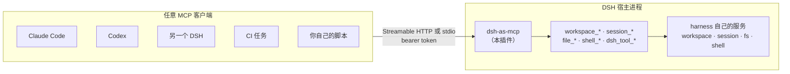

<p align="center">
  <!-- 故意用绝对 URL：npm 从 tarball 渲染 README，不解析相对图片路径，
       写成相对路径在 npm 页面上会是裂图。两个版本是因为 wordmark 是深海军蓝，
       在 GitHub 暗色主题下会看不见。 -->
  <picture>
    <source media="(prefers-color-scheme: dark)" srcset="https://raw.githubusercontent.com/xiseliuli/dsh-as-mcp/main/assets/logo-dark.png">
    
  </picture>
</p>

<p align="center"><a href="README.md">English</a> | 中文</p>

<p align="center">
  <a href="https://github.com/xiseliuli/dsh-as-mcp/actions/workflows/ci.yml"></a>
  <a href="https://github.com/xiseliuli/dsh-as-mcp/releases"></a>
  <a href="LICENSE"></a>
  <a href="https://www.typescriptlang.org/"></a>
  <a href="https://nodejs.org/"></a>
  <a href="https://modelcontextprotocol.io/"></a>
  <a href="https://github.com/topics/dsh-plugin"></a>
</p>

把一个正在运行的 **DeepSeek Harness** 暴露成 **MCP 服务**，让别的 agent —— Claude Code、
Codex、另一个 DSH、CI 任务、你自己写的脚本 —— 都能驱动它：创建工作区、新建会话、把编码
任务交给 DSH 的 agent、读写文件、执行命令。

端点跑在 DSH 宿主进程**内部**，所以通过 MCP 建出来的会话就是真正的 DSH 会话：它实时出现
在 DSH 界面里，跑在 DSH 沙箱中，受和你手敲一样的那套权限策略约束。agent 本身没有任何东西
是被重新实现的。

## 工作原理



---

## 安装

三种渠道都能把这个 bundle 装进 profile，按你拿到包的方式选一种。

**从 npm：**

```bash
dsh plugin --profile <名称> add dsh-as-mcp
```

从源码 checkout 里跑，等价命令是 `pnpm dsh plugin --profile <名称> add dsh-as-mcp`。

**从 GitHub：**

```bash
dsh plugin --profile <名称> add github:xiseliuli/dsh-as-mcp
```

git 安装拉下来的是源码，不是构建产物 `lib/`，所以 pnpm 得跑本包的 `prepare` 脚本
（`tsdown && node scripts/build-client.mjs`）才能把它建出来。pnpm 的供应链门禁默认拒绝执行
依赖的构建脚本——连带它依赖的 `esbuild` 的 postinstall 也一并拦下——直到 profile 显式放行，
所以第一次 `add` 会以 `ERR_PNPM_GIT_DEP_PREPARE_NOT_ALLOWED` 失败。这是 pnpm 的策略，不是打包
缺陷：git 依赖在安装期可以执行任意代码，所以 pnpm 要求一次精确、明确的放行。

**一次放行、按仓库 URL 生效（推荐）。** pnpm 按 `<name>@<git url>`（不带 `#<ref>`）匹配 git 依赖的
构建，因此一条条目就能跨 commit、跨版本一直有效。profile 的 pnpm ≥11.19.0 时——DSH 0.2.1-rc.5
自带 11.28.5，成功的那次 `add` 最后一行会写明用的版本（`… using pnpm v…`）——把下面这段写进
profile 的 `pnpm-workspace.yaml`（`~/.dsh/profiles/<名称>/pnpm-workspace.yaml`），再重跑 `add`：

```yaml
allowBuilds:
  'dsh-as-mcp@git+https://github.com/xiseliuli/dsh-as-mcp.git': true
  esbuild: true
```

裸包名（`dsh-as-mcp: true`）永远不会放行 git 托管产物：pnpm 认的是带来源的身份，不是包名
（[pnpm 文档](https://pnpm.io/settings/build#allowbuilds)）。

更早的 pnpm（11.0–11.18）只认精确 key，因为「按仓库 URL 放行 tarball 形式的 `github:` 依赖」是
[pnpm 11.19.0](https://github.com/pnpm/pnpm/releases/tag/v11.19.0) 才有的——本页两条命令
（`github:…` 和 release `.tgz`）都是按 tarball 拉取的。失败的那次 `add` 会打印这个精确 key
（钉在解析出的 commit 上）；原样抄过去，如果终端把 URL 折行了就拼回一行；并且此后**每次更新都要
重新放行**（[pnpm/pnpm#12367](https://github.com/pnpm/pnpm/issues/12367)）。不要指望 pnpm 已经替你
写好占位项：这条失败路径下它不会写。pnpm 10 上这个开关叫 `onlyBuiltDependencies` 而不是
`allowBuilds`，以报错里给出的 key 为准。

这个放行等于允许在你机器上、在安装阶段执行这个包的构建代码。如果你把依赖钉死到某个 commit
（`github:xiseliuli/dsh-as-mcp#<sha>`），key 就必须带那个 commit；上面那条仓库 URL 形式放行的是
本仓库的任意 commit。

**不想放行构建**，就装已经构建好的发布物——两者都带现成的 `lib/`，都不执行 `prepare`：

```bash
dsh plugin --profile <名称> add dsh-as-mcp
dsh plugin --profile <名称> add \
  https://github.com/xiseliuli/dsh-as-mcp/releases/download/v<版本>/dsh-as-mcp-<版本>.tgz
```

git 安装还要求 DSH ≥ `0.1.5-rc.1`（见[兼容性](#兼容性)）；更老的运行时会拒绝加载，除非用
`dsh plugin allow-version` 授予精确版本豁免。

**从 tarball：**

```bash
pnpm pack
dsh plugin --profile <名称> add /绝对路径/dsh-as-mcp-<版本>.tgz
```

用**同一个** tarball 路径重装会悄悄沿用旧构建——原因和规避方法见下文「装进 DSH Desktop」一节，
每次重新打包都换一个文件名。

---

`dsh plugin add` 会把包记进 profile 的 `dsh.profile.bundles`，包内的 `cordis.patch.yml`
负责提供插件行和默认配置。**装完要重启 DSH**：bundle patch 是启动时读取的，不热重载。

确认这一层已经合成进去：

```bash
dsh --profile <名称> --dump-config | grep -A 30 '# == dsh-as-mcp'
```

**给发布者：** GitHub 仓库要打上 `dsh-plugin` 这个 topic——插件发现就是靠它找到你的仓库；npm
的 `latest` 标签要指向一个精确的稳定版本（不能是预发布版，也不能是范围），因为
`dsh plugin add dsh-as-mcp` 解析的就是这个。

## 让客户端接进来

每个请求都要带 bearer token。解析顺序：

1. 插件配置里的 `auth.token`；
2. `$DSH_HOME/dsh-as-mcp/token`；
3. 都没有时在首次运行生成并写入该文件，权限 `0600`。

默认端点是 `http://127.0.0.1:8790/mcp`。

无法设置请求头的客户端可以改用 `?token=<token>`。但优先用请求头：写在 URL 里的凭证可能被
你的 shell 历史、反向代理的访问日志、或浏览器历史留下。DSH 自己不记录查询串
（`webserver/src/index.ts:224`），插件也不记录 token，所以这更多是一个值得养成的习惯，而不是
这段代码引入的泄漏。

**支持 HTTP 的客户端**（Streamable HTTP）：

```json
{
  "mcpServers": {
    "dsh": {
      "type": "http",
      "url": "http://127.0.0.1:8790/mcp",
      "headers": { "Authorization": "Bearer <token>" }
    }
  }
}
```

配置面板会生成一段一模一样的配置，并且已经填好当前令牌，所以直接用面板上的**复制**按钮，
不必手工替换 `<token>`。

**只支持 stdio 的客户端** —— 用随包提供的桥接脚本，它把每条 JSON-RPC 消息通过 HTTP 转给
端点：

```json
{
  "mcpServers": {
    "dsh": {
      "command": "npx",
      "args": ["-y", "dsh-as-mcp"],
      "env": { "DSH_AS_MCP_TOKEN": "<token>" }
    }
  }
}
```

`dsh-as-mcp --help` 会打印它将使用的端点和 token 状态。桥接脚本只会把**从 token 文件读到的**
凭证发给回环端点；要把 `DSH_AS_MCP_URL` 指向远程，必须显式设置 `DSH_AS_MCP_TOKEN`——复制来的
客户端配置因此无法悄悄把本机凭证外传。「回环」是**精确匹配**：`localhost`、`::1`，或字面量
`127.x.x.x` 地址，因此 `127.0.0.1.example.com` 这类域名会被当作它实际所属的远程主机处理。
scheme 可以省略：`127.0.0.1:8790/mcp` 也能识别。

**先调 `dsh_info`**。它会返回端点、插件版本与运行时长、token 的来源、哪些工具组开着，以及——这点很
关键——当前 profile 实际提供了哪些 harness 服务、token 用量能不能读、有没有价格来源；这样客户端能区分
「这个 profile 没有 shell」和「这条命令执行失败了」。`includeModels: true` 会向每个 provider 路由询问
可用模型（选对 model id 的可靠方式）；`probeSearch: true` 会顺带验证会话搜索**是否真的可用**（控制器
可能暴露了 search，但 session-query 索引被配置关闭），代价是首次探测会打开该索引。

它还会带 `catalog`：`session_create` 真正接受的选择——`providers`（已注册适配器的路由）、`agentPresets`
及其 `defaultAgentPreset`、生效的 `sandboxMode`、`permissionPresets` 名单，以及 `sessionCount`。传
`includeModels: true` 还会读每个路由声明的模型（`catalog.providerModels`）：这会去问 adapter，所以默认关闭、
每个 provider 都有超时，但这是选对 `session_create.model` 或 `session_set_model.model` 最可靠的办法。
每个字段都是可选的、各自独立兜底，`catalog.unavailable` 会点名哪个读取没能回答，所以缺字段表示
「这个 profile 没说」，不是「什么都不允许」。它的 `notes` 里还会列出本端点的推送 feed 与两种传输，
调用方不必读这份 README 也能找到订阅面。

## 工具

返回数据的工具（`dsh_info`、`session_list`、`session_usage`、`session_messages`、`file_list`、
`workspace_list`）同时声明 output schema 并在文本块之外返回 `structuredContent`，支持结构化输出的客户端
可以直接读对象，不必从文本里解析 JSON。

| 工具 | 作用 |
| --- | --- |
| `dsh_info` | 端点、版本与运行时长、token 来源、已启用的工具组、可用的 harness 服务、用量/费用是否可用、可接受的 provider/agent preset/sandbox 模式 `catalog`、`toolAvailability`（通过全部规则的 `availableTools`，可与 `tools/list` 对照；以及本部署无法服务的工具及原因），以及 `notes` 里的推送 feed URI；`probeSearch` 可验证搜索是否真的可用。 |
| `workspace_create` | 把一个目录注册成 DSH 工作区（目录不存在时先创建；传 `createDirectory: false` 则要求它已存在）。 |
| `workspace_list` | 列出所有工作区：id、路径、标题、目录是否还在，以及**挂在该注册下**的会话数（用 `workspaceId` 创建的会话）——这不是"cwd 恰好是该目录"的会话数，后者由 `session_list { cwd }` 回答。 |
| `workspace_delete` | 注销一个工作区（文件与会话历史不受影响）；幂等。 |
| `session_create` | 新建一个绑定到工作区（或裸目录）的 DSH agent 会话，可同时给它一个独立的 Git 检出。不指定模型时沿用本 DSH 实例的默认路由（`provider` 与 `model` 必须成对出现——只给一半会在会话创建之前被拒绝；给了不可路由的一对仍会创建会话，但会在 `modelSelectionError` 里说明）。传 `worktree: true`（或 `{ name, from }`）会在会话建成后从工作区创建 Git 分支与检出，并把它设为该会话的实时工作目录：带 `workspaceId` 创建的会话保持所在工作区分组（持久目录仍是工作区），只用 cwd 创建的会话则不在任何分组里。回复带 `worktree` 记录和新的 `workingDirectory`；worktree 创建失败不会回滚会话——它仍能在工作区使用，回复用 `worktreeError` 说明原因（可再用 `worktree_create` 重试）；profile 没有 worktrees 服务时，整个调用在创建会话之前就被拒绝。 |
| `worktree_create` | 从会话当前的检出创建 Git 分支与检出，并把它设为该会话的工作目录——即 DSH 界面「New worktree」选项对新会话做的事，但用于已存在的会话（会话有正在跑的 turn 时拒绝；同一会话上的并发 worktree 调用会被串行化）。`name` 是新分支名，也是源检出 `.agents/worktrees/` 下的目录名；`from` 是本地 commit、分支或 tag（默认取检出的 `HEAD`）；未提交的文件留在源检出里，分支或检出名已存在则失败。回复带 `path`、`branch`、`baseCommit`、`repositoryRoot` 与 `from`——保存它，`worktree_restore` 要用。需要 worktrees 服务。 |
| `worktree_restore` | 当 worktree 目录被会话之外的操作删除后，按记录在 `path` 的位置重新检出：`branch` 还在就检出该分支，否则在 `baseCommit` 上重建，仓库根用记录的 `repositoryRoot`。会话当前的工作目录不变；随目录一起丢掉的未提交修改无法恢复。传入 `worktree_create`（或 `session_status.worktree`）返回的那条记录。需要 worktrees 服务。 |
| `session_fork` | 把一个会话（存活的，或从磁盘恢复的）分叉成继承其事件前缀的子会话（可用 `atSeq` 指定事件位置，或用 `atTurn` 指定轮次边界；不指定时 harness 取最近一个完整轮次）。从该点继续只需一轮，不用重放历史；`session_usage` 会单独报出继承前缀的用量。 |
| `session_set_model` | 切换后续轮次使用的 provider 路由与模型：先用便宜模型、难任务时升级、或某路由不可用时回退；`reasoningEffort` 可为同一路由提高思考预算。回复里的按模型用量会显示每条路由各花了多少。 |
| `session_rename` | 给会话设置显式的用户标题，让外部 harness 为任务起的名字在 DSH 界面里保持不变（同时停止自动生成标题）。若该会话正被另一个 DSH 进程持有写句柄，harness 会拒绝并在错误里说明。 |
| `session_search` | 对会话**消息内容**做搜索（FTS 词/短语），每条命中返回 `sessionId`、一段 snippet，以及（会话列表可读时）该匹配的 `cwd`/`updatedAt`/`running`，subagent 会话还带 `parentSessionId`/`origin`；harness 单次上限 20 条并给 `hasMore`。匹配的是词/短语（不是任意子串），多个词须同时命中。**需要开启**：随包组合把 `session-query` 配成 `openAt: "never"`，此时该工具会说明如何启用索引，而不是假装搜索过。 |
| `session_list` | 存活会话摘要，按最近更新排序；`includeTitle` 附加每个会话的最新标题（每会话一次日志读取），`includeWorktree` 附加每行的实时 `workingDirectory` 与 forge 面板的 `worktree` 记录（每会话一次 projection 读取——同一工作区的多个会话各在自己的检出里工作时，靠它区分）；`cwd`/`running` 会在 limit 生效前过滤。每行还带 `archived` 与 `pinned`，读自 DSH 侧边栏归档/置顶动作写入的同一组 registry 集合。subagent 会话会带 `parentSessionId` 与 `origin: "subagent"`；`origin`（`root`/`subagent`）在 limit 之前过滤，因此扁平列表可当树视图用。回复带 `total`（截断前匹配数）以及 limit 有隐藏时的 `truncated`。 |
| `session_status` | 单个会话的实时状态，供 `session_prompt { wait: false }` 这类"先启动、后观察"的用法：`running`、当前 `turn`/`step`、最新事件（`lastEventSeq`/`lastEventAt`）、`idleMs`（日志安静了多久）、`stalled`（在运行但已静默一分钟——是症状，不是结论）、最后一场轮次的结束方式（`lastTurn.reason`），以及异常结束时的 `failure`。profile 能读 session projection 时还会报 `workingDirectory`（会话当前实际工作的目录——进入 worktree 后就是那个检出）和 `worktree`（forge 面板为它创建的 worktree 记录）；两者任一变化都算 `waitMs` 眼中的一次变化，因此挂着等的调用会在会话进入 worktree 时立即返回，而不是睡到上限。`waitMs` 会把调用挂起到"状态发生变化"或超时（上限 60 秒），上游因此可以每次变化报一次，而不必猜轮询间隔。只读。 |
| `session_prompt` | 给 DSH 会话下发一个任务；默认等待本轮结束，返回回复、agent 调过的工具调用，以及本轮的 token 用量和该会话的累计量。`toolCalls` 控制每次调用的回显量：`summary`（默认）只给名称/id/参数字节数，`full` 附带参数（受 `maxArgumentChars` 限制），`none` 只留计数。可用 `images` 附带截图（png/jpeg/webp/gif，最多 4 张；harness 会真正解码，因此只有文件头、能被 `file_read_image` 嗅探识别的文件会被判为 malformed）。带 `idempotencyKey` 时可安全重试：重复调用会返回已有轮次，而不是把任务再发一遍；若重试带 `wait: true`，它会**等待**那一轮结束——这正是"先用 `wait: false` 排队、之后再来等它的结果"的做法。客户端带 `progressToken` 时，等待期间最多每秒一次 `notifications/progress`。`maxReplyChars` 可选地限制 agent 最终回复长度（被截断时带 `replyTruncated` 和原始 `replyChars`），`turn.models` 列出实际作答的 `provider/model`。客户端对该调用发出 `notifications/cancelled` 时，会中止对应轮次，等待以 `turn.aborted: true` 收尾——这条通知由端点自己路由，因为所用 SDK 版本只确认、不处理它。用量快照只有在轮次仍在运行时才带 `partial: true`；取消后已结算的轮次给出的是最终数字。 **同一连接**在轮次运行中再次 prompt 会排在其后（本端点对每个会话一次只跑一个轮次），而不是进入 harness 收件箱；要让消息真正排在运行中的轮次后面，需要第二个 MCP 客户端，或用 `mode: "steer"` 把它并入当前轮次。 |
| `session_messages` | 读取会话的用户/助手对话记录；`sinceSeq`/`role` 让它成为增量轮询，`maxCharsPerMessage` 限制每条消息长度（被截断的消息带 `truncated` 与原始 `chars`），每条消息还带队列操作要用的 `id`（用户消息另带 `requestId`，即 `idempotencyKey` 派生出的准入 id），`includeToolCalls` 会把每条助手消息里的工具调用（名称、call id、参数 JSON 长度，以及工具答完后结果的长度与是否出错）折叠进记录，`includeToolResults` 则把每个工具结果作为独立的 `role: "tool"` 行（callId、文本、error）加入，让一次读取覆盖完整时间线（传 `"errors"` 只保留失败的结果）；助手行与工具行还带 `turn`/`step`，用 `turn: N` 或 `fromTurn`/`toTurn` 可把读取收窄到某一轮或某个阶段，`beforeSeq` 可向前翻页：传入你手上最老的 seq，返回更早窗口的尾部，因此长于窗口的完整记录也能读完。回复带 `total`（过滤器匹配到的消息数）以及在 limit 窗口隐藏了更早消息时的 `truncated`。 |
| `session_queue` | 只传 `sessionId` 时列出**待执行队列**（排队消息还没有对话事件，所以 `session_messages` 看不到它）；带 `messageId` + `action` 时修改其中一条：`remove`（不再执行）、`edit`（替换文本，消息 id 保持不变，无需重新列队）、`steer`（插入正在运行的轮次——它会作为用户消息出现在对话记录里，该轮次会据此行动）。`session_cancel` 停的是当前轮次，这个工具改的是它后面排队的活。 |
| `session_tool_result` | 读取某次工具调用的结果，可用 `callId`（来自 `session_messages { includeToolCalls: true }`）或 `toolName`（该工具最近一次已完成的调用）定位：返回文本、原始长度、harness 是否标记为错误；`maxChars` 截断，`from: "end"` 保留尾部（堆栈与错误通常在末尾）。调试失败的工具而不必重读整段记录。 |
| `session_cancel` | 让 agent 停下当前这一轮。 |
| `session_archive` | 归档一个会话——与 DSH 侧边栏的归档动作写入同一个 registry 全局归档集。归档后会话从界面分组中消失、后续轮次被拒绝，但日志仍保留，可用 `session_unarchive` 恢复。会话还有正在运行的工作时，除非传 `stopActivity: true` 否则拒绝归档；那个开关同时也要求停掉这些工作，因此必须由调用方显式请求。不删除任何东西。 |
| `session_unarchive` | 把归档的会话放回它在 DSH 界面里记录的位置。幂等：对未归档的 id 不算错误；日志从未被动过，因此会话重新可见、可继续 prompt。 |
| `session_pin` | 把会话置顶到 DSH 界面的会话列表（与侧边栏置顶写入同一个 pin 集合）。会话必须存在且未归档；置顶幂等。 |
| `session_unpin` | 把会话从 DSH 界面的 pin 集合里移除。幂等：对未置顶的 id 不算错误。 |
| `session_command_list` | 列出该会话 agent 能运行的斜杠命令——每条带一句描述、可选的 `input` 提示与 `permitted` 标记——因此调用方能看到某个命令存在、而本端点故意不运行它（放行集是 `/compact`、`/plan`、`/goal`、`/export`；`/permission` 与 `/feedback` 刻意拒绝）。命令**不消耗模型轮次**（直接调用 handler），所以这是压缩长会话、导出日志、进入 plan 模式或设置目标最便宜的办法——与人在 DSH 输入框里敲命令完全一致。只读；用 `session_command` 运行其中一条。 |
| `session_command` | 对会话的 agent 执行一条斜杠命令，不花模型轮次，就像人真的在 DSH 输入框里敲了它：`command` 可带可不带前导斜杠，参数写在同一字符串里（`"compact"`、`"/export"`、`"/goal <objective>"`、`"/plan off"`）。执行走 harness 自己的命令注册表，因此与真人敲同一行的执行完全一致，会话日志也会记录；回复带 harness 的 `commandId`、`ok`（handler 自己报告错误结果时为 `false`）、handler 的 `text`，以及它报告时记录的 `sourceEventSeq`。只放行用户面命令（`/compact`、`/plan`、`/goal`、`/export`）；`/permission`（会改变会话的 permission preset）与 `/feedback`（会写入你自己的评审记录）在任何 handler 运行之前就被拒绝，因此被拒调用**不会向会话日志写入任何东西**；本 profile 未注册的命令名会被拒绝并列出放行集。注册表没有接收的名字或参数返回错误并说明什么都没写进日志。先调 `session_command_list` 看该 agent 接受的确切名字与输入提示。 |
| `session_goal` | 读取或修改会话的持久目标（durable goal）——即 harness 的轮次驱动会在多轮之间持续推进的长期目标，调用方因此可以委派多小时的任务，而不必一直挂着一轮。`action` 取 `get`（返回 `goal` 或 `null`），或 `create`（需要 `objective`）、`edit`（需要 `objective` 和/或 `maxGoalRounds`）、`pause`、`resume`、`complete`、`clear` 之一；除 `create` 外的动作都作用于当前存在的目标，其 ref 来自一次读取而不是调用方。传 `expectedRevision`（来自之前的读取）可拒绝"目标已在脚下被改过"的修改——相当于 DSH 界面的冲突处理。目标报出 `id`、`revision`、`objective`、`phase`（`active`/`paused`/`blocked`/`complete`）、`activation`（`armed`/`disarmed`）、`maxGoalRounds`、`roundsStarted`、被阻塞时的 `blockedReason` 与 `createdAt`/`updatedAt`；`clear` 返回 `goal: null`（并带 `cleared: true`），`complete` 返回已完成的目标。 |
| `schedule_create` | 创建一个 **Host 级** 定时任务：harness 会在每次触发时把指令投递到某个会话，无论本端点或任何客户端是否在线。时必须且只能给出一种形式——`rrule`（一行 `DTSTART` 加一行 `RRULE`，即 DSH「自动化」页面写出的 RFC 5545 子集，例如 `"DTSTART;TZID=Asia/Singapore:20260901T080000\nRRULE:FREQ=DAILY;COUNT=3"`）、`afterSeconds`（从现在起 N 秒后执行一次）、或 `everySeconds`（固定间隔）。`target` 决定投递落点：`"session"` 更新一个已有会话（需要 `sessionId`）、`"new_once"` 首次投递时新建一个会话并复用、`"new"` 每次投递都新建会话；后两种可带 `cwd` 与 `agentPreset`。给了 `sessionId` 时默认 `"session"`，否则默认 `"new"`。返回存下的任务，含生成的 id、`scheduledAt`、`status` 与具体时间形态字段。任务属于 Host 记录而不是会话记录，因此当 `session.scope` 为 `"owned"` 时整个 schedule 面会被拒绝。 |
| `schedule_list` | Host 定时任务的一页，活动任务按下次触发时间在前，暂停/已结束的在后。`active: true` 只留活动任务，`false` 只留暂停与已结束的；不传则返回全部。`limit` 为 1–200（默认 20），`offset` 用于跳过。每行含任务 `id`、`title`、`prompt`、时间形态字段、`scheduledAt`、`status`、`target`，以及触发过之后的最近一次投递。列出的是任何会话创建的任务；`session.scope` 为 `"owned"` 时拒绝。 |
| `schedule_view` | 按 `scheduleId` 读一个 Host 定时任务，字段与 `schedule_list` 相同并附投递目标细节。已不存在的 id 返回 `{ "found": false, "id": ... }` 而不是报错，清理循环因此保持幂等。`session.scope` 为 `"owned"` 时拒绝。 |
| `schedule_edit` | 修改或删除一个 Host 定时任务。`action: "update"` 至少需要一项改动：`title`、`prompt`、某种时间形态（`rrule`、`afterSeconds` 或 `everySeconds`）、`target`（`"session"` 需 `sessionId`，`"new"`/`"new_once"` 可带 `cwd`/`agentPreset`），或 `active`——`false` 暂停，`true` 恢复，旧规则已耗尽时恢复可能需要新的时间形态。`action: "delete"` 删除任务及其保存的投递记录，且不接受任何改动字段。`expectedUpdatedAt` 是丢失更新的守卫：若任务在该次读取后变过，调用返回 `conflict: true` 且不做任何修改。结果是数据而不是错误：`{ updated: true, task }`、`{ deleted: true }`、`{ found: false }` 或 `{ conflict: true }`。`session.scope` 为 `"owned"` 时拒绝。 |
| `forge_changes` | 某会话绑定的变更请求（pull request），即 DSH forge 面板看到的内容：每个绑定的 `url` 与 `origin`、forge 解析成功时的仓库与 `number`，以及缓存的快照——`title`、`state`、`draft`、`author`、`headBranch`/`baseBranch`、`additions`/`deletions`、`mergeability`、`mergeReady`、`mergeMethods`、`reviewDecision`、`checksRollup` 与 `checks` 明细、`unresolvedThreads`、`updatedAt`。快照读不出来的绑定仍会列出，并带 `failure`（例如 `unauthenticated`），因为面板也是这么显示的。`includeChecks` 会向 forge 刷新每个请求的 checks（每个请求一次调用，需要 forge 登录；刷新失败则保留缓存快照并标 `checksStale`），`includeDiff` 增加变更文件列表（由 `maxFiles` 限制）。只读——不提交、不标 ready、不合并。需要 forge bundle 且 harness 当前持有该会话的 live 句柄。 |
| `forge_local_diff` | 某会话的本地 Git diff（forge 面板所显示的那份），让调用方看到 agent 实际改了什么。`scope` 选择面板视图：`uncommitted`（默认，所有未提交改动）、`branch`（会话分支相对基线）、`staged` 或 `unstaged`。不传 `path` 时返回文件清单——`path`、`previousPath`、`status`、增删行数、`hunks` 数量以及 `binary`/`oversized`/`untracked` 标记——由 `maxFiles` 限制并用 `omitted` 说明省略了多少；传 `path` 时返回该文件的 unified patch 文本，由 `maxChars` 限制（默认 16 KiB，最大 64 KiB），被截断时标 `textTruncated`。只读；需要 forge bundle 与 live 会话。 |
| `forge_branches` | 某会话 checkout 里的分支列表与当前分支 `current`——即 forge 面板分支选择器提供的那份列表，也是 `worktree_create` 的 `from` 可接受的基础版本。只读；需要 forge bundle 与 live 会话。 |
| `session_usage` | 按会话统计 token 用量（默认含其 subagent）：精确的四桶计数、按模型拆分、可选的按轮拆分，装了价格插件时还有钱。传 `sessionIds` 可一次结算多个已知会话，传 `cwd` 可汇总某个工作目录里跑过的所有会话。 |
| `file_read` | 经 DSH 文件系统服务读 UTF-8 文件。受字节上限约束；`offset`/`nextOffset` 可翻页读取更大的文件（两者都是**字节**偏移，因此 EOF 处或之后的偏移是空的完整读取），`maxBytes` 用更小的窗口降低单次开销；`sha256: true` 返回整个文件的哈希，作为后续写入/编辑的比较并交换值。 |
| `file_read_image` | 读取图片（png/jpeg/gif/webp/bmp，按字节嗅探）并以 MCP image block 返回，让你直接看截图或图表而不是靠猜。上限 8 MiB。 |
| `file_write` | 经 DSH 文件系统服务创建或覆盖文件。默认会创建缺失的父目录（`createDirectories: false` 则要求父目录已存在）；`expectedSha256` 让写入变成比较并交换：文件在读到哈希后变过就会被拒绝。 |
| `file_edit` | 在一个文件里替换字面文本（`oldText` → `newText`）：精确匹配，除非 `replaceAll` 否则要求唯一，歧义匹配不写入，`expectedSha256` 在文件读后变过时拒绝编辑。不再需要"整读 + 整写"。 |
| `file_list` | 经 DSH 文件系统服务列目录；`recursive` 递归遍历子目录（受 `maxDepth` 与条目上限约束并带 `truncated`），每个条目给相对 `path`；`sha256: true` 为每个文件算哈希以便批量变更检测。 |
| `shell_run` | 经 DSH shell 服务执行一条命令并等待它结束。 |
| `shell_start` | 后台启动一条命令（构建、测试、开发服务器）并返回 job id；可选看门狗。最多保留 16 个任务：满了会先淘汰已结束的旧任务，但第 17 个**正在运行**的任务会被拒绝，而不会悄悄停掉别人的进程。 |
| `shell_output` | 增量读取后台任务的输出（不重复返回已读部分）；`truncated` 表示有字节未送达，`lossy` 表示 shell 服务自身丢弃了字节（此时 spill 路径指向完整流）。 |
| `shell_kill` | 结束一个后台任务（`jobId`），最多等待 `waitMs` 让它收尾；幂等。 |
| `shell_list` | 列出后台任务；`running` 只筛存活或已结束的。 |
| `dsh_tool_list` | 本端点允许调用的 agent 工具，附 DSH 自己 agent 所见的结构。 |
| `dsh_tool_call` | 直接运行其中之一，走与 agent 完全相同的管线。`maxResultChars` 限制返回量，避免大结果淹没调用方。 |

典型的编码流程：

```
workspace_create { path: "/Users/me/project" }
  -> session_create { workspaceId: "..." }
  -> session_prompt { sessionId: "...", prompt: "给 CLI 加一个 --verbose 开关，并补一个测试。" }
```

`session_prompt` 是让 DSH **替你干活**的入口：DSH agent 自己规划、改文件、调它自己的工具，
还能派生子 agent。`file_*` 和 `shell_run` 用在你想自己动手、不想经过 agent 的场合。

`dsh_tool_call` 是第三种选择：直接运行 DSH **自己**的某个工具，不必先花一轮模型去决定要调用它。
先调 `dsh_tool_list`——它报告的正是被允许的集合，没报告的名字一律拒绝。两者都**必须**传
`sessionId`：该会话的 agent **就是**策略本身，是它让 harness 施加沙箱、跑 guard、并把调用归档到
某份会话记录里。

这里刻意没有"不带会话"的形式。DSH 把工具注册进**注册它的那个 context 的作用域**，而每个工具包都
装在 agent preset 内，所以全局层本来就是空的——不带作用域的列举确实返回零个工具，不带作用域的调用
会答 `unknown tool`。因此不带会话的 `dsh_tool_list` 会**直接报错**，而不是返回一个空工具箱（那会被
读成"什么都不允许"）。要走不涉及 agent 的路径，请用 `file_read`／`file_write`／`file_edit`／`file_list`／
`shell_run`，它们直接解析部署策略，不需要会话。

允许集是**白名单**，而且刻意很窄。不在名单里的一律**拒绝且不出现在 `dsh_tool_list` 中**。要紧的几项遗漏：

- **`run_code`** 是 DSH 的程序化工具调用入口：一次调用即可运行一个能按名字调用**任意其他工具**的程序。
  放它进来等于让整份名单失效。
- **`cordis_run`、`cordis_define` 等**会执行任意插件代码。现成的 bundle 都没挂它们，所以一份照今天
  profile 写的黑名单，恰恰会在挂上它们的那个 profile 里失明——这正是这里用白名单的原因。
- **`ask_user_question` 与 `present`** 会直接触达键盘前的人。
- **`workflow`、`ralph`、`send_message`、`spawn_teammate`、`schedule_create`** 会启动比本次调用活得更久的
  工作；**`create_goal`、`update_goal`** 会维持无人值守的持续执行。
- **`create_worktree`**（DSH 0.2.2+）会改变调用方会话的工作目录。同一个操作以一等工具 `worktree_create`
  暴露：它把操作限定在本端点有权寻址的会话上，并报出保留的分支与检出；把面向模型的这个工具放进白名单，
  会让 agent 移动它碰巧所在的任意会话，而且把记录藏起来。

运维方可以通过 `agentTools.allow` 有意放宽，或用 `agentTools.deny` 从默认集合里减去。

### 会话编排

有些活不是一次 prompt 能装下的。压缩长会话、导出日志、进入 plan 模式、设置目标，都是人在 DSH 输入框里
敲一条斜杠命令就能完成的用户面动作；持久目标还会把"一次请求"变成 harness 的轮次驱动会跨轮持续推进的
目标。这两条路本身都不消耗模型轮次。预期流程：

```
session_command_list { sessionId }                                    # 该 agent 接受什么；permitted 标出放行集
  -> session_command { sessionId, command: "/compact" }               # 运行一条；不花模型轮次
  -> session_goal { sessionId, action: "create", objective: "完成迁移", maxGoalRounds: 20 }
  -> session_goal { sessionId, action: "get" }                        # 轮询 phase/revision……
     或订阅 dsh://session/<id>/projections                               # ……或等它在变化时通知你
  -> session_goal { sessionId, action: "pause", expectedRevision: 3 } # 之后 resume / complete / clear
```

`session_command_list` 报出每条命令的 `permitted` 标记而不是把被拒命令藏起来，调用方因此能看到该 profile
上确实有 `/permission` 与 `/feedback`、而本端点故意不运行它们：`/permission` 会改变会话的权限 preset，
`/feedback` 会写入用户自己的评审记录；两者都到不了 handler，也不会向会话日志写入任何东西。
`session_status` 报的是会话的轮次与日志状态，不含目标本身；目标的 phase 与 revision 来自
`session_goal { action: "get" }`，而 `dsh://session/<id>/projections` feed（其中含 `goal`）会在目标变化时
发布，因此跟进一个目标是轮询或订阅，而不是每轮都发 prompt。不带 `expectedRevision` 的修改作用于当时存在
的目标；若可能有两个监督者竞争，请传回读取时拿到的 revision。

### 定时自动化

定时任务是本插件里唯一比进程活得更久的面：harness 负责存储并在每次触发时投递 prompt，因此即使没有
任何 MCP 客户端在线也照常工作。任务是 **Host** 记录而不是会话记录——`schedule_list` 列出任何会话创建的
任务，`target` 决定投递是更新同一个会话、首次投递时新建一个会话再复用、还是每次新建一个会话：

```
schedule_create { title: "每日依赖检查", prompt: "跑一遍依赖审计并汇报",
                  rrule: "DTSTART;TZID=Asia/Singapore:20260901T080000\nRRULE:FREQ=DAILY",
                  target: "new_once", cwd: "/repo" }
schedule_create { title: "十分钟后看构建", prompt: "看看构建是否变绿",
                  afterSeconds: 600, target: "session", sessionId }
  -> schedule_list { active: true }                       # id、下次触发、状态
  -> schedule_edit { scheduleId, action: "update", active: false }   # 暂停
  -> schedule_edit { scheduleId, action: "update", title: "..." , everySeconds: 3600 }
  -> schedule_edit { scheduleId, action: "delete" }       # 连任务与投递记录一起删除
```

因为 Host 记录没有所属会话，`session.scope` 为 `"owned"` 时整个面色会被**拒绝**：这种记录上无法表达
归属过滤，而任务的投递目标可以指向实例上的任意会话。拒绝信息会说明原因并指向 `scope: "all"`。
`expectedUpdatedAt` 携带 harness 自己的 revision，因此过期编辑返回 `conflict: true` 且不做修改，而不是
覆盖用户刚在「自动化」页面里改过的东西。

## 工作树

一个会话可以在一份自己的、来自同一仓库的 Git 检出里工作。这正是 DSH 界面「New worktree」选项做的事：
从某个 revision 新建分支，检出到源检出的 `.agents/worktrees/` 下，并把它设为会话的实时工作目录。
同一工作区组里的多个会话因此可以各自隔离地干活。

保持侧边栏分组的是创建顺序：`session_create { worktree: true }` 会**先**把会话建在调用方指定的工作区
（或裸目录）上，再从那份检出创建 worktree。会话的持久目录始终是工作区，所以带 `workspaceId` 创建的
会话在 DSH 界面里仍属于同一个工作区分组；只用裸 `cwd` 创建的会话本来就不在任何组里，也不会因为进入
worktree 而进组。它的工具、命令和 prompt 则在 worktree 里运行。对已存在的会话，
`worktree_create { sessionId, name?, from? }` 做同样的移动；会话有正在运行的 turn 时拒绝（同一会话上的
并发调用会被串行化）。

典型流程：

```
session_create { workspaceId: "...", worktree: true }
  -> session_prompt { sessionId: "...", prompt: "在这个检出里实现功能；别动 main。" }
  -> session_status { sessionId: "..." }          # workingDirectory 已是新检出
```

`session_create`（以及 `worktree_create`）的回复带着 `worktree_restore` 需要的记录：`path`、`branch`、
`baseCommit`、`repositoryRoot`（外加 `from` revision，来自 `HEAD` 时为 `null`）。保存它：如果检出目录被
会话之外的操作用删掉，`worktree_restore` 会把那个分支重新检出——分支也被删了就在 `baseCommit` 上重建
——并且不改会话当前的工作目录。随目录一起丢掉的未提交修改无法恢复。

有两条限制需要讲清楚。**这些工具需要 worktrees 服务**，它由 DSH Desktop/Web 里的 forge bundle 提供；
`dsh_info.harnessServices.worktrees` 报出它，`toolAvailability` 会点名当前 profile 服务不了的工具。没有该服务时，`session_create { worktree }` 在创建会话之前就被拒绝，端点其余部分不变。**worktree 不是
commit**：它是一个分支加一份检出，未提交的文件留在源检出、不会被复制，分支或检出名已存在时直接失败而
不是复用。

profile 能读 session projection 时，`session_status` 会报 `workingDirectory` 与 forge 面板的 `worktree`
记录，`session_list { includeWorktree: true }` 把同样的两个字段折进每一行。完整的宿主侧契约——服务签名、
分组证明、失败矩阵与推荐操作顺序——见 `docs/WORKTREE-INTEGRATION-CONTRACT.md`；本次发布背后的能力审计是
`docs/NEW-CAPABILITIES-0.2.2.md`。

## 服务端推送与两种传输

MCP 服务无法主动调用客户端，所以「有什么变了」只能以资源通知的形式送出去。本端点把同一套变更 feed 发布到
两种标准的推送通道上，而且每条通知都**不携带负载**：它只点名一个合成资源，客户端再去读那个资源拿 JSON。
这件事没有新增任何工具——工具面是上面表格里的 45 个——推送也没有配置键：它始终开启，且在无人订阅时
零成本。

| 客户端时代 | 握手 | 服务端→客户端通道 | 如何请求推送 |
| --- | --- | --- | --- |
| **2026-07-28（现代）** | `server/discover`；每个请求自带 `_meta` 信封以及 `mcp-protocol-version` / `mcp-method` 头，因此没有会话 | 一条长期打开的 `subscriptions/listen` 流 | 在 `notifications.resourceSubscriptions` 里点名 feed；服务端回 `notifications/subscriptions/acknowledged`，之后推 `notifications/resources/updated` |
| **2025 时代 Streamable HTTP** | `initialize` 的回复带 `Mcp-Session-Id`；之后的 `POST`/`DELETE` 都带它 | 该会话长期打开的 `GET`（`Accept: text/event-stream`） | 端点宣布 `resources.subscribe`，并把 feed 发布给每个存活的 stateful 会话，因此同样的 `notifications/resources/updated` 帧会出现在这条流上；数据仍用 `resources/read` 取 |
| **stdio**（`bin/mcp-stdio.mjs`） | 桥接脚本经 HTTP 发 `initialize`，并保留服务端给出的会话 id | 它在同一会话上自己开一条长期 `GET` | 流上每条通知（以及任何服务端→客户端请求）都作为一行 JSON 写到 stdout；通道断开后按 500 ms→30 s 退避重连 |

遇到 stateless 端点时——`initialize` 没带会话 id，或 `GET` 回答 `404`/`405`——桥接脚本只打印一条
「push disabled」提示，请求/应答行为不变。

一个具体的现代交互（2025 客户端把第 1–2 步换成 stateful 握手与它的 GET 流；负载完全相同）：

```json
// 1. 开一条流并点名 feed。会话类 feed 需要 tools.session，任务类 feed 需要
//    tools.shell；resources/list 与 resources/templates/list 会公布它们。
{ "jsonrpc": "2.0", "id": 1, "method": "subscriptions/listen",
  "params": { "notifications": { "resourceSubscriptions": [
    "dsh://sessions",
    "dsh://session/<sessionId>/events",
    "dsh://session/<sessionId>/assistant",
    "dsh://jobs" ] } } }

// 2. 确认里列出服务端真正接受的子集
{ "jsonrpc": "2.0", "method": "notifications/subscriptions/acknowledged",
  "params": { "notifications": { "resourceSubscriptions": [ … ] } } }

// 3. 每次变化就是一条不带负载的帧……
{ "jsonrpc": "2.0", "method": "notifications/resources/updated",
  "params": { "uri": "dsh://session/<sessionId>/events" } }

// 4. ……再对那个 URI 调 resources/read 拿数据
{ "jsonrpc": "2.0", "id": 2, "method": "resources/read",
  "params": { "uri": "dsh://session/<sessionId>/events" } }
```

| feed URI | 负载 | 何时发布 |
| --- | --- | --- |
| `dsh://sessions` | 与 `session_list` 一致的会话列表，但不含标题（`sessions`、`total`） | 会话被新增、移除、创建或销毁，开始/停止运行，活动或状态变化，或 subagent 开始/结束 |
| `dsh://session/{id}/events` | 最新的持久事件，投影为 `{seq, type, at, turn, step, summary, error}` 并带 `asOfSeq`（单次读取至多 64 个事件；`summary` 是有界预览，`error` 标记失败的 tool 结果或异常结束的轮次） | 该会话每次持久追加 |
| `dsh://session/{id}/assistant` | 实时的 assistant 帧 `{seq, at, turn, step, kind, text, done}`，带 `asOfSeq` 与 `truncated`；`kind` 为 `start`、`text`、`reasoning`、`tool`、`finish` 或 `end`，`seq` 每会话单调递增 | 模型轮次流式输出期间——开始时一帧、结束时一帧，每个 text、reasoning 或 tool-call 增量各一帧，另有 finish 帧 |
| `dsh://session/{id}/status` | 与 `session_status` 相同的负载 | 该会话出现新的持久事件，或 agent 状态变化 |
| `dsh://session/{id}/projections` | 白名单内的 projection 值：`workingDirectory`、`worktree`、`goal`、`plan`、`todos`、`agentPreset`、`title` | 轮次结束、选定 agent preset、追加用户消息，或 goal 变化 |
| `dsh://jobs` | 本端点启动的每个后台 shell 任务（`jobs`） | 任务开始或结束，或其状态、待读字节数变化 |
| `dsh://jobs/{id}` | 单个任务及其保留的输出尾部（`tail`、`tailTruncated`） | 它的输出尾部增长或状态变化 |
| `dsh://session/{id}/turn` | 与 `session_status` 相同的负载 | 该轮结算——0.52.86 就有的资源，仍然立即发布、不参与合并 |

**背压：别让 token 流变成请求风暴。** 发布按 URI 合并：窗口内第一次立即发出，同一个 URI 的后续发布合并成
150 ms（`PUSH_COALESCE_MS`）后的一次尾随发布，不同 URI 之间互不等待。因此一段 token 流对每个 URI 至多
每 150 ms 产生一条通知，而不是每个 token 一条。轮次结算是例外——那是调用方正在等的离散事件，所以立即发布。
通知不携带负载，所以一串增量只花一次 `resources/read`，而不是每个 token 一份与回复等大的负载。实时 feed 在
进程内是有界的：assistant 缓冲每会话至多保留 256 KiB / 2,000 帧，单次读取至多返回 200 帧、约 32 KiB 文本
（从新到旧；更旧的帧被丢弃或未返回时带 `truncated`），事件读取上限 64 条，任务读取至多返回 16 KiB 保留尾部
里的最后 8,192 个字符。任务 feed 大约每秒轮询一次，而且只在有人订阅时轮询：没有订阅者时采集器提前返回、
不读任何 harness 服务，所以没有监听者的 fire-and-forget prompt 成本和以前完全一样。任务尾部刻意设计成
**不消费**：投递缓冲仍归 `shell_output`，因此盯 `dsh://jobs/{id}` 不会从轮询它的调用方那里偷走字节。

**2025 时代那条腿是有状态的，旧的 stateless 行为照旧保留。** 2025 的 `initialize` 现在会在回复里带
`mcp-session-id` 头；带这个头的请求由每会话的 server 与 transport 服务，所以 `GET`（通知流）与 `DELETE`
（会话拆除）都能用，`notifications/resources/updated` 也终于能到达 2025 客户端。同时最多保留 8 个会话：
开第 9 个时淘汰最久未使用的那个；静默 30 分钟的会话会被关闭，之后它的 id 回答
`404 Session not found`，客户端重新 initialize。从不接收会话 id 的客户端保持此前的 stateless 服务不变——
之后每个 `POST`（不是再次 `initialize` 的那种）都由一个全新实例应答——它的 `GET`/`DELETE` 仍是 `405`：
stateless 的旧式 GET **不是**推送通道，有状态会话的 GET 才是。推送没有重放存储：断开的流重连时没有游标
（不认 `Last-Event-ID`），这之所以安全，正是因为通知不携带负载——客户端重新读一遍它被告知的资源即可。

**安全与作用域。** 每个请求都要过 bearer 校验——包括长期打开的 2025 `GET` 流和会话 `DELETE`，所以不存在
未鉴权的推送路径；被拒绝的请求返回 `401` 并带 `WWW-Authenticate: Bearer realm="dsh-as-mcp"`。
`session.scope: "owned"` 同样约束通知，而不只是读取：只有本端点创建或 fork 的会话（记录在 owned id 集合
里的那些）才会产生帧，因此这条通道无法用来枚举其他会话的 id。于是一个 owned 会话自己的 subagent 会话也不
会产生帧——它父会话的 feed 照常发布，而这些 subagent 的 feed 仍**可读**，因为读取和工具一样沿 owned 树
放行。`dsh://jobs` 系列 feed 不按会话划分作用域：它们显示的是本端点启动的后台任务。

有一条边界没有变，而且仍是有意为之：对 turn feed 来说，流必须在 prompt 被接收**之前**打开；在没有任何
监听者时接收的 prompt 不会安排 watcher，之后再订阅可能错过那一次结算。watcher 就是阻塞式
`session_prompt` 用的同一个等待（同样的 `promptTimeoutMs` 上限、同样的取消行为），每个 request id 一个；
等到超时的 watcher 什么也不推，不会宣称一个它没看见的结束。推送不取代轮询：什么都不订阅的客户端行为
和以前完全一样。

## 用量统计

DSH 没有「会话结束」事件，所以没有可订阅的钩子，也没有最后一个回调可以等。花费就报在调用方能问
的地方：每条 `session_prompt` 回复里，以及按需调用的 `session_usage`。

**每条 prompt 回复都带。** `turn.usage` 是这次 prompt 消耗的量——本轮每一步、每步一次模型调用，
含工具往返——`session` 则是该会话的累计总量，带按模型的拆分，装了价格插件时还带钱：

```json
{
  "accepted": true,
  "turn": {
    "reply": "…", "toolCalls": [], "turn": 1, "turnEndReason": {"kind": "completed"},
    "timedOut": false, "aborted": false,
    "usage": {
      "turn": 1, "steps": 157,
      "uncachedInputTokens": 1032706, "cacheReadTokens": 21192320,
      "cacheWriteTokens": 0, "outputTokens": 86148, "totalTokens": 22311174
    }
  },
  "session": {
    "sessionId": "session-…",
    "usage": {
      "totals": {"uncachedInputTokens": 1032706, "cacheReadTokens": 21192320,
                 "cacheWriteTokens": 0, "outputTokens": 86148, "totalTokens": 22311174},
      "byModel": [{"provider": "opencode-go-xise", "model": "deepseek-v4.1-flash",
                   "samples": 157, "uncachedInputTokens": 1032706,
                   "cacheReadTokens": 21192320, "cacheWriteTokens": 0,
                   "outputTokens": 86148, "totalTokens": 22311174}],
      "turns": 1, "steps": 157, "samples": 157,
      "verifiedAgainstProjection": true
    },
    "cost": {
      "available": true, "source": "dsh-cost-meter", "estimate": true,
      "costUsd": 0.5384, "costEstimateUsd": 0.5384, "costCny": 3.5818, "costEur": 0.4819,
      "calls": 157
    }
  }
}
```

`mode: "steer"` 时那一轮本来就在跑，所以 `turn.usage` 覆盖整个轮次，也包括你这条消息之前已经
跑过的步骤。

本轮一个 token 都没花时（还没走到第一步就被取消，或 provider 没报 usage），`turn.usage` 不存在。
用量本身读不出来时也同样不存在——但这种情况**不会静默**：回复会带 `usageUnavailable: true` 和一
条 `reason`，所以拿这些数字结账的调用方能分清“日志读不出来”和“这一轮没花钱”，也就可以改用
`session_usage` 重试。`wait: false` 时没有可描述的轮次，但 `session` 仍然返回（读失败时同样带
`usageUnavailable`）。等待超时、或快照是在轮次仍在运行时取的，会把总量标成 `partial: true`：那一轮还没落定、还会继续
增长；排队中的消息也标 `partial`，因为它的轮次还没跑。而被取消之后**已经结算**的轮次给的是最终数字，
不会再有新的计费。

**或者直接问。** `session_usage` 是最后一次 prompt 之后用来收账的收据。它读的是持久会话日志而不是
存活会话，所以对已经空闲、已经离开存活 session store、甚至是更早一次 DSH 运行建出来的会话都答得上
来——只要你知道它的 id：

```json
{
  "generatedAt": "2026-11-02T08:00:00.000Z",
  "scope": "session",
  "sessions": [
    {
      "sessionId": "session-…",
      "cwd": "/Users/me/project",
      "origin": "self",
      "usage": {
        "totals": {"uncachedInputTokens": 1032706, "cacheReadTokens": 21192320,
                   "cacheWriteTokens": 0, "outputTokens": 86148,
                   "totalTokens": 22311174},
        "byModel": [{"provider": "opencode-go-xise", "model": "deepseek-v4.1-flash",
                     "samples": 157, "uncachedInputTokens": 1032706,
                     "cacheReadTokens": 21192320, "cacheWriteTokens": 0,
                     "outputTokens": 86148, "totalTokens": 22311174}],
        "turns": 1, "steps": 157, "samples": 157,
        "verifiedAgainstProjection": true
      },
      "cost": {"available": true, "source": "dsh-cost-meter", "estimate": true,
               "costUsd": 0.5384, "calls": 157}
    }
  ],
  "totals": {"uncachedInputTokens": 1032706, "cacheReadTokens": 21192320,
             "cacheWriteTokens": 0, "outputTokens": 86148, "totalTokens": 22311174,
             "turns": 1, "steps": 157, "samples": 157},
  "byModel": [{"provider": "opencode-go-xise", "model": "deepseek-v4.1-flash",
               "samples": 157, "uncachedInputTokens": 1032706,
               "cacheReadTokens": 21192320, "cacheWriteTokens": 0,
               "outputTokens": 86148, "totalTokens": 22311174}],
  "subagentsIncluded": false,
  "cost": {"available": true, "source": "dsh-cost-meter", "estimate": true,
           "costUsd": 0.5384},
  "notes": ["…"]
}
```

| 参数 | 含义 |
| --- | --- |
| `sessionId` | 报告这个会话，默认连同它下面的 subagent 会话一起。省略则汇总本端点创建的会话。 |
| `all` | 不给 `sessionId` 时：扫描这个 DSH 知道的全部会话，按最近更新排序。给了 `sessionId` 时忽略。 |
| `includeSubagents` | 把 subagent 子会话作为独立行折进来。默认 `true`。 |
| `includeTurns` | 同时返回每行的按轮拆分。默认 `false`。 |
| `includeCost` | 是否从 `dsh-cost-meter` 读金额。默认 `true`；大范围扫描时可设 `false`，省掉每行一次账本读取。 |
| `limit` | 不给 `sessionId` 时扫描的会话数上限。默认 20，最大 200。 |

如果在会话最新一轮还在运行时读取，该行会带 `partial: true`；只要有任何一行如此，整份报告也会带
`partial: true` 并在 `notes` 里说明——总量是仍会增长的快照，不能据此结算。

不带 `sessionId` 指的是**本 DSH 进程里由本端点创建的**会话。harness 并不记录这种归属，所以重启之后
请传 id；改用 `all: true` 则扫描这个 DSH 知道的全部会话，被 limit 截断时会在 `notes` 里说明。

**DSH 重启之后，知道 id 就够。** 实机验证过：重启前创建的会话仍可读取，`session_usage { sessionId }`
返回同样的总量，对它 `session_prompt` 会继续对话，累计用量横跨两个进程。只有"按归属"的默认值会复位
——不带 id 的 `session_usage` 只报本进程创建的会话，并在 `notes` 里说明。

**四个桶互不重叠**，就是 provider 报的原样，`totalTokens` 是它们的和：

| 字段 | 含义 |
| --- | --- |
| `uncachedInputTokens` | provider 没有从缓存里命中的 prompt token。它就是 provider 的 `inputTokens`——按定义就是未缓存的输入，不是输入总量。 |
| `cacheReadTokens` | 按缓存读计费的 prompt token。 |
| `cacheWriteTokens` | 按缓存写（建缓存）计费的 prompt token。 |
| `outputTokens` | 生成的 token。`reasoningTokens` 是它的子集，永远不是第五个桶，所以哪里都不会再加一次。 |
| `totalTokens` | 四者之和——真正用来计费的数字——由四个桶算出来，而不是相信 provider 给的 `totalTokens` 字段。 |

**精确性。** 总量是从持久会话日志折出来的——用的正是 harness 自己那个 `tokenUsage` 投影所依据的
`assistant/message.data.usage` 记录，以及被重试的 `assistant/attempt` 里的 usage chunk——所以是
provider 报的计数，不是估算。`verifiedAgainstProjection: true` 表示在同一个切点上 harness 自己的
累计值也在、且四个桶逐一相等（在一个 1,146 个事件的真实会话上确实完全相等）。不一致时
`projectionTotals` 会带上 harness 的那个数：日志折算的结果留在 `totals`，分歧照实报出来，而不是
悄悄替你选一个。

每一次真正计费的 provider 尝试都会被计入，包括失败后又被重试的那次——那些 token 已经扣了钱。同一个
调用的更正或重复上报会**替换**它的桶而不是重复累加，完全相同的重复上报则什么都不做。所以 `samples`
是折进来的 provider **调用次数**，不是不同的步数：重试的调用加一次，更正不加，因此它可能和 `steps`
不同。`byModel` 只列真正扣了 token 的路由，所以一条报了 0 token 的调用会出现在 `samples` 里、却
没有对应的路由行。`turns`、`steps` 则是上报过用量的轮数和步数。某条记录读不出来（缺字段或不是整数）时会出现
`ignoredSamples`：此时总量会低于 provider 实际扣的量，藏起来比报出来更糟；聚合报告会把各行忽略的
条数加起来并在 `notes` 里说明。

**哪些没有算进去，以及为什么。**

- **压缩（compaction）** 本身也是一次 LLM 调用，harness 把它的用量记在
  `compaction/summary.data.usage`。它单独放在可选的 `compaction` 块里
  （`{totals, summaries, ignoredSummaries}`），并刻意排除在 `usage.totals` 之外，因为 harness
  自己的投影也不含它——折进去会让这些数字和 DSH 界面上同一会话的数字对不上。要整份 token 账单就
  自己把它加上。
- **会话标题** 由一次 LLM 调用生成，而这条调用在日志里根本不留用量记录（只有
  `session/title-llm-request`，它只记路由）。任何 token 折算都看不到它。
- **fork 出来的会话** 继承父会话的事件前缀。这部分是记在父会话账上的，所以单独报成 `inherited`，
  `totals` 只覆盖子会话自己的轮次。
- **subagent** 的 token 记在同一个账号上，所以 `session_usage` 默认把子会话作为独立行折进来
  （`includeSubagents: false` 可排除），每个目标最多 50 个，被上限截断时给 `truncatedSubagents`。
  子会话按 harness 自己的 `origin: "subagent"` 标记识别：普通 **fork** 也会记父会话链接，但 fork
  是一个完整会话，所以永远不会被当成子会话折进来。prompt 回复里的 `session` 块不含 subagent：
  那只是该会话自己轮次的量，这也正是需要有这个工具的原因。单份报告最多 100 行（给
  `truncatedRows`，金额总量同时标成 `partial`）；如果连会话列表都读不到，报告会说明无法枚举
  subagent，而不是声称没有 subagent。
- **读不出来的会话**（被清理、损坏）会变成一行带 `error` 而没有 `usage` 的记录，被排除在总量之外，
  并在 `notes` 里点名——一个坏会话不会让整份报告失败。

**钱是另一回事，而且是可选的。** 只有装了第三方 **`dsh-cost-meter`** 插件时才有 `cost`：harness
本身完全没有价格或货币服务。它是该插件价格目录给出的**估算**——目录带峰谷时段，路由不认识时按模型
名匹配——不是账单；而且它给两个不同的美元数字，因为它们回答的是两个不同的问题：

- **`costUsd`** 是真实扣的钱：cost-meter 的 `apiCost`。这是跨会话求和用的字段；订阅/编码套餐覆盖的
  调用是 `0`，因为账号里并没有按 token 扣钱。
- **`costEstimateUsd`** 是挂牌价估算：cost-meter 的 `cost`，按目录算出来、与怎么计费无关。它是同样
  这些调用按 API 价格本该花多少，也是套餐会话里唯一会变的那个数字。

`costCny`／`costEur` 是 cost-meter 冻结的估算汇率副本（它的账本是美元本位的），`calls` 是它记下的
LLM 调用次数（轮次、压缩、标题；它的单会话数字不合并 subagent，所以每行单独计价）。没有这个插件时
该块是 `available: false` 加一条可读的 `reason`（“no price source in this DSH profile: …”），
token 数字不受影响。钱覆盖会话内每一次 LLM 调用，而 token 总量不含压缩、也看不到标题调用，所以
**token 和钱对不上是正常的**：花钱看 `costUsd`，挂牌价看 `costEstimateUsd`，用量看
`totalTokens`，不要拿一个推另一个。

两条路径都由 `tools.usage` 控制（默认 `true`），见下面的配置。这个开关独立于 `tools.session`：
关掉会话工具后，拿着已知的会话 id 仍然可以问用量。两种情况都不会改变记录本身——用量是从端点已经
在读的会话日志里折出来的，开关只改变返回什么，不改变存在什么。

## 安全

这个端点等于远程操控一个拥有 shell 权限的编码 agent。请把 token 当 SSH 私钥对待——插件自己也是
这么做的：没有任何工具会返回它的值。`dsh_info` 只报 token 的来源（文件路径或配置），不报明文，
所以调用方 agent 的上下文里不会攒下这个凭证。启动时，短于 16 个字符的自定义 token 会触发告警；
自动生成的 token 是 43 个字符的 CSPRNG 输出。

- 被拒绝的请求返回 `401` 并带 `WWW-Authenticate: Bearer realm="dsh-as-mcp"`，标准 MCP 客户端因此
  知道"带上配置好的 token 重试"才是解法，而不是把它当成端点不可用。realm 是固定标签，token 不会回显。
- 声明超过 64 MiB 的请求体在读取前即返回 `413`；chunked 请求没有声明长度，但它的字节在流式
  读取时被计数，超过上限同样返回 `413`（实测：70 MB chunked 在 71 ms 内得到 `413`，而合法的
  chunked 请求仍然可用）。这是纵深防御：每个可能携带大负载的工具本身还有自己的上限。
- 监听绑定在 `127.0.0.1`，所有请求都做 bearer 校验——包括挂在 DSH 自身 web server 上的那条
  路由。但在那条路由上，**这个校验是唯一的关卡**：插件注册的精确路由会先于 DSH 的鉴权围栏被
  匹配，没匹配上的请求才会作为 fallback 交给围栏（`webserver/src/index.ts:222-227`）。所以
  `http.mountOnWebServer: true` 并**不**继承你浏览器会话的保护，它自带准入。DSH Desktop 上
  有一个例外：关闭普通浏览器访问时，web server 还会拒绝不带渲染进程头的请求，此时挂载路径对
  普通 MCP 客户端不可达——请使用插件自有的监听端口。把 `http.host` 改成 `0.0.0.0` 等于把同样
  的权力开放到你的网络；插件会在绑定时告警，且只应在你自己的网关后面这么做。
- **token 就是全部的安全边界，而这个边界等于你的用户账号。** 这里没有任何路径沙箱。调用方一旦
  持有 token，`file_read`／`file_write`／`file_edit`／`file_list` 就能触及 DSH 进程能触及的一切，`shell_run`
  就是以你的身份执行任意命令——因为 harness 自己的 `fs` 与 `shell` 服务替 DSH agent 做事时正是
  如此。两条都在实机上验证过：`file_read` 读出了 `/etc/passwd`、`~/.dsh/settings.yaml` 以及本
  插件自己的 token 文件；`file_write` 在**所有**已注册工作区之外创建了文件。工作区决定的是
  *会话的 agent 从哪里开始*，它并不围住这些工具。
- **这座桥是实例级的，不按调用方隔离。** `session_list` 会枚举本实例中的**每一个**会话，
  `session_messages` 能读取其中任何一个的记录——已实测读到了一个并非本插件创建的会话。那些
  正是你和 DSH 对话的会话，所以令牌持有者能看到你的对话历史，而调用方 agent 的上下文也会把
  它攒下来。这不是越权（同样的字节就在 `$DSH_HOME/sessions`，用 `shell_run` 一样能读到），
  但它是一个在你分发令牌之前值得知道的隐私后果。而且这种触达不只是"读"：
  `session_prompt`／`session_queue`／`session_cancel`／`session_rename`／`session_set_model`／
  `session_fork` 都能作用在本进程持有的任意会话上——令牌持有者可以撤回你排队的消息、取消一轮、
  改名、换模型，或把会话内容 fork 到自己拥有的会话里。部署开启搜索索引时，`session_search`
  还会把同一份历史变成可按消息内容查询的搜索（有界 snippet）——它默认关闭正是这个原因。这些
  都不超出"token 就是你"，但你不愿交给它 `shell_run` 的 token，同样不该交给这些工具。
- 因此 `tools` 开关**收窄的是客户端能发现和调用的范围，而不是隔离**。`tools.shell: false`
  会移除 shell 工具，但 `file_write` 照样能写你的 shell 启动文件、`file_read` 照样能读你的
  凭证——所以关掉 shell 工具的 profile，**不等于**可以交给一个你不愿给登录权限的调用方。
  要真正的隔离，请把整个 DSH 实例跑在操作系统级沙箱里、或用独立的非特权账号运行，并把 token
  当作那个账号的密码。
- **花费在同一条边界上可读。** 令牌持有者能读到本端点够得到的任何会话的 token 用量——装了
  `dsh-cost-meter` 时还有估算金额：`session_usage`，以及每条 `session_prompt` 回复里的用量块。
  它并没有扩大**权限**（用量记录就在对话记录同一份持久会话日志里，`shell_run` 本来也能读到那份
  日志），但它的**发现面**比会话工具更大：`session_usage` 加 `all: true` 时，即使 `tools.session`
  是关的，也能列出每个会话的 id、`cwd` 和花费。如果你关掉会话工具是为了不让调用方碰这个实例，请把
  `tools.usage` 一起关掉。
- `approval.policy` 决定 DSH agent 想做一件本该问人的事时怎么办：
  - `inherit`（默认）—— 插件不参与应答。没有浏览器接进来时，需要审批的工具会解析为
    `unavailable`，即 agent 的动作**失败关闭**。
  - `allow` —— 通过 approval 服务把**本插件创建的**每个会话（以及 fork 出的子会话）切到 harness
    的无人值守策略（`never`），harness 会把这次切换告知 agent；非本插件创建的会话保持你的策略，
    你手动操作的会话不受影响。这是让无人值守的 agent 任务能跑通的前提，也确实实质性地扩大了
    agent 可执行的范围。创建/fork 的回复会带 `approvalPolicy: "never"`，切换失败则带
    `approvalPolicyError`。
- `file_write`、`shell_run` 以及后台的 `shell_start`/`shell_kill` 都是**调用方**的动作，不是
  agent 的。它们走 harness 自己的文件系统与 shell 服务，所以这个 DSH 实例配置的沙箱和策略照样生效。

## 装进 DSH Desktop（需要重启）

在当前的 harness（0.2.1-rc.5）上，普通终端里 `dsh plugin --profile desktop add <tarball>` 是可用的：
被拒绝的只是应用独占的*管理类*操作（例如对 `desktop` profile 执行 `--dump-config`）。下面的 tarball
安装是最简路径；手写 patch 层则是该子命令被拒绝时的兜底。无论哪种方式，装完**必须重启 DSH Desktop**。

### 为什么必须重启

profile manifest 里的 `patchReload: live` 只对 **CLI 启动器**生效。免重启重组由
`watchUserPatches()` 实现，它位于 CLI 的 `runProfile()`（`apps/cli/src/profile-boot.ts`）里。
DSH Desktop 走另一条路：它调用 `@deepseek-ai/dsh-app-boot` 的 `boot()`，patch 列表在启动时
算好一次——应用源码里根本没有这个 watcher：

```bash
grep -rn watchUserPatches <dsh-desktop>/dsh-plugin-desktop/src/    # 无匹配
```

实测也一致：改完 profile 的 `cordis.patch.yml` 之后，应用日志一行都没新增，端口也没起来。

所以：**CLI 启动的 profile（`dsh --profile xxx`）改 patch 文件即时生效；DSH Desktop 必须重启。**
无论哪条路径，watcher 都只重组配置、不替换已加载的模块——改完 `lib/` 之后一样要重启。

### 万一重启后起不来

`~/.dsh/profiles/desktop/cordis.patch.yml` 清回 `[]` 即可，插件不会再参与启动；确认无误后
再逐项排查。彻底移除：`cd ~/.dsh/profiles/desktop && pnpm remove dsh-as-mcp`。

### 1. 打包并装进 desktop profile

```bash
cd /path/to/dsh-as-mcp && pnpm pack --pack-destination /tmp

# raw pnpm，绕过 CLI 对保留 profile 名的限制
cd ~/.dsh/profiles/desktop && pnpm add /tmp/dsh-as-mcp-0.1.0.tgz
```

> **覆盖安装时，务必换一个 tarball 路径。**
> `pnpm` 把 `file:` 依赖按**路径**记录；从同一路径重装会报 `added 0`，却仍然链接着上一份内容——
> 一个能启动、能运行、但静默过期的构建。让每次构建的文件名唯一，spec 字符串才会跟着变：
>
> ```bash
> TARBALL=/tmp/dsh-as-mcp-$(date +%s).tgz
> cd /path/to/dsh-as-mcp && pnpm pack --pack-destination "$(dirname $TARBALL)"
> mv /tmp/dsh-as-mcp-0.1.0.tgz "$TARBALL"
> cd ~/.dsh/profiles/desktop && pnpm remove dsh-as-mcp && pnpm add "$TARBALL"
> ```
>
> 然后核对字节数是否真的相同，否则你测的是旧构建：
>
> ```bash
> wc -c ~/.dsh/profiles/desktop/node_modules/dsh-as-mcp/lib/index.js \
>       /path/to/dsh-as-mcp/lib/index.js
> ```

### 2. 把插件行写进 profile 自己的 patch 层

编辑 `~/.dsh/profiles/desktop/cordis.patch.yml`（把其中的 `[]` 替换为）：

```yaml
- insert:
    - id: dsh-as-mcp
      name: dsh-as-mcp
      config:
        http:
          enabled: true
          host: 127.0.0.1
          port: 8790
          path: /mcp
        tools:
          workspace: true
          session: true
          files: true
          shell: true
```

保存后**重启 DSH Desktop**，插件才会挂载。

> ⚠️ **不要同时把 `dsh-as-mcp` 加进 `dsh.profile.bundles`。** bundle 会贡献它自己的行，于是最终
> 组合里会出现**两行同 id**（`dsh --profile <name> --dump-config` 会直接显示出 2 行）。用 patch
> 层就只走 patch 层。反过来说，想让它跨重启常驻时，才改用 `dsh plugin add` 走 bundle 路线。
>
> 后果比"多一行"严重得多：**设置面板的每一次写入都会被拒绝**，错误是
> `Configuration for "dsh-as-mcp" is overridden by a home patch or command-line overlay`。DSH 的
> config editor 拿**第一行**组合结果校验编辑，而 Loader 生效的是**最后一行**，两行同 id 时永远
> 对不上，于是什么也存不下去。面板只会显示"写入失败，已重新读取。请重试。"，看起来像偶发故障，
> 而不是组合写错了。走 bundle 路线就删掉手写的 `- insert:` 那一行；走 patch 路线就把
> `dsh-as-mcp` 从 `dsh.profile.bundles` 里去掉。

### 3. 冒烟验证

```bash
node ~/.dsh/profiles/desktop/node_modules/dsh-as-mcp/scripts/smoke.mjs
```

它会读 `<DSH_HOME>/dsh-as-mcp/token`、握手、列出工具、调 `dsh_info` 报出该 profile 实际挂载了
哪些 harness 服务，再调 `workspace_list`。通过时最后一行是 `OK`，失败则退出码非 0。

要跑一次真实链路（建临时工作区 → 建会话 → 交给 DSH agent 干活 → 打印回复、工具调用和本轮花掉的
token，再经 `session_usage` 把同一个总量读回来核对）：

```bash
node ~/.dsh/profiles/desktop/node_modules/dsh-as-mcp/scripts/smoke.mjs \
  --prompt "在当前工作区创建 hello.txt，内容为 hi，然后读回来确认"
```

### 4. 卸载

把 `~/.dsh/profiles/desktop/cordis.patch.yml` 清回 `[]` 并重启，插件就不再挂载。
要彻底移除：`cd ~/.dsh/profiles/desktop && pnpm remove dsh-as-mcp`。

## 配置

默认值随 `cordis.patch.yml` 一起提供。profile 自己的 `cordis.patch.yml` 按 `id` 覆盖该行，
而且覆盖是**整体替换该行的 `config` 对象**、不是深合并——你仍然想要每个键都得重新写一遍。
未知键会在启动时报错并指名是哪个键，因为一个被静默忽略的拼写错误意味着你的覆盖根本没生效。

```yaml
- id: dsh-as-mcp
  name: dsh-as-mcp
  config:
    http:
      enabled: true          # 插件自有的监听
      host: 127.0.0.1
      port: 8790             # 0 表示让系统分配空闲端口
      path: /mcp
      mountOnWebServer: false # 同时挂在 http://<dsh 主机>:<dsh web 端口>/mcp
    auth:
      # 整个 `token` 都不写：用 $DSH_HOME/dsh-as-mcp/token（首次运行自动生成）。
      # 不要写成 `token: ''`：只要这个键存在（哪怕是空串），设置面板就会认为
      # 已经固定了密钥。
      # token: '<一个够长的随机密钥>'
    tools:
      workspace: true
      session: true
      files: true
      shell: true
      agentTools: true
      usage: true            # session_usage + session_prompt 回复里的用量块
    agentTools:
      allow: []              # 空：用内置白名单；非空则整体替换
      deny: []               # 从解析后的集合里减去
    session:
      agentPreset: ''        # 空：用 harness 默认
      provider: ''           # 必须和 model 成对出现
      model: ''
      promptTimeoutMs: 900000
      scope: all             # all：本 DSH 的所有会话；owned：仅本端点创建或 fork 的会话
    limits:
      maxReadBytes: 1048576
      shellTimeoutMs: 120000
      agentToolTimeoutMs: 120000
    approval:
      policy: inherit        # inherit | allow
```

`session.scope` 是把 token 交给"不应接触你自己对话"的一方时用的收窄选项：设为 `owned` 后，所有涉及
会话内容的工具（prompt、cancel、list、messages、fork、rename、model、queue、search）都只作用于本端点
创建或 fork 的会话**及其 subagent 会话**，越界会明确报出该设置。纳入 subagent 是因为它们是 harness
自己派生出的、属于该会话的后代：把它们排除掉，会让本端点创建的会话在账单与列表里悄悄漏掉它引发的
工作。默认 `all` 保持历史上的实例级触达。它位于 token 边界之内，
不能替代 token：文件、shell、agent 工具仍由各自的工具开关与部署的沙箱策略约束。

归属是**持久化**的：创建与 fork 出的会话 id 记录在 `$DSH_HOME/dsh-as-mcp/owned.json`（0600，
保留最新 1000 个），所以插件重新加载或 DSH 重启后 `owned` 仍然覆盖它们。记录缺失或损坏时按"什么都没
拥有"处理——它只会隐藏会话，不会暴露会话；该文件是提示性的，不是安全边界：能改它的人本来就能改会话
存储。

`session_search` 是对 harness 返回的至多 20 条结果**先取后过滤**，所以一页可能全是别人的——此时回复
带 `hidden`，并用 `hasMore` 表明还有更多。

`mountOnWebServer` 可以单独使用：配合 `enabled: false`，端点只挂在 DSH 的 web server 上
（`<dsh 主机>:<dsh web 端口><path>`），不再占第二个端口。插件会等待该服务挂载，然后注册精确路由——
`dsh_info` 里看 `mountedOnDshWebServer`，等待期间还有 `mountNote`。服务暂时不存在不算错误：插件照常
加载，web server 一出现就挂上去。挂载路由与独立监听行为一致：进度通知按秒实时流出（实测不是结束后
一次性补齐），取消通知也会中止轮次。

## 设置面板

宿主挂载了 settings 服务时（DSH Desktop 与 `dsh web` 都有），插件会在设置面板里贡献一个
**MCP 服务** 分组。它编辑的就是上面那段配置所在的 `dsh-as-mcp` 命名空间——面板和文件是同一个
值的两种视图，不是两份副本。

同一份面板也会出现在**插件页**：本 bundle 自己的详情页里，通过宿主的 `plugins.bundle.config`
插槽（按包名作为 key）渲染。因此想改设置不必每次都打开 DSH 设置面板。两个入口渲染的是同一个
组件、同一个共享配置表单和同一份快照，是同一个值的两扇门——在任一边写入，另一边无需刷新就能看到。
插件页的单元格与设置页一样，只在宿主确实提供这一项的配置表单时才注册；宿主插件页没有这个插槽时
什么都不显示，设置入口不受影响。

面板覆盖全部设置，包括 `agentTools.allow` 与 `agentTools.deny` 这两份名单（用逗号分隔的文本
编辑）。它们本质是 `string[]`，所以**名字里带逗号**的工具无法在面板里表达，那种情况请改配置
文件。

所有改动**即时生效**：

| 改动 | 效果 |
| --- | --- |
| 工具开关 | 该组在下一次 `tools/list` 中消失或出现；被关闭的工具是真正不存在，调用它会报“未知工具”，而不是执行后被拒绝。`usage: false` 还会让 `session_prompt` 回复不再带用量块 |
| 上限、会话默认值 | 下一次调用开始时读取 |
| 令牌 | 下一次请求就要求新值，旧令牌立即失效 |
| `enabled`、`host`、`port`、`path`、`mountOnWebServer` | 监听器会被搬走 |

最值得说清的是改端口：插件会先停掉旧监听再起新的，所以端点是真的搬了。如果新端口被占用，
绑定错误会显示在面板和 `dsh_info` 里，而不是被吞掉。

令牌在表单里是**只写**的：明文不会进入设置表单，所以输入框只负责写入，另有一个清除按钮用来撤销
面板自己写的那一层（如果令牌来自组合配置，清除它不影响该令牌，它仍然生效）。“是否已固定令牌”由
宿主回答，而不是页面自己猜——`auth.token` 特意不设 schema 默认值，因为设置服务判断“这个 secret
是否已设置”用的是 `value !== undefined`，一旦有默认值，插件一加载面板就会声称令牌已固定。

面板里**可复制的客户端配置**是唯一一处有意交出明文的地方。**复制**按钮写入的片段里是当前真实
生效的令牌，粘贴即可用；屏幕上显示的那份则打了掩码（另有一个“显示令牌”按钮），这样截图或共享
屏幕都不会泄露它。两者都来自同一条只读状态路由，位于 DSH connection 层——在该层的 Host/Origin
与浏览器 cookie 围栏**之内**，因此自动继承 DSH 自己的鉴权，绝不会暴露在一个裸端口上。`dsh_info`
仍然只报告令牌来源：已经用这个令牌通过鉴权的调用方，没必要让它再被回显进对话记录里。

两个入口——`settings.section` 设置页，以及宿主声明了该插槽时的插件页 `plugins.bundle.config`
单元格——都由浏览器半边通过 `ctx.configForms.whileServed` 注册，因此只有宿主确实在提供这一项的
配置表单时才会出现。这需要 `@deepseek-ai/schemastery`：DSH 0.2.0-rc.2 只给
`Config` 上带 `toJSON()` 的 entry 投影表单，而且只保留标了 `meta.volatile` 的字段。DSH 里没有
免 schemastery 的面板路径，所以它作为 peer 直接 import——拿不到它插件根本无法被 import，这正是
下面那条兼容范围要挡住的情况。

## 部署要求

每个工具在服务缺失时都会给出可操作的错误，而 `dsh_info.toolAvailability` 会在运行时按调用方自己的
profile 推导同一份映射；不过配置 profile 的人应当能在一处读到全部要求。"必需"表示
没有它该工具完全不可用；"可配置关闭"表示常规 profile 自带该服务，但部署可以把它关掉。

| 工具组 | 需要 | 说明 |
| --- | --- | --- |
| `dsh_info`、按 id 的 `session_usage` | 只需可读的会话日志 | 只要有能读整份日志的来源（`sessionQuery`，或 ≤0.1.7 上控制器的 `inspect` 回退）就能按 id 读用量；0.2.2 移除了 `inspect`，而用量刻意不退回有界 `events` 分页，因为那会少算 |
| `session_create` / `session_list` / `session_prompt` / `session_messages` / `session_cancel` / `session_fork` / `session_rename` / `session_set_model` | `sessionController` | 只有必须等待的地方才等待（`session_create`/`prompt`）；其余工具会明确报缺失服务 |
| `session_search` | `sessionController.search` **且** 会话查询索引已打开 | `session-query-sqlite` 默认 `openAt: "never"`；改为 `startup` 或 `first-search` 才启用搜索 |
| `worktree_create` / `worktree_restore` / `session_create { worktree }` | `worktrees` **且** `sessionController.resolveAgent` | 服务由 DSH Desktop/Web 的 forge bundle（`@deepseek-ai/dsh-experimental-forge-bundle`）提供；裸 profile 没有它，`dsh_info.toolAvailability` 会把这些工具报成不可用，`session_create { worktree }` 在创建会话之前就被拒绝。会话的执行环境里还需要 Git 与 Node |
| `session_status.workingDirectory` / `session_status.worktree` / `session_list { includeWorktree }` | 可读的 session projection（`sessionController.projections` 或 `sessionQuery.observeSession`） | 可选：没有它时两个回复都省略这两个字段，其余内容不变 |
| `session_archive` / `session_unarchive` / `session_pin` / `session_unpin` | `workspaceRegistry.archiveSession` / `pinSession` | 与 DSH 侧边栏动作写入同一组 registry 集合；方法缺失时这些工具被报成不可用 |
| `session_command_list` / `session_command` / `session_goal` | `sessionController.resolveAgent` **且** `commands` / `goals` | 两个服务都是 agent 作用域的，会话的实时 agent 就是桥；profile 没有它们时 `dsh_info.toolAvailability` 会把这三个工具报成不可用，每次调用也会点名缺少的服务与提供它的 bundle |
| `workspace_*` | `workspaceRegistry` | 常规 profile 由 base bundle 提供 |
| `file_*` | `fs` | 部署的沙箱策略照样生效；`file_read_image` 还需要受支持的图片格式 |
| `shell_*` | `shell` | `shell_run` 有 `run()` 用 `run()`、否则 `execute()`；后台任务需要 `start()` 或 `execute()` |
| `dsh_tool_list` / `dsh_tool_call` | `tools` **且** `sessionController.resolveAgent` | `dsh_tool_call` 会自动识别宿主的工具执行契约（≤0.1.7 的单调用、0.2.2+ 的批量）；allow-list 叠加在会话自身策略之上 |
| 用量里的金额 | `costMeter` | 第三方价格插件（`dsh-cost-meter`）；默认没有，回复会说明 |
| `approval.policy: "allow"` | `approval` **且** 能解析出 agent | 缺失时 create/fork 回复带 `approvalPolicyError` |
| `http.mountOnWebServer` | `webServer` | 插件等待它出现再挂载；等待期间 `dsh_info.mountNote` 会说明 |

## 兼容性

- **Harness** ≥ `0.1.5-rc.1`，声明为 `peerDependencies["@deepseek-ai/dsh"]: ">=0.1.5-rc.1"`，
  不封顶。DSH 的插件加载器会直接从 manifest 里读出这个范围，在插件被 import **之前**就拿它和
  唯一那个运行时版本做 semver 比对（预发布版也参与比对）；不兼容的安装会被拒载，除非宿主显式
  给出精确版本豁免（`dsh plugin allow-version`）。
- **Node** `^22.19.0 || >=24.0.0`。
- **两种 MCP 协议时代。** 同一个 URL 同时服务现代 2026-07-28 的逐请求协议（`server/discover`、请求自包含）
  与 2025 时代的 Streamable HTTP 流程（`initialize` → `Mcp-Session-Id`，之后是有状态的
  `POST`/`GET`/`DELETE`）。从不接收会话 id 的 2025 客户端保持此前的 stateless 服务不变，其中
  `GET`/`DELETE` 回答 `405`；只有有状态会话的 `GET` 才是推送通道。有状态会话上限 8 个、静默 30 分钟后
  关闭（被淘汰的客户端会在 `404` 上重新 initialize），并且服务端不实现可恢复性：刻意不做
  `Last-Event-ID` 重放，因为每条通知都不携带负载，重连的客户端重新读一次资源即可。随包的
  `bin/mcp-stdio.mjs` 走同一套有状态流程，并把流上的帧转发到 stdout。
- `@deepseek-ai/dsh` 这个 peer 声明为**可选**，纯粹是为了不让 `dsh plugin add` 为了满足它就把
  一整个 harness 装进每个 profile。可选只影响安装行为——DSH 的兼容性检查不看
  `peerDependenciesMeta`，只读 `peerDependencies`，所以上面那条版本校验照样生效，一条都不少。
- **设置模型。** 已针对 `dsh 0.2.0-rc.2` 验证：它的 settings 服务换掉了本插件最初面向的 0.1.x
  API——`settings.installSection` 已不存在，命名空间改由 entry 自己的 `Config` 按 Loader 行 id
  投影，且只有 `meta.volatile` 字段可编辑；volatile 写入直接提交进运行中的引用，不重挂载。因此
  宿主半边不再做任何注册，每次读取都通过 `plainConfig()` 解出实时值，唯一保留的 settings 调用是
  `configure({ auto: false }, ctx.fiber)`（本插件自带页面）。**面板需要 0.2 的设置模型**；在
  0.1.x 运行时上端点仍按配置文件正常运行，但没有面板——那种运行时只会为「插件通过已移除的那个
  调用注册过的命名空间」投影表单。
- **插件页的入口同样是可选的。** 只有插件页声明了 `plugins.bundle.config` 插槽、并且这一项的配置
  表单正在被提供时，浏览器半边才会注册那个单元格；宿主插件页没有该插槽时不显示配置单元格，设置页
  入口照常工作。这个插槽按 bundle 的包名派发，所以 key 必须是包名——写成别的值不会报错，只是静默
  地什么都不渲染。
- **0.2.2 的工具执行契约会自动识别。** DSH 0.2.2 把 `ctx.tools.execute` 从"单调用输入/输出"换成了
  批量契约（输入是带 JSON 字符串参数的原始调用，输出是一个 `{ results }` 批），这会让
  `dsh_tool_call` 直接以 "Tool batch execution failed" 失败，而 `dsh_tool_list` 一直正常。驱动现在
  靠 `tools.resolve`（与批量执行器同版发布）区分两种形状，按对应信封发送一次调用并解包结果，因此
  同一份构建在 ≤0.1.7 与 0.2.2+ 上都能用；allow-list 与作用域检查在这两条路径之前执行。
- **0.2.2 移除了 `sessionController.inspect`。** 日志读取优先用 `sessionQuery`，≤0.1.7 上仍用
  `inspect`，0.2.2 上回退到控制器的 `events` 消息对齐分页——这对"现在开着什么"和对话记录都够用，
  只是有界分页在很长的日志上覆盖得少一些。用量需要整份日志，并且刻意不用分页读取，因为那会悄悄
  少算：没有 `sessionQuery`（或 ≤0.1.7 的 `inspect`）时，它会报明确的能力错误，而不是 `TypeError`。
  `session_search` 在随包发布的 Desktop profile 上依旧不可用：`session-query` 索引配的是
  `openAt: "never"`，工具会解释这一点而不是假装搜索过。
- **Worktree（Git）。** `worktree_create`、`worktree_restore` 与 `session_create { worktree }` 需要
  `ctx.worktrees`，首次验证于 DSH `0.2.2-rc.1`，由 Desktop/Web 组合的 experimental forge bundle
  （`@deepseek-ai/dsh-experimental-forge-bundle`）提供。更老或更裸的 profile 上，worktree 工具会在
  `dsh_info.toolAvailability` 里被报成不可用，`session_create { worktree }` 在创建会话之前就被拒绝；
  端点其余部分不变。只要有 projection 读取来源，`session_status.workingDirectory` 与
  `session_list { includeWorktree }` 在没有 forge bundle 时也能用；没有读取来源时这两个字段会被
  省略，而不是猜一个值。
- **用量需要会话日志。** token 数字经 `sessionQuery`（优先）或 ≤0.1.7 上的 `sessionController.inspect`
  从持久日志折出；0.2.2 移除了 `inspect`，并且刻意不用它那个有界 `events` 分页来算用量（会少算），
  所以没有 `sessionQuery` 的 0.2.2 profile 会报 `tokenUsage: false`。`dsh_info` 把这一点报成
  `tokenUsage`。两者都没有时，`session_prompt` 的回复会带
  `usageUnavailable` 和原因，而不是假装这一轮没花钱；会话工具照常可用；带 `sessionId` 的
  `session_usage` 会返回一行 `error`（其总量不含它）；不带 `sessionId` 时只报本端点自己创建的
  会话（或给出解释的空报告），而 `all: true` 因为需要枚举会话，仍会报能力缺失错误。钱还需要
  第三方 `dsh-cost-meter`，`dsh_info` 报成 `costMeter`。
- **没有其它硬 `@deepseek-ai/*` 依赖。** 除上面这个版本闸门，本包的其它能力都通过
  `ctx.get(name)` 做结构化解析。唯一的例外是 `@deepseek-ai/schemastery`，作为 peer 直接 import：
  DSH 里没有免 schemastery 的设置表单路径。

## 设计说明

- **能力探测，而非 `inject`。** 插件能在一个既没有 web server、也没有会话服务、也没有文件系统
  接缝的裸 CLI profile 里加载，然后由每个工具明确报出缺少哪个服务、该由哪个 bundle 提供。
  如果声明 `inject`，loader 会直接拒绝挂载插件——对一个能力桥来说这是更差的答案。
- **如何等一轮结束。** harness 没有提供「等待这一条消息对应那一轮」的 API——
  `sessionController.prompt()` 在消息入队后就立即返回。所以 `session_prompt` 会轮询持久会话
  日志，找 `source.rpcId` 等于它传给 `prompt()` 的 `requestId` 的那条 `user/message`——这正是
  session controller 自己做幂等检查时用的关联方式——然后等**那一轮**关闭。这个归属判断才是
  正确性的来源，而不是「看起来合理」：排队中的 prompt 在日志里是落在**正在跑的那一轮**的区间
  内部的，所以出现在我们消息之后的 `turn/end` 通常属于别人，不属于我们。同一会话上的轮次另外
  还做了串行化，因此两个并发调用方不会把 prompt 交错在一起、然后对「哪条回复属于谁」产生分歧。
  代价要说清楚：串行化覆盖的是**整个等待**，不只是消息提交——前一个等待还没结束时，第二个
  `session_prompt` 的消息连提交都不会提交（直到前者落定或超时）；此时发来的 `steer` 也会被
  推迟到前者结束，从而退化为一条排队消息。针对进行中调用的 `notifications/cancelled` 会按请求 id
  匹配并中止对应轮次（内部即 `session_cancel`），所以被取消的等待以 aborted 收尾而不是跑完。只想排队
  的调用方应当改用轮询 `session_messages`，
  而不是长时间握着一个等待不放。**不同会话之间不互相串行**：两个会话可以同时跑轮次（实测：两个
  各自阻塞在 4 秒工具步骤上的 prompt 总共 6.3 秒完成），取消其中一个会话也不影响另一个。
- **文件系统。** 只有 `workspace_create` 为创建工作区根目录本身用到 `node:fs` 的 `mkdir`
  （这个目录是新的沙箱根，按定义在既有根之外，所以无法走接缝，也因此受 read-only 策略约束）；
  harness 的文件系统服务有意不暴露 `mkdir`。其余读写一律走 `ctx.fs`，所以 DSH agent 所处的
  路径规则与沙箱同样约束调用方。
- **没有删除会话。** harness 只有 `archiveSession`/`unarchiveSession`，没有 delete，本插件
  同样不提供。`session_archive`/`session_unarchive` 与 `session_pin`/`session_unpin` 写入的正是
  DSH 侧边栏动作写入的那组 registry 集合，`session_list` 会报出每行的 `archived`/`pinned` 标志；
  归档保留日志且可逆，这里没有任何操作会删掉对话记录。
- **推送只是变更信号，不是负载。** 每个 feed 都是一个合成资源：通知只点名一个 URI，`resources/read`
  返回 JSON——这既是 2026-07-28 订阅能收到的唯一一种带负载事件，也正是 2025 会话 GET 流可以原样承载的
  形状。同一套发布面同时喂两种传输——现代 handler 的订阅总线与每个存活的 stateful 2025 会话——所以两个
  时代不可能对「哪个资源变了」给出不同答案。发布按 URI 以 150 ms 合并（轮次结算立即发出），assistant
  缓冲有界且只在有订阅者时采集，任务 feed 读的是不消费的保留尾部；断开的流读一次即可恢复，因为通知本身
  没有可丢失的内容。`session.scope: "owned"` 同样作用于发布而不只是读取，因此推送通道无法被用来试探
  工具会拒绝的会话 id。

## 开发

```bash
pnpm install
pnpm build       # tsdown -> lib/
pnpm typecheck   # tsc --noEmit
pnpm test        # vitest
```

测试套件会打真实的 HTTP 到真实监听的端点、真的 spawn `bin/mcp-stdio.mjs`、并把插件加载进真实的
`@deepseek-ai/cordis` context（配置校验由 `resolveConfig` 执行），因此线协议、桥接脚本和
loader 契约都是被真正跑过的，不是 mock 出来的。

另有两个脚本针对**运行中的端点**，这是另一回事。两者解析端点的方式完全一致——`--url`／
`--token` 参数优先，其次是 `DSH_AS_MCP_URL`／`DSH_AS_MCP_TOKEN`，最后才是回环默认值——而且
两者都会在发出第一个请求之前把解析到的端点及其来源（`arg`／`env`／`default`）打到 stderr，
这样一次误跑就不会悄悄打到默认端口上恰好在监听的某个 DSH 实例：

```bash
node scripts/smoke.mjs       # 握手、tools/list、dsh_info —— 线通不通？
node scripts/exercise.mjs    # 约 60 项断言：建工作区、开会话、让 DSH agent 写代码、
                             # 从磁盘读回来、运行它、检查对话记录、核对回复里的 token
                             # 用量与 `session_usage` 回执是否一致，并确认失败路径可读
```

由于 `tools/live-checks.mjs` 会先读取实际公布的工具面，它也能验证**收窄**部署，而不只是全开部署。
以下形态都用当前构建实测过：

| 启用的工具组 | 公布工具数 | 最近结果 |
| --- | --- | --- |
| 全部六组 | 38 | `--with-model --with-subagent` 下 live-checks 195/195；验收 166/166，同一轮启动、搜索索引开启 |
| 仅 `session`、`usage` | 23 | `--with-model` 下 live-checks 95/95（文件/shell/工作区段落跳过） |
| `workspace`、`session`、`agentTools`、`usage` | 28 | live-checks 64/64（被关闭的组会在原因里点名 `tools.<group>` 开关） |
| 仅 `files`、`shell` | 11 | live-checks 68/68（会话/用量/队列/搜索段落跳过） |

"公布工具数"一列是当前工具面（0.55.0：session 组 21 个、总计 38 个）；"最近结果"一列记录的是
针对 0.52.86（尚无 0.53.0 新增工具）的实测，此后未重测。

第五个形态 `mountonly` 以 `http.enabled: false` + `mountOnWebServer: true` 启动，经 DSH 自己的
web 服务器验证端点：109/109，全部廉价，其中包含 `dsh_info` 必须报 `listening: false`、
`mountedOnDshWebServer: true`，且端点串只描述"它在哪里"而不冒充 URL。

第六个形态 `hybrid` **同时开启两个入口**（插件监听 + web 服务器挂载）：先经监听跑完整套件，
再经第二个 URL 做三条跨入口检查——两个入口公布相同工具、报告相同构建与监听状态、看到相同
的已注册工作区；还包括状态：经监听创建的会话在 web 入口也能列出，经 web 入口改的标题在监听侧
也如实反映；两个入口的准入一致（无 token 或错误 token 都是 `401` + `WWW-Authenticate: Bearer`）。
116/116。

带 `--with-model` 的两行是含真实轮次的计数；`tools/release.sh --shapes` 不加该参数时只跑廉价子集，
同样四个组形态报 110/47/64/68。

`node tools/shapes.mjs [--with-model]` 用一条命令复现上面的表：为每个形态建临时 profile、装入打包产物、
等 harness 服务真正挂载（socket 会比服务先应答）、跑 `tools/live-checks.mjs`、打印计数，并清理所有
profile 与进程。改表时用它，而不是手工测。

`docs/LIVE-VERIFICATION.md` 还记录了从这些轮次里总结的**抖动纪律**（检查必须自己制造它所依赖的前提，否则测到的是机器）；它同时记录哪些行为真正在真实 harness 上验证过、各自从哪个版本开始提供、如何复现，
以及一份"**未在此验证**"的清单与原因。

逐版本的更新记录在 [CHANGELOG.md](./CHANGELOG.md)；每个版本的中文摘要见
[CHANGELOG.zh.md](./CHANGELOG.zh.md)（版本标题与英文版一一对应，由 `tools/check-docs.mjs` 强制检查）。

`tools/check-docs.mjs` 会校验：两个 README 的工具表与代码注册的工具集合一致；两个 README 的配置示例
与 `normalizeConfig` 接受的键一致；设置面板字段路径与这些键一致（配置里有、面板里没有的项会静默消失；
面板里有、配置不接受的项写了也没用）；`package.json` 版本与 CHANGELOG 最新标题一致；发布 `files` 列表
与实际文件一致（且不含维护者专用目录）；README 引用的 `docs/*.md` 与脚本路径都存在；`docs/LIVE-VERIFICATION.md` 里引用的每个版本号都在 CHANGELOG
中有对应条目（引用一个从未发布的版本同样是漂移）；设置面板用到的本地化键在**中英两份字典里都存在且键集相同**，
并列出未被引用的死键；README 中散文写出的上限（图片大小、请求体、prompt 图片数、后台任务数、记住的 owned id 数）与代码里强制它们的常量一致；**两份 README** 的 yaml 配置示例里的每个标量都与 `src/defaults.ts` 一致（复制示例不应悄悄改变行为）；`docs/CAPABILITY-GAPS.md` 开头声明的工具数量与代码一致、其能力探针数量与 `describeCapabilities()` 一致；以及**每个 inputSchema 选项都真的传到了 driver**（只加进 schema、handler 却没转发的参数会被接受却静默失效——这个错误在检查存在前被发布过三次）。它既是 `tools/release.sh` 的一步，也会随测试套件一起跑（`vitest run` 会直接失败，而不
把漂移留到发布时才发现）；也可以单独运行。`tools/live-checks.mjs` 会先读取实际公布的工具面，因此也能用于**收窄的部署**（关闭了部分工具组的 profile）：对应段落会明确跳过而不是失败。

`tools/release.sh` 把发布检查清单变成可执行脚本：两端 typecheck、测试、两个 bundle、打包、断言包里没有
维护者专用目录、可选 live 检查（`--live URL [--with-model] [--with-subagent]`，或 `--full-live` 一次带上两者）、`--shapes`（验证所有已文档化的部署形态，走 `tools/shapes.mjs`）、可选的完整验收（`--acceptance`：自建临时 profile 跑完
再拆除）、以及可选安装进桌面 profile 并生成回滚目录（`--install`）。如果桌面 profile 已是同版本，它会拒绝重装——因为 pnpm 会把同一 tarball 路径当作
"已安装"。

还有一个**不随包发布**的维护者脚本：`tools/live-checks.mjs`。它覆盖前两个脚本覆盖不了的部分——
通用 MCP 客户端依赖的协议契约（解析错误、method-not-found、401 Bearer 挑战、超大 body 拒绝）、
需要真实服务才能成立的列表/分页契约，以及加 `--with-model` 后才跑的、真正花 token 的两项：轮次运行
期间的进度通知是否实时流出、MCP `notifications/cancelled` 是否让等待迅速以 `turn.aborted` 收尾；
加 `--with-subagent` 还会验证真实 subagent 轮次是否作为独立行计入父会话用量、并能通过 owned 会话树读取。
端点与 token 的解析方式与随包脚本一致，失败时以非零码退出。

```bash
node tools/live-checks.mjs --url http://127.0.0.1:8821/mcp                     # 不调用模型
node tools/live-checks.mjs --url http://127.0.0.1:8821/mcp --with-model        # 会消耗真实 token
node tools/live-checks.mjs --url http://127.0.0.1:8821/mcp --with-model         # 还会消耗真实轮次
node tools/live-checks.mjs --url http://127.0.0.1:8821/mcp --with-model --with-subagent
node tools/live-checks.mjs --url http://127.0.0.1:8790/mcp --old-endpoint      # 旧部署：不满足当前契约的项记为跳过
```

检查项按端点自己的 `tools/list` 门控：旧构建没有的工具会自动记为跳过而不是失败；`--old-endpoint` 还会把
"契约不匹配"（缺 `total`、缺 `WWW-Authenticate` 挑战）记为跳过——这样把脚本指向旧部署，得到的是"该构建
缺少哪些契约"的说明，而不是一次失败。

`smoke.mjs` 回答"这玩意儿会说 MCP 吗"，`exercise.mjs` 回答"外部 agent 真的能通过它驱动一个
DSH 实例吗"——而为了回答这个问题，它会给一个真实的 DSH agent 下发一个真实的 prompt，对它解析到
的那个端点发起真实的 LLM 调用，产生真实花费，所以运行前请先看清它打印的那行端点信息。它是唯一
能抓住某一整类 bug 的检查——**测试桩比它所替代的 harness 服务更宽容**。这类 bug 在本项目里造成
过四次真实故障、三次落在主路径上，所以改动驱动后务必跑一遍。`docs/STUB-FIDELITY-AUDIT.md` 是
穷举这一类问题的审计报告；在给某个 harness 服务写替身之前，值得先读它。

这个项目用代价换来的两条规则：

- **替身必须执行服务的真实前置条件。** 该抛错的地方返回了 `undefined`，或者真实调用拒绝两个
  参数同时出现而桩照单全收——这会把生产故障变成一条绿色的测试。当某个服务无法被如实建模时，
  **缺少替身本身就是问题**：文件系统与 shell 两条接缝一个替身都没有，而最严重的 bug 就住在那儿。
- **测试本身可能把 bug 锁死。** 有一条断言认为"`turn/start` 出现在我们消息之前"就意味着那个
  回合不属于我们；真实会话日志显示这恰恰是**最常见的形状**，而这条断言让每次等待
  `session_prompt` 都在已经完成的回合上超时。

## 发布（维护者）

**一次性设置**，在 GitHub 仓库建好之后：

1. 把仓库里所有 `xiseliuli/dsh-as-mcp` 占位符（package.json 的 `repository`、`homepage`、`bugs`，以及
   两份 README）替换成真实的 `xiseliuli/dsh-as-mcp`——一次全局替换就够，因为每处拼法都一样。
2. 打上插件发现要靠的 topic：`gh repo edit xiseliuli/dsh-as-mcp --add-topic dsh-plugin`。
3. Trusted Publishing 没法完成包的**第一次**发布——npm 要求先有这个包存在于 registry 上，
   才能给它挂 Trusted Publisher（[`npm trust` 文档](https://docs.npmjs.com/cli/v11/commands/npm-trust/)
   把这条前提写得很直白："Package must exist: The package you're configuring must already exist
   on the npm registry."）。所以第一版必须手动发：在 checkout 里跑
   `npm publish --access public`（或者不想碰长期凭证的话，先 `npm login --auth-type=web` 再
   发布）。这次发布成功之后，这个包才会有 Settings 页可配。
4. 在 npmjs.com 上打开这个包 → **Settings** → **Trusted Publisher**，填入这个仓库的 owner、
   仓库名，以及精确的 workflow 文件名 `release.yml`。从这之后的每次发布都走
   `.github/workflows/release.yml` 的 OIDC 流程，不再涉及 `NPM_TOKEN`。

**每次发布：**

```bash
npm version patch   # 或 minor / major
git push --follow-tags
```

推上去的 tag 会触发 `release.yml`：校验 tag 与 `package.json` 的版本一致、build、test，然后
发布——如果是预发布版本就发到 `next` 这个 dist-tag，而不是 `latest`。

**发布之后，验证它真的能装上：**

```bash
dsh plugin --profile <名称> add dsh-as-mcp
dsh --profile <名称> --dump-config | grep -A 30 '# == dsh-as-mcp'
```

这就是上面「安装」一节里同一套安装/验证组合，只是这次针对的是刚发出去的版本。

## 许可证

MIT
