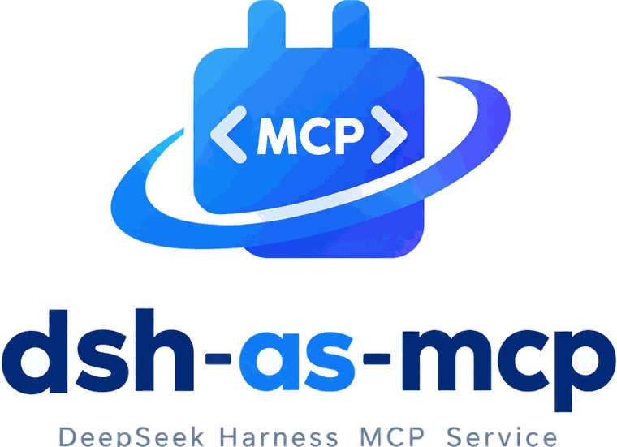
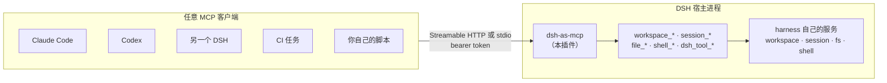

<p align="center">
  <!-- 故意用绝对 URL：npm 从 tarball 渲染 README，不解析相对图片路径，
       写成相对路径在 npm 页面上会是裂图。两个版本是因为 wordmark 是深海军蓝，
       在 GitHub 暗色主题下会看不见。 -->
  <picture>
    <source media="(prefers-color-scheme: dark)" srcset="https://raw.githubusercontent.com/xiseliuli/dsh-as-mcp/main/assets/logo-dark.png">
    
  </picture>
</p>

<p align="center"><a href="README.md">English</a> | 中文</p>

<p align="center">
  <a href="https://github.com/xiseliuli/dsh-as-mcp/actions/workflows/ci.yml"></a>
  <a href="https://github.com/xiseliuli/dsh-as-mcp/releases"></a>
  <a href="LICENSE"></a>
  <a href="https://www.typescriptlang.org/"></a>
  <a href="https://nodejs.org/"></a>
  <a href="https://modelcontextprotocol.io/"></a>
  <a href="https://github.com/topics/dsh-plugin"></a>
</p>

把一个正在运行的 **DeepSeek Harness** 暴露成 **MCP 服务**，让别的 agent —— Claude Code、
Codex、另一个 DSH、CI 任务、你自己写的脚本 —— 都能驱动它：创建工作区、新建会话、把编码
任务交给 DSH 的 agent、读写文件、执行命令。

端点跑在 DSH 宿主进程**内部**，所以通过 MCP 建出来的会话就是真正的 DSH 会话：它实时出现
在 DSH 界面里，跑在 DSH 沙箱中，受和你手敲一样的那套权限策略约束。agent 本身没有任何东西
是被重新实现的。

## 工作原理



---

## 安装

三种渠道都能把这个 bundle 装进 profile，按你拿到包的方式选一种。

**从 npm：**

```bash
dsh plugin --profile <名称> add dsh-as-mcp
```

从源码 checkout 里跑，等价命令是 `pnpm dsh plugin --profile <名称> add dsh-as-mcp`。

**从 GitHub：**

```bash
dsh plugin --profile <名称> add github:xiseliuli/dsh-as-mcp
```

git 安装拉下来的是源码，不是构建产物 `lib/`，所以 pnpm 得跑本包的 `prepare` 脚本
（`tsdown && node scripts/build-client.mjs`）才能把它建出来。pnpm ≥10 默认拒绝执行这个脚本——
连带它依赖的 `esbuild` 的 postinstall 也一并拦下——直到 profile 显式放行，所以第一次 `add` 会以
`ERR_PNPM_GIT_DEP_PREPARE_NOT_ALLOWED` 失败。

`allowBuilds` 里写裸包名，对 `esbuild`（来自 registry）有效，但对这里的 `dsh-as-mcp` 永远无效：
pnpm 只认 git 依赖精确解析出来的那个 key，不认包名
（[pnpm 文档](https://pnpm.io/settings/build#allowbuilds)）。失败的那次 `add` 会在报错里打印这个
精确 key；把它原样抄进 profile 的 `pnpm-workspace.yaml`（`~/.dsh/profiles/<名称>/pnpm-workspace.yaml`），
再重新跑一次 `add`。不要指望 pnpm 已经替你写好占位项——这条失败路径下它不会写。结果长这样：

```yaml
allowBuilds:
  '<pnpm 写出来的那个精确 git spec，含 commit hash>': true
  esbuild: true
```

这个放行等于允许在你机器上、在安装阶段执行这个包的代码——建议钉死到某个 commit
（`github:xiseliuli/dsh-as-mcp#<sha>`），免得后续的 push 悄悄改掉实际跑的代码。`dsh plugin add` 使用的是
DSH 锁定的 pnpm 版本（DSH 0.2.1-rc.5 为 v11.28.5，输出末尾会打印 `using pnpm v…`），所以下面这条要等
DSH 自带更新的 pnpm 后才适用。如果 profile 用的 pnpm
≥11.19.0（若是克隆而非 `github:` 这种 tarball 形式的 git 依赖，则 ≥11.11.0 即可），可以改为放行整个
仓库——`'dsh-as-mcp@git+https://github.com/xiseliuli/dsh-as-mcp.git': true`，不带 `#<sha>`——这样同一个仓库
之后再提交新 commit 也不用重新放行；更早的 pnpm 版本只能用精确 commit 的 key，每次更新都要重新放行一次
（[pnpm 11.11 release notes](https://pnpm.io/blog/releases/11.11-11.14)，
[pnpm/pnpm#12367](https://github.com/pnpm/pnpm/issues/12367)）。

**从 tarball：**

```bash
pnpm pack
dsh plugin --profile <名称> add /绝对路径/dsh-as-mcp-<版本>.tgz
```

用**同一个** tarball 路径重装会悄悄沿用旧构建——原因和规避方法见下文「装进 DSH Desktop」一节，
每次重新打包都换一个文件名。

---

`dsh plugin add` 会把包记进 profile 的 `dsh.profile.bundles`，包内的 `cordis.patch.yml`
负责提供插件行和默认配置。**装完要重启 DSH**：bundle patch 是启动时读取的，不热重载。

确认这一层已经合成进去：

```bash
dsh --profile <名称> --dump-config | grep -A 30 '# == dsh-as-mcp'
```

**给发布者：** GitHub 仓库要打上 `dsh-plugin` 这个 topic——插件发现就是靠它找到你的仓库；npm
的 `latest` 标签要指向一个精确的稳定版本（不能是预发布版，也不能是范围），因为
`dsh plugin add dsh-as-mcp` 解析的就是这个。

## 让客户端接进来

每个请求都要带 bearer token。解析顺序：

1. 插件配置里的 `auth.token`；
2. `$DSH_HOME/dsh-as-mcp/token`；
3. 都没有时在首次运行生成并写入该文件，权限 `0600`。

默认端点是 `http://127.0.0.1:8790/mcp`。

无法设置请求头的客户端可以改用 `?token=<token>`。但优先用请求头：写在 URL 里的凭证可能被
你的 shell 历史、反向代理的访问日志、或浏览器历史留下。DSH 自己不记录查询串
（`webserver/src/index.ts:224`），插件也不记录 token，所以这更多是一个值得养成的习惯，而不是
这段代码引入的泄漏。

**支持 HTTP 的客户端**（Streamable HTTP）：

```json
{
  "mcpServers": {
    "dsh": {
      "type": "http",
      "url": "http://127.0.0.1:8790/mcp",
      "headers": { "Authorization": "Bearer <token>" }
    }
  }
}
```

配置面板会生成一段一模一样的配置，并且已经填好当前令牌，所以直接用面板上的**复制**按钮，
不必手工替换 `<token>`。

**只支持 stdio 的客户端** —— 用随包提供的桥接脚本，它把每条 JSON-RPC 消息通过 HTTP 转给
端点：

```json
{
  "mcpServers": {
    "dsh": {
      "command": "npx",
      "args": ["-y", "dsh-as-mcp"],
      "env": { "DSH_AS_MCP_TOKEN": "<token>" }
    }
  }
}
```

`dsh-as-mcp --help` 会打印它将使用的端点和 token 状态。桥接脚本只会把**从 token 文件读到的**
凭证发给回环端点；要把 `DSH_AS_MCP_URL` 指向远程，必须显式设置 `DSH_AS_MCP_TOKEN`——复制来的
客户端配置因此无法悄悄把本机凭证外传。「回环」是**精确匹配**：`localhost`、`::1`，或字面量
`127.x.x.x` 地址，因此 `127.0.0.1.example.com` 这类域名会被当作它实际所属的远程主机处理。
scheme 可以省略：`127.0.0.1:8790/mcp` 也能识别。

**先调 `dsh_info`**。它会返回端点、插件版本与运行时长、token 的来源、哪些工具组开着，以及——这点很
关键——当前 profile 实际提供了哪些 harness 服务、token 用量能不能读、有没有价格来源；这样客户端能区分
「这个 profile 没有 shell」和「这条命令执行失败了」。`includeModels: true` 会向每个 provider 路由询问
可用模型（选对 model id 的可靠方式）；`probeSearch: true` 会顺带验证会话搜索**是否真的可用**（控制器
可能暴露了 search，但 session-query 索引被配置关闭），代价是首次探测会打开该索引。

它还会带 `catalog`：`session_create` 真正接受的选择——`providers`（已注册适配器的路由）、`agentPresets`
及其 `defaultAgentPreset`、生效的 `sandboxMode`、`permissionPresets` 名单，以及 `sessionCount`。传
`includeModels: true` 还会读每个路由声明的模型（`catalog.providerModels`）：这会去问 adapter，所以默认关闭、
每个 provider 都有超时，但这是选对 `session_create.model` 或 `session_set_model.model` 最可靠的办法。
每个字段都是可选的、各自独立兜底，`catalog.unavailable` 会点名哪个读取没能回答，所以缺字段表示
「这个 profile 没说」，不是「什么都不允许」。

## 工具

返回数据的工具（`dsh_info`、`session_list`、`session_usage`、`session_messages`、`file_list`、
`workspace_list`）同时声明 output schema 并在文本块之外返回 `structuredContent`，支持结构化输出的客户端
可以直接读对象，不必从文本里解析 JSON。

| 工具 | 作用 |
| --- | --- |
| `dsh_info` | 端点、版本与运行时长、token 来源、已启用的工具组、可用的 harness 服务、用量/费用是否可用，以及可接受的 provider、agent preset 与 sandbox 模式的 `catalog`；`probeSearch` 可验证搜索是否真的可用。 |
| `workspace_create` | 把一个目录注册成 DSH 工作区（目录不存在时先创建）。 |
| `workspace_list` | 列出所有工作区：id、路径、标题、会话数、目录是否还在。 |
| `session_create` | 新建一个绑定到工作区（或裸目录）的 DSH agent 会话。 |
| `session_create` | 在 workspace 或裸目录上创建一个 DSH agent 会话。 |
| `session_fork` | 把一个会话（存活的，或从磁盘恢复的）分叉成继承其事件前缀的子会话（可用 `atSeq` 指定分叉点；不指定时 harness 取最近一个完整轮次）。从该点继续只需一轮，不用重放历史；`session_usage` 会单独报出继承前缀的用量。 |
| `session_set_model` | 切换后续轮次使用的 provider 路由与模型：先用便宜模型、难任务时升级、或某路由不可用时回退。回复里的按模型用量会显示每条路由各花了多少。 |
| `session_rename` | 给会话设置显式的用户标题，让外部 harness 为任务起的名字在 DSH 界面里保持不变（同时停止自动生成标题）。若该会话正被另一个 DSH 进程持有写句柄，harness 会拒绝并在错误里说明。 |
| `session_search` | 对会话**消息内容**做字面搜索，每条命中返回 `sessionId` 与一段 snippet（harness 单次上限 20 条并给 `hasMore`）。用来在 prompt/读取之前先找到"哪个会话聊过这件事"。 |
| `session_list` | 存活会话摘要，按最近更新排序；`includeTitle` 附加每个会话的最新标题（每会话一次日志读取），`cwd`/`running` 会在 limit 生效前过滤。回复带 `total`（截断前匹配数）以及 limit 有隐藏时的 `truncated`。 |
| `session_prompt` | 给 DSH 会话下发一个任务；默认等待本轮结束，返回回复、agent 调过的工具调用，以及本轮的 token 用量和该会话的累计量。`toolCalls` 控制每次调用的回显量：`summary`（默认）只给名称/id/参数字节数，`full` 附带参数（受 `maxArgumentChars` 限制），`none` 只留计数。可用 `images` 附带截图（png/jpeg/webp/gif，最多 4 张）。带 `idempotencyKey` 时可安全重试：重复调用会返回已有轮次，而不是把任务再发一遍。客户端带 `progressToken` 时，等待期间最多每秒一次 `notifications/progress`。`maxReplyChars` 可选地限制 agent 最终回复长度（被截断时带 `replyTruncated` 和原始 `replyChars`），`turn.models` 列出实际作答的 `provider/model`。客户端对该调用发出 `notifications/cancelled` 时，会中止对应轮次，等待以 `turn.aborted: true` 收尾——这条通知由端点自己路由，因为所用 SDK 版本只确认、不处理它。用量快照只有在轮次仍在运行时才带 `partial: true`；取消后已结算的轮次给出的是最终数字。 |
| `session_messages` | 读取会话的用户/助手对话记录。 |
| `session_cancel` | 让 agent 停下当前这一轮。 |
| `session_usage` | 按会话统计 token 用量（默认含其 subagent）：精确的四桶计数、按模型拆分、可选的按轮拆分，装了价格插件时还有钱。 |
| `file_read` | 经 DSH 文件系统服务读 UTF-8 文件。 |
| `file_write` | 经 DSH 文件系统服务创建或覆盖文件。 |
| `file_list` | 经 DSH 文件系统服务列一层目录。 |
| `shell_run` | 经 DSH shell 服务执行一条命令。 |
| `dsh_tool_list` | 本端点允许调用的 agent 工具，附 DSH 自己 agent 所见的结构。 |
| `dsh_tool_call` | 直接运行其中之一，走与 agent 完全相同的管线。 |

典型的编码流程：

```
workspace_create { path: "/Users/me/project" }
  -> session_create { workspaceId: "..." }
  -> session_prompt { sessionId: "...", prompt: "给 CLI 加一个 --verbose 开关，并补一个测试。" }
```

`session_prompt` 是让 DSH **替你干活**的入口：DSH agent 自己规划、改文件、调它自己的工具，
还能派生子 agent。`file_*` 和 `shell_run` 用在你想自己动手、不想经过 agent 的场合。

`dsh_tool_call` 是第三种选择：直接运行 DSH **自己**的某个工具，不必先花一轮模型去决定要调用它。
先调 `dsh_tool_list`——它报告的正是被允许的集合，没报告的名字一律拒绝。两者都**必须**传
`sessionId`：该会话的 agent **就是**策略本身，是它让 harness 施加沙箱、跑 guard、并把调用归档到
某份会话记录里。

这里刻意没有"不带会话"的形式。DSH 把工具注册进**注册它的那个 context 的作用域**，而每个工具包都
装在 agent preset 内，所以全局层本来就是空的——不带作用域的列举确实返回零个工具，不带作用域的调用
会答 `unknown tool`。因此不带会话的 `dsh_tool_list` 会**直接报错**，而不是返回一个空工具箱（那会被
读成"什么都不允许"）。要走不涉及 agent 的路径，请用 `file_read`／`file_write`／`file_edit`／`file_list`／
`shell_run`，它们直接解析部署策略，不需要会话。

允许集是**白名单**，而且刻意很窄。不在名单里的一律**拒绝且不出现在 `dsh_tool_list` 中**。要紧的几项遗漏：

- **`run_code`** 是 DSH 的程序化工具调用入口：一次调用即可运行一个能按名字调用**任意其他工具**的程序。
  放它进来等于让整份名单失效。
- **`cordis_run`、`cordis_define` 等**会执行任意插件代码。现成的 bundle 都没挂它们，所以一份照今天
  profile 写的黑名单，恰恰会在挂上它们的那个 profile 里失明——这正是这里用白名单的原因。
- **`ask_user_question` 与 `present`** 会直接触达键盘前的人。
- **`workflow`、`ralph`、`send_message`、`spawn_teammate`、`schedule_create`** 会启动比本次调用活得更久的
  工作；**`create_goal`、`update_goal`** 会维持无人值守的持续执行。

运维方可以通过 `agentTools.allow` 有意放宽，或用 `agentTools.deny` 从默认集合里减去。

## 用量统计

DSH 没有「会话结束」事件，所以没有可订阅的钩子，也没有最后一个回调可以等。花费就报在调用方能问
的地方：每条 `session_prompt` 回复里，以及按需调用的 `session_usage`。

**每条 prompt 回复都带。** `turn.usage` 是这次 prompt 消耗的量——本轮每一步、每步一次模型调用，
含工具往返——`session` 则是该会话的累计总量，带按模型的拆分，装了价格插件时还带钱：

```json
{
  "accepted": true,
  "turn": {
    "reply": "…", "toolCalls": [], "turn": 1, "turnEndReason": {"kind": "completed"},
    "timedOut": false, "aborted": false,
    "usage": {
      "turn": 1, "steps": 157,
      "uncachedInputTokens": 1032706, "cacheReadTokens": 21192320,
      "cacheWriteTokens": 0, "outputTokens": 86148, "totalTokens": 22311174
    }
  },
  "session": {
    "sessionId": "session-…",
    "usage": {
      "totals": {"uncachedInputTokens": 1032706, "cacheReadTokens": 21192320,
                 "cacheWriteTokens": 0, "outputTokens": 86148, "totalTokens": 22311174},
      "byModel": [{"provider": "opencode-go-xise", "model": "deepseek-v4.1-flash",
                   "samples": 157, "uncachedInputTokens": 1032706,
                   "cacheReadTokens": 21192320, "cacheWriteTokens": 0,
                   "outputTokens": 86148, "totalTokens": 22311174}],
      "turns": 1, "steps": 157, "samples": 157,
      "verifiedAgainstProjection": true
    },
    "cost": {
      "available": true, "source": "dsh-cost-meter", "estimate": true,
      "costUsd": 0.5384, "costEstimateUsd": 0.5384, "costCny": 3.5818, "costEur": 0.4819,
      "calls": 157
    }
  }
}
```

`mode: "steer"` 时那一轮本来就在跑，所以 `turn.usage` 覆盖整个轮次，也包括你这条消息之前已经
跑过的步骤。

本轮一个 token 都没花时（还没走到第一步就被取消，或 provider 没报 usage），`turn.usage` 不存在。
用量本身读不出来时也同样不存在——但这种情况**不会静默**：回复会带 `usageUnavailable: true` 和一
条 `reason`，所以拿这些数字结账的调用方能分清“日志读不出来”和“这一轮没花钱”，也就可以改用
`session_usage` 重试。`wait: false` 时没有可描述的轮次，但 `session` 仍然返回（读失败时同样带
`usageUnavailable`）。等待超时、或快照是在轮次仍在运行时取的，会把总量标成 `partial: true`：那一轮还没落定、还会继续
增长；排队中的消息也标 `partial`，因为它的轮次还没跑。而被取消之后**已经结算**的轮次给的是最终数字，
不会再有新的计费。

**或者直接问。** `session_usage` 是最后一次 prompt 之后用来收账的收据。它读的是持久会话日志而不是
存活会话，所以对已经空闲、已经离开存活 session store、甚至是更早一次 DSH 运行建出来的会话都答得上
来——只要你知道它的 id：

```json
{
  "generatedAt": "2026-11-02T08:00:00.000Z",
  "scope": "session",
  "sessions": [
    {
      "sessionId": "session-…",
      "cwd": "/Users/me/project",
      "origin": "self",
      "usage": {
        "totals": {"uncachedInputTokens": 1032706, "cacheReadTokens": 21192320,
                   "cacheWriteTokens": 0, "outputTokens": 86148,
                   "totalTokens": 22311174},
        "byModel": [{"provider": "opencode-go-xise", "model": "deepseek-v4.1-flash",
                     "samples": 157, "uncachedInputTokens": 1032706,
                     "cacheReadTokens": 21192320, "cacheWriteTokens": 0,
                     "outputTokens": 86148, "totalTokens": 22311174}],
        "turns": 1, "steps": 157, "samples": 157,
        "verifiedAgainstProjection": true
      },
      "cost": {"available": true, "source": "dsh-cost-meter", "estimate": true,
               "costUsd": 0.5384, "calls": 157}
    }
  ],
  "totals": {"uncachedInputTokens": 1032706, "cacheReadTokens": 21192320,
             "cacheWriteTokens": 0, "outputTokens": 86148, "totalTokens": 22311174,
             "turns": 1, "steps": 157, "samples": 157},
  "byModel": [{"provider": "opencode-go-xise", "model": "deepseek-v4.1-flash",
               "samples": 157, "uncachedInputTokens": 1032706,
               "cacheReadTokens": 21192320, "cacheWriteTokens": 0,
               "outputTokens": 86148, "totalTokens": 22311174}],
  "subagentsIncluded": false,
  "cost": {"available": true, "source": "dsh-cost-meter", "estimate": true,
           "costUsd": 0.5384},
  "notes": ["…"]
}
```

| 参数 | 含义 |
| --- | --- |
| `sessionId` | 报告这个会话，默认连同它下面的 subagent 会话一起。省略则汇总本端点创建的会话。 |
| `all` | 不给 `sessionId` 时：扫描这个 DSH 知道的全部会话，按最近更新排序。给了 `sessionId` 时忽略。 |
| `includeSubagents` | 把 subagent 子会话作为独立行折进来。默认 `true`。 |
| `includeTurns` | 同时返回每行的按轮拆分。默认 `false`。 |
| `includeCost` | 是否从 `dsh-cost-meter` 读金额。默认 `true`；大范围扫描时可设 `false`，省掉每行一次账本读取。 |
| `limit` | 不给 `sessionId` 时扫描的会话数上限。默认 20，最大 200。 |

如果在会话最新一轮还在运行时读取，该行会带 `partial: true`；只要有任何一行如此，整份报告也会带
`partial: true` 并在 `notes` 里说明——总量是仍会增长的快照，不能据此结算。

不带 `sessionId` 指的是**本 DSH 进程里由本端点创建的**会话。harness 并不记录这种归属，所以重启之后
请传 id；改用 `all: true` 则扫描这个 DSH 知道的全部会话，被 limit 截断时会在 `notes` 里说明。

**DSH 重启之后，知道 id 就够。** 实机验证过：重启前创建的会话仍可读取，`session_usage { sessionId }`
返回同样的总量，对它 `session_prompt` 会继续对话，累计用量横跨两个进程。只有"按归属"的默认值会复位
——不带 id 的 `session_usage` 只报本进程创建的会话，并在 `notes` 里说明。

**四个桶互不重叠**，就是 provider 报的原样，`totalTokens` 是它们的和：

| 字段 | 含义 |
| --- | --- |
| `uncachedInputTokens` | provider 没有从缓存里命中的 prompt token。它就是 provider 的 `inputTokens`——按定义就是未缓存的输入，不是输入总量。 |
| `cacheReadTokens` | 按缓存读计费的 prompt token。 |
| `cacheWriteTokens` | 按缓存写（建缓存）计费的 prompt token。 |
| `outputTokens` | 生成的 token。`reasoningTokens` 是它的子集，永远不是第五个桶，所以哪里都不会再加一次。 |
| `totalTokens` | 四者之和——真正用来计费的数字——由四个桶算出来，而不是相信 provider 给的 `totalTokens` 字段。 |

**精确性。** 总量是从持久会话日志折出来的——用的正是 harness 自己那个 `tokenUsage` 投影所依据的
`assistant/message.data.usage` 记录，以及被重试的 `assistant/attempt` 里的 usage chunk——所以是
provider 报的计数，不是估算。`verifiedAgainstProjection: true` 表示在同一个切点上 harness 自己的
累计值也在、且四个桶逐一相等（在一个 1,146 个事件的真实会话上确实完全相等）。不一致时
`projectionTotals` 会带上 harness 的那个数：日志折算的结果留在 `totals`，分歧照实报出来，而不是
悄悄替你选一个。

每一次真正计费的 provider 尝试都会被计入，包括失败后又被重试的那次——那些 token 已经扣了钱。同一个
调用的更正或重复上报会**替换**它的桶而不是重复累加，完全相同的重复上报则什么都不做。所以 `samples`
是折进来的 provider **调用次数**，不是不同的步数：重试的调用加一次，更正不加，因此它可能和 `steps`
不同。`byModel` 只列真正扣了 token 的路由，所以一条报了 0 token 的调用会出现在 `samples` 里、却
没有对应的路由行。`turns`、`steps` 则是上报过用量的轮数和步数。某条记录读不出来（缺字段或不是整数）时会出现
`ignoredSamples`：此时总量会低于 provider 实际扣的量，藏起来比报出来更糟；聚合报告会把各行忽略的
条数加起来并在 `notes` 里说明。

**哪些没有算进去，以及为什么。**

- **压缩（compaction）** 本身也是一次 LLM 调用，harness 把它的用量记在
  `compaction/summary.data.usage`。它单独放在可选的 `compaction` 块里
  （`{totals, summaries, ignoredSummaries}`），并刻意排除在 `usage.totals` 之外，因为 harness
  自己的投影也不含它——折进去会让这些数字和 DSH 界面上同一会话的数字对不上。要整份 token 账单就
  自己把它加上。
- **会话标题** 由一次 LLM 调用生成，而这条调用在日志里根本不留用量记录（只有
  `session/title-llm-request`，它只记路由）。任何 token 折算都看不到它。
- **fork 出来的会话** 继承父会话的事件前缀。这部分是记在父会话账上的，所以单独报成 `inherited`，
  `totals` 只覆盖子会话自己的轮次。
- **subagent** 的 token 记在同一个账号上，所以 `session_usage` 默认把子会话作为独立行折进来
  （`includeSubagents: false` 可排除），每个目标最多 50 个，被上限截断时给 `truncatedSubagents`。
  子会话按 harness 自己的 `origin: "subagent"` 标记识别：普通 **fork** 也会记父会话链接，但 fork
  是一个完整会话，所以永远不会被当成子会话折进来。prompt 回复里的 `session` 块不含 subagent：
  那只是该会话自己轮次的量，这也正是需要有这个工具的原因。单份报告最多 100 行（给
  `truncatedRows`，金额总量同时标成 `partial`）；如果连会话列表都读不到，报告会说明无法枚举
  subagent，而不是声称没有 subagent。
- **读不出来的会话**（被清理、损坏）会变成一行带 `error` 而没有 `usage` 的记录，被排除在总量之外，
  并在 `notes` 里点名——一个坏会话不会让整份报告失败。

**钱是另一回事，而且是可选的。** 只有装了第三方 **`dsh-cost-meter`** 插件时才有 `cost`：harness
本身完全没有价格或货币服务。它是该插件价格目录给出的**估算**——目录带峰谷时段，路由不认识时按模型
名匹配——不是账单；而且它给两个不同的美元数字，因为它们回答的是两个不同的问题：

- **`costUsd`** 是真实扣的钱：cost-meter 的 `apiCost`。这是跨会话求和用的字段；订阅/编码套餐覆盖的
  调用是 `0`，因为账号里并没有按 token 扣钱。
- **`costEstimateUsd`** 是挂牌价估算：cost-meter 的 `cost`，按目录算出来、与怎么计费无关。它是同样
  这些调用按 API 价格本该花多少，也是套餐会话里唯一会变的那个数字。

`costCny`／`costEur` 是 cost-meter 冻结的估算汇率副本（它的账本是美元本位的），`calls` 是它记下的
LLM 调用次数（轮次、压缩、标题；它的单会话数字不合并 subagent，所以每行单独计价）。没有这个插件时
该块是 `available: false` 加一条可读的 `reason`（“no price source in this DSH profile: …”），
token 数字不受影响。钱覆盖会话内每一次 LLM 调用，而 token 总量不含压缩、也看不到标题调用，所以
**token 和钱对不上是正常的**：花钱看 `costUsd`，挂牌价看 `costEstimateUsd`，用量看
`totalTokens`，不要拿一个推另一个。

两条路径都由 `tools.usage` 控制（默认 `true`），见下面的配置。这个开关独立于 `tools.session`：
关掉会话工具后，拿着已知的会话 id 仍然可以问用量。两种情况都不会改变记录本身——用量是从端点已经
在读的会话日志里折出来的，开关只改变返回什么，不改变存在什么。

## 安全

这个端点等于远程操控一个拥有 shell 权限的编码 agent。请把 token 当 SSH 私钥对待——插件自己也是
这么做的：没有任何工具会返回它的值。`dsh_info` 只报 token 的来源（文件路径或配置），不报明文，
所以调用方 agent 的上下文里不会攒下这个凭证。启动时，短于 16 个字符的自定义 token 会触发告警；
自动生成的 token 是 43 个字符的 CSPRNG 输出。

- 被拒绝的请求返回 `401` 并带 `WWW-Authenticate: Bearer realm="dsh-as-mcp"`，标准 MCP 客户端因此
  知道"带上配置好的 token 重试"才是解法，而不是把它当成端点不可用。realm 是固定标签，token 不会回显。
- 监听绑定在 `127.0.0.1`，所有请求都做 bearer 校验——包括挂在 DSH 自身 web server 上的那条
  路由。但在那条路由上，**这个校验是唯一的关卡**：插件注册的精确路由会先于 DSH 的鉴权围栏被
  匹配，没匹配上的请求才会作为 fallback 交给围栏（`webserver/src/index.ts:222-227`）。所以
  `http.mountOnWebServer: true` 并**不**继承你浏览器会话的保护，它自带准入。DSH Desktop 上
  有一个例外：关闭普通浏览器访问时，web server 还会拒绝不带渲染进程头的请求，此时挂载路径对
  普通 MCP 客户端不可达——请使用插件自有的监听端口。把 `http.host` 改成 `0.0.0.0` 等于把同样
  的权力开放到你的网络；插件会在绑定时告警，且只应在你自己的网关后面这么做。
- **token 就是全部的安全边界，而这个边界等于你的用户账号。** 这里没有任何路径沙箱。调用方一旦
  持有 token，`file_read`／`file_write`／`file_edit`／`file_list` 就能触及 DSH 进程能触及的一切，`shell_run`
  就是以你的身份执行任意命令——因为 harness 自己的 `fs` 与 `shell` 服务替 DSH agent 做事时正是
  如此。两条都在实机上验证过：`file_read` 读出了 `/etc/passwd`、`~/.dsh/settings.yaml` 以及本
  插件自己的 token 文件；`file_write` 在**所有**已注册工作区之外创建了文件。工作区决定的是
  *会话的 agent 从哪里开始*，它并不围住这些工具。
- **这座桥是实例级的，不按调用方隔离。** `session_list` 会枚举本实例中的**每一个**会话，
  `session_messages` 能读取其中任何一个的记录——已实测读到了一个并非本插件创建的会话。那些
  正是你和 DSH 对话的会话，所以令牌持有者能看到你的对话历史，而调用方 agent 的上下文也会把
  它攒下来。这不是越权（同样的字节就在 `$DSH_HOME/sessions`，用 `shell_run` 一样能读到），
  但它是一个在你分发令牌之前值得知道的隐私后果。
- 因此 `tools` 开关**收窄的是客户端能发现和调用的范围，而不是隔离**。`tools.shell: false`
  会移除 shell 工具，但 `file_write` 照样能写你的 shell 启动文件、`file_read` 照样能读你的
  凭证——所以关掉 shell 工具的 profile，**不等于**可以交给一个你不愿给登录权限的调用方。
  要真正的隔离，请把整个 DSH 实例跑在操作系统级沙箱里、或用独立的非特权账号运行，并把 token
  当作那个账号的密码。
- **花费在同一条边界上可读。** 令牌持有者能读到本端点够得到的任何会话的 token 用量——装了
  `dsh-cost-meter` 时还有估算金额：`session_usage`，以及每条 `session_prompt` 回复里的用量块。
  它并没有扩大**权限**（用量记录就在对话记录同一份持久会话日志里，`shell_run` 本来也能读到那份
  日志），但它的**发现面**比会话工具更大：`session_usage` 加 `all: true` 时，即使 `tools.session`
  是关的，也能列出每个会话的 id、`cwd` 和花费。如果你关掉会话工具是为了不让调用方碰这个实例，请把
  `tools.usage` 一起关掉。
- `approval.policy` 决定 DSH agent 想做一件本该问人的事时怎么办：
  - `inherit`（默认）—— 插件不参与应答。没有浏览器接进来时，需要审批的工具会解析为
    `unavailable`，即 agent 的动作**失败关闭**。
  - `allow` —— 通过 approval 服务把**本插件创建的**每个会话（以及 fork 出的子会话）切到 harness
    的无人值守策略（`never`），harness 会把这次切换告知 agent；非本插件创建的会话保持你的策略，
    你手动操作的会话不受影响。这是让无人值守的 agent 任务能跑通的前提，也确实实质性地扩大了
    agent 可执行的范围。创建/fork 的回复会带 `approvalPolicy: "never"`，切换失败则带
    `approvalPolicyError`。
- `file_write`、`shell_run` 以及后台的 `shell_start`/`shell_kill` 都是**调用方**的动作，不是
  agent 的。它们走 harness 自己的文件系统与 shell 服务，所以这个 DSH 实例配置的沙箱和策略照样生效。

## 装进 DSH Desktop（需要重启）

在当前的 harness（0.2.1-rc.5）上，普通终端里 `dsh plugin --profile desktop add <tarball>` 是可用的：
被拒绝的只是应用独占的*管理类*操作（例如对 `desktop` profile 执行 `--dump-config`）。下面的 tarball
安装是最简路径；手写 patch 层则是该子命令被拒绝时的兜底。无论哪种方式，装完**必须重启 DSH Desktop**。

### 为什么必须重启

profile manifest 里的 `patchReload: live` 只对 **CLI 启动器**生效。免重启重组由
`watchUserPatches()` 实现，它位于 CLI 的 `runProfile()`（`apps/cli/src/profile-boot.ts`）里。
DSH Desktop 走另一条路：它调用 `@deepseek-ai/dsh-app-boot` 的 `boot()`，patch 列表在启动时
算好一次——应用源码里根本没有这个 watcher：

```bash
grep -rn watchUserPatches <dsh-desktop>/dsh-plugin-desktop/src/    # 无匹配
```

实测也一致：改完 profile 的 `cordis.patch.yml` 之后，应用日志一行都没新增，端口也没起来。

所以：**CLI 启动的 profile（`dsh --profile xxx`）改 patch 文件即时生效；DSH Desktop 必须重启。**
无论哪条路径，watcher 都只重组配置、不替换已加载的模块——改完 `lib/` 之后一样要重启。

### 万一重启后起不来

`~/.dsh/profiles/desktop/cordis.patch.yml` 清回 `[]` 即可，插件不会再参与启动；确认无误后
再逐项排查。彻底移除：`cd ~/.dsh/profiles/desktop && pnpm remove dsh-as-mcp`。

### 1. 打包并装进 desktop profile

```bash
cd /path/to/dsh-as-mcp && pnpm pack --pack-destination /tmp

# raw pnpm，绕过 CLI 对保留 profile 名的限制
cd ~/.dsh/profiles/desktop && pnpm add /tmp/dsh-as-mcp-0.1.0.tgz
```

> **覆盖安装时，务必换一个 tarball 路径。**
> `pnpm` 把 `file:` 依赖按**路径**记录；从同一路径重装会报 `added 0`，却仍然链接着上一份内容——
> 一个能启动、能运行、但静默过期的构建。让每次构建的文件名唯一，spec 字符串才会跟着变：
>
> ```bash
> TARBALL=/tmp/dsh-as-mcp-$(date +%s).tgz
> cd /path/to/dsh-as-mcp && pnpm pack --pack-destination "$(dirname $TARBALL)"
> mv /tmp/dsh-as-mcp-0.1.0.tgz "$TARBALL"
> cd ~/.dsh/profiles/desktop && pnpm remove dsh-as-mcp && pnpm add "$TARBALL"
> ```
>
> 然后核对字节数是否真的相同，否则你测的是旧构建：
>
> ```bash
> wc -c ~/.dsh/profiles/desktop/node_modules/dsh-as-mcp/lib/index.js \
>       /path/to/dsh-as-mcp/lib/index.js
> ```

### 2. 把插件行写进 profile 自己的 patch 层

编辑 `~/.dsh/profiles/desktop/cordis.patch.yml`（把其中的 `[]` 替换为）：

```yaml
- insert:
    - id: dsh-as-mcp
      name: dsh-as-mcp
      config:
        http:
          enabled: true
          host: 127.0.0.1
          port: 8790
          path: /mcp
        tools:
          workspace: true
          session: true
          files: true
          shell: true
```

保存后**重启 DSH Desktop**，插件才会挂载。

> ⚠️ **不要同时把 `dsh-as-mcp` 加进 `dsh.profile.bundles`。** bundle 会贡献它自己的行，于是最终
> 组合里会出现**两行同 id**（`dsh --profile <name> --dump-config` 会直接显示出 2 行）。用 patch
> 层就只走 patch 层。反过来说，想让它跨重启常驻时，才改用 `dsh plugin add` 走 bundle 路线。
>
> 后果比"多一行"严重得多：**设置面板的每一次写入都会被拒绝**，错误是
> `Configuration for "dsh-as-mcp" is overridden by a home patch or command-line overlay`。DSH 的
> config editor 拿**第一行**组合结果校验编辑，而 Loader 生效的是**最后一行**，两行同 id 时永远
> 对不上，于是什么也存不下去。面板只会显示"写入失败，已重新读取。请重试。"，看起来像偶发故障，
> 而不是组合写错了。走 bundle 路线就删掉手写的 `- insert:` 那一行；走 patch 路线就把
> `dsh-as-mcp` 从 `dsh.profile.bundles` 里去掉。

### 3. 冒烟验证

```bash
node ~/.dsh/profiles/desktop/node_modules/dsh-as-mcp/scripts/smoke.mjs
```

它会读 `<DSH_HOME>/dsh-as-mcp/token`、握手、列出工具、调 `dsh_info` 报出该 profile 实际挂载了
哪些 harness 服务，再调 `workspace_list`。通过时最后一行是 `OK`，失败则退出码非 0。

要跑一次真实链路（建临时工作区 → 建会话 → 交给 DSH agent 干活 → 打印回复、工具调用和本轮花掉的
token，再经 `session_usage` 把同一个总量读回来核对）：

```bash
node ~/.dsh/profiles/desktop/node_modules/dsh-as-mcp/scripts/smoke.mjs \
  --prompt "在当前工作区创建 hello.txt，内容为 hi，然后读回来确认"
```

### 4. 卸载

把 `~/.dsh/profiles/desktop/cordis.patch.yml` 清回 `[]` 并重启，插件就不再挂载。
要彻底移除：`cd ~/.dsh/profiles/desktop && pnpm remove dsh-as-mcp`。

## 配置

默认值随 `cordis.patch.yml` 一起提供。profile 自己的 `cordis.patch.yml` 按 `id` 覆盖该行，
而且覆盖是**整体替换该行的 `config` 对象**、不是深合并——你仍然想要每个键都得重新写一遍。
未知键会在启动时报错并指名是哪个键，因为一个被静默忽略的拼写错误意味着你的覆盖根本没生效。

```yaml
- id: dsh-as-mcp
  name: dsh-as-mcp
  config:
    http:
      enabled: true          # 插件自有的监听
      host: 127.0.0.1
      port: 8790             # 0 表示让系统分配空闲端口
      path: /mcp
      mountOnWebServer: false # 同时挂在 http://<dsh 主机>:<dsh web 端口>/mcp
    auth:
      # 整个 `token` 都不写：用 $DSH_HOME/dsh-as-mcp/token（首次运行自动生成）。
      # 不要写成 `token: ''`：只要这个键存在（哪怕是空串），设置面板就会认为
      # 已经固定了密钥。
      # token: '<一个够长的随机密钥>'
    tools:
      workspace: true
      session: true
      files: true
      shell: true
      agentTools: true
      usage: true            # session_usage + session_prompt 回复里的用量块
    agentTools:
      allow: []              # 空：用内置白名单；非空则整体替换
      deny: []               # 从解析后的集合里减去
    session:
      agentPreset: ''        # 空：用 harness 默认
      provider: ''           # 必须和 model 成对出现
      model: ''
      promptTimeoutMs: 900000
    limits:
      maxReadBytes: 1048576
      shellTimeoutMs: 120000
      agentToolTimeoutMs: 120000
    approval:
      policy: inherit        # inherit | allow
```

`mountOnWebServer` 可以单独使用：配合 `enabled: false`，端点只挂在 DSH 的 web server 上
（`<dsh 主机>:<dsh web 端口><path>`），不再占第二个端口。插件会等待该服务挂载，然后注册精确路由——
`dsh_info` 里看 `mountedOnDshWebServer`，等待期间还有 `mountNote`。服务暂时不存在不算错误：插件照常
加载，web server 一出现就挂上去。挂载路由与独立监听行为一致：进度通知按秒实时流出（实测不是结束后
一次性补齐），取消通知也会中止轮次。

## 设置面板

宿主挂载了 settings 服务时（DSH Desktop 与 `dsh web` 都有），插件会在设置面板里贡献一个
**MCP 服务** 分组。它编辑的就是上面那段配置所在的 `dsh-as-mcp` 命名空间——面板和文件是同一个
值的两种视图，不是两份副本。

面板覆盖全部设置，包括 `agentTools.allow` 与 `agentTools.deny` 这两份名单（用逗号分隔的文本
编辑）。它们本质是 `string[]`，所以**名字里带逗号**的工具无法在面板里表达，那种情况请改配置
文件。

所有改动**即时生效**：

| 改动 | 效果 |
| --- | --- |
| 工具开关 | 该组在下一次 `tools/list` 中消失或出现；被关闭的工具是真正不存在，调用它会报“未知工具”，而不是执行后被拒绝。`usage: false` 还会让 `session_prompt` 回复不再带用量块 |
| 上限、会话默认值 | 下一次调用开始时读取 |
| 令牌 | 下一次请求就要求新值，旧令牌立即失效 |
| `enabled`、`host`、`port`、`path`、`mountOnWebServer` | 监听器会被搬走 |

最值得说清的是改端口：插件会先停掉旧监听再起新的，所以端点是真的搬了。如果新端口被占用，
绑定错误会显示在面板和 `dsh_info` 里，而不是被吞掉。

令牌在表单里是**只写**的：明文不会进入设置表单，所以输入框只负责写入，另有一个清除按钮用来撤销
面板自己写的那一层（如果令牌来自组合配置，清除它不影响该令牌，它仍然生效）。“是否已固定令牌”由
宿主回答，而不是页面自己猜——`auth.token` 特意不设 schema 默认值，因为设置服务判断“这个 secret
是否已设置”用的是 `value !== undefined`，一旦有默认值，插件一加载面板就会声称令牌已固定。

面板里**可复制的客户端配置**是唯一一处有意交出明文的地方。**复制**按钮写入的片段里是当前真实
生效的令牌，粘贴即可用；屏幕上显示的那份则打了掩码（另有一个“显示令牌”按钮），这样截图或共享
屏幕都不会泄露它。两者都来自同一条只读状态路由，位于 DSH connection 层——在该层的 Host/Origin
与浏览器 cookie 围栏**之内**，因此自动继承 DSH 自己的鉴权，绝不会暴露在一个裸端口上。`dsh_info`
仍然只报告令牌来源：已经用这个令牌通过鉴权的调用方，没必要让它再被回显进对话记录里。

面板是浏览器半边通过 `ctx.configForms.whileServed` 注册进 `settings.section` 的一页，因此只有宿主
确实在提供这一项的配置表单时才会出现。这需要 `@deepseek-ai/schemastery`：DSH 0.2.0-rc.2 只给
`Config` 上带 `toJSON()` 的 entry 投影表单，而且只保留标了 `meta.volatile` 的字段。DSH 里没有
免 schemastery 的面板路径，所以它作为 peer 直接 import——拿不到它插件根本无法被 import，这正是
下面那条兼容范围要挡住的情况。

## 部署要求

每个工具在服务缺失时都会给出可操作的错误，但配置 profile 的人应当能在一处读到全部要求。"必需"表示
没有它该工具完全不可用；"可配置关闭"表示常规 profile 自带该服务，但部署可以把它关掉。

| 工具组 | 需要 | 说明 |
| --- | --- | --- |
| `dsh_info`、按 id 的 `session_usage` | 只需可读的会话日志 | 只要有 `sessionQuery`（或控制器的 `inspect` 回退）就能按 id 读用量 |
| `session_create` / `session_list` / `session_prompt` / `session_messages` / `session_cancel` / `session_fork` / `session_rename` / `session_set_model` | `sessionController` | 只有必须等待的地方才等待（`session_create`/`prompt`）；其余工具会明确报缺失服务 |
| `session_search` | `sessionController.search` **且** 会话查询索引已打开 | `session-query-sqlite` 默认 `openAt: "never"`；改为 `startup` 或 `first-search` 才启用搜索 |
| `workspace_*` | `workspaceRegistry` | 常规 profile 由 base bundle 提供 |
| `file_*` | `fs` | 部署的沙箱策略照样生效；`file_read_image` 还需要受支持的图片格式 |
| `shell_*` | `shell` | `shell_run` 有 `run()` 用 `run()`、否则 `execute()`；后台任务需要 `start()` 或 `execute()` |
| `dsh_tool_list` / `dsh_tool_call` | `tools` **且** `sessionController.resolveAgent` | allow-list 叠加在会话自身策略之上 |
| 用量里的金额 | `costMeter` | 第三方价格插件（`dsh-cost-meter`）；默认没有，回复会说明 |
| `approval.policy: "allow"` | `approval` **且** 能解析出 agent | 缺失时 create/fork 回复带 `approvalPolicyError` |
| `http.mountOnWebServer` | `webServer` | 插件等待它出现再挂载；等待期间 `dsh_info.mountNote` 会说明 |

## 兼容性

- **Harness** ≥ `0.1.5-rc.1`，声明为 `peerDependencies["@deepseek-ai/dsh"]: ">=0.1.5-rc.1"`，
  不封顶。DSH 的插件加载器会直接从 manifest 里读出这个范围，在插件被 import **之前**就拿它和
  唯一那个运行时版本做 semver 比对（预发布版也参与比对）；不兼容的安装会被拒载，除非宿主显式
  给出精确版本豁免（`dsh plugin allow-version`）。
- **Node** `^22.19.0 || >=24.0.0`。
- `@deepseek-ai/dsh` 这个 peer 声明为**可选**，纯粹是为了不让 `dsh plugin add` 为了满足它就把
  一整个 harness 装进每个 profile。可选只影响安装行为——DSH 的兼容性检查不看
  `peerDependenciesMeta`，只读 `peerDependencies`，所以上面那条版本校验照样生效，一条都不少。
- **设置模型。** 已针对 `dsh 0.2.0-rc.2` 验证：它的 settings 服务换掉了本插件最初面向的 0.1.x
  API——`settings.installSection` 已不存在，命名空间改由 entry 自己的 `Config` 按 Loader 行 id
  投影，且只有 `meta.volatile` 字段可编辑；volatile 写入直接提交进运行中的引用，不重挂载。因此
  宿主半边不再做任何注册，每次读取都通过 `plainConfig()` 解出实时值，唯一保留的 settings 调用是
  `configure({ auto: false }, ctx.fiber)`（本插件自带页面）。**面板需要 0.2 的设置模型**；在
  0.1.x 运行时上端点仍按配置文件正常运行，但没有面板——那种运行时只会为「插件通过已移除的那个
  调用注册过的命名空间」投影表单。
- **用量需要会话日志。** token 数字经 `sessionQuery`（优先）或 `sessionController.inspect` 从持久
  日志折出；`dsh_info` 把这一点报成 `tokenUsage`。两者都没有时，`session_prompt` 的回复会带
  `usageUnavailable` 和原因，而不是假装这一轮没花钱；会话工具照常可用；带 `sessionId` 的
  `session_usage` 会返回一行 `error`（其总量不含它）；不带 `sessionId` 时只报本端点自己创建的
  会话（或给出解释的空报告），而 `all: true` 因为需要枚举会话，仍会报能力缺失错误。钱还需要
  第三方 `dsh-cost-meter`，`dsh_info` 报成 `costMeter`。
- **没有其它硬 `@deepseek-ai/*` 依赖。** 除上面这个版本闸门，本包的其它能力都通过
  `ctx.get(name)` 做结构化解析。唯一的例外是 `@deepseek-ai/schemastery`，作为 peer 直接 import：
  DSH 里没有免 schemastery 的设置表单路径。

## 设计说明

- **能力探测，而非 `inject`。** 插件能在一个既没有 web server、也没有会话服务、也没有文件系统
  接缝的裸 CLI profile 里加载，然后由每个工具明确报出缺少哪个服务、该由哪个 bundle 提供。
  如果声明 `inject`，loader 会直接拒绝挂载插件——对一个能力桥来说这是更差的答案。
- **如何等一轮结束。** harness 没有提供「等待这一条消息对应那一轮」的 API——
  `sessionController.prompt()` 在消息入队后就立即返回。所以 `session_prompt` 会轮询持久会话
  日志，找 `source.rpcId` 等于它传给 `prompt()` 的 `requestId` 的那条 `user/message`——这正是
  session controller 自己做幂等检查时用的关联方式——然后等**那一轮**关闭。这个归属判断才是
  正确性的来源，而不是「看起来合理」：排队中的 prompt 在日志里是落在**正在跑的那一轮**的区间
  内部的，所以出现在我们消息之后的 `turn/end` 通常属于别人，不属于我们。同一会话上的轮次另外
  还做了串行化，因此两个并发调用方不会把 prompt 交错在一起、然后对「哪条回复属于谁」产生分歧。
  代价要说清楚：串行化覆盖的是**整个等待**，不只是消息提交——前一个等待还没结束时，第二个
  `session_prompt` 的消息连提交都不会提交（直到前者落定或超时）；此时发来的 `steer` 也会被
  推迟到前者结束，从而退化为一条排队消息。针对进行中调用的 `notifications/cancelled` 会按请求 id
  匹配并中止对应轮次（内部即 `session_cancel`），所以被取消的等待以 aborted 收尾而不是跑完。只想排队
  的调用方应当改用轮询 `session_messages`，
  而不是长时间握着一个等待不放。**不同会话之间不互相串行**：两个会话可以同时跑轮次（实测：两个
  各自阻塞在 4 秒工具步骤上的 prompt 总共 6.3 秒完成），取消其中一个会话也不影响另一个。
- **文件系统。** 只有 `workspace_create` 为创建工作区根目录本身用到 `node:fs` 的 `mkdir`
  （这个目录是新的沙箱根，按定义在既有根之外，所以无法走接缝，也因此受 read-only 策略约束）；
  harness 的文件系统服务有意不暴露 `mkdir`。其余读写一律走 `ctx.fs`，所以 DSH agent 所处的
  路径规则与沙箱同样约束调用方。
- **没有删除会话。** harness 只有 `archiveSession`/`unarchiveSession`，没有 delete，本插件
  同样不提供。

## 开发

```bash
pnpm install
pnpm build       # tsdown -> lib/
pnpm typecheck   # tsc --noEmit
pnpm test        # vitest
```

测试套件会打真实的 HTTP 到真实监听的端点、真的 spawn `bin/mcp-stdio.mjs`、并把插件加载进真实的
`@deepseek-ai/cordis` context（配置校验由 `resolveConfig` 执行），因此线协议、桥接脚本和
loader 契约都是被真正跑过的，不是 mock 出来的。

另有两个脚本针对**运行中的端点**，这是另一回事。两者解析端点的方式完全一致——`--url`／
`--token` 参数优先，其次是 `DSH_AS_MCP_URL`／`DSH_AS_MCP_TOKEN`，最后才是回环默认值——而且
两者都会在发出第一个请求之前把解析到的端点及其来源（`arg`／`env`／`default`）打到 stderr，
这样一次误跑就不会悄悄打到默认端口上恰好在监听的某个 DSH 实例：

```bash
node scripts/smoke.mjs       # 握手、tools/list、dsh_info —— 线通不通？
node scripts/exercise.mjs    # 约 60 项断言：建工作区、开会话、让 DSH agent 写代码、
                             # 从磁盘读回来、运行它、检查对话记录、核对回复里的 token
                             # 用量与 `session_usage` 回执是否一致，并确认失败路径可读
```

还有一个**不随包发布**的维护者脚本：`tools/live-checks.mjs`。它覆盖前两个脚本覆盖不了的部分——
通用 MCP 客户端依赖的协议契约（解析错误、method-not-found、401 Bearer 挑战、超大 body 拒绝）、
需要真实服务才能成立的列表/分页契约，以及加 `--with-model` 后才跑的、真正花 token 的两项：轮次运行
期间的进度通知是否实时流出、MCP `notifications/cancelled` 是否让等待迅速以 `turn.aborted` 收尾。
端点与 token 的解析方式与随包脚本一致，失败时以非零码退出。

```bash
node tools/live-checks.mjs --url http://127.0.0.1:8821/mcp                     # 不调用模型
node tools/live-checks.mjs --url http://127.0.0.1:8821/mcp --with-model        # 会消耗真实 token
```

`smoke.mjs` 回答"这玩意儿会说 MCP 吗"，`exercise.mjs` 回答"外部 agent 真的能通过它驱动一个
DSH 实例吗"——而为了回答这个问题，它会给一个真实的 DSH agent 下发一个真实的 prompt，对它解析到
的那个端点发起真实的 LLM 调用，产生真实花费，所以运行前请先看清它打印的那行端点信息。它是唯一
能抓住某一整类 bug 的检查——**测试桩比它所替代的 harness 服务更宽容**。这类 bug 在本项目里造成
过四次真实故障、三次落在主路径上，所以改动驱动后务必跑一遍。`docs/STUB-FIDELITY-AUDIT.md` 是
穷举这一类问题的审计报告；在给某个 harness 服务写替身之前，值得先读它。

这个项目用代价换来的两条规则：

- **替身必须执行服务的真实前置条件。** 该抛错的地方返回了 `undefined`，或者真实调用拒绝两个
  参数同时出现而桩照单全收——这会把生产故障变成一条绿色的测试。当某个服务无法被如实建模时，
  **缺少替身本身就是问题**：文件系统与 shell 两条接缝一个替身都没有，而最严重的 bug 就住在那儿。
- **测试本身可能把 bug 锁死。** 有一条断言认为"`turn/start` 出现在我们消息之前"就意味着那个
  回合不属于我们；真实会话日志显示这恰恰是**最常见的形状**，而这条断言让每次等待
  `session_prompt` 都在已经完成的回合上超时。

## 发布（维护者）

**一次性设置**，在 GitHub 仓库建好之后：

1. 把仓库里所有 `xiseliuli/dsh-as-mcp` 占位符（package.json 的 `repository`、`homepage`、`bugs`，以及
   两份 README）替换成真实的 `xiseliuli/dsh-as-mcp`——一次全局替换就够，因为每处拼法都一样。
2. 打上插件发现要靠的 topic：`gh repo edit xiseliuli/dsh-as-mcp --add-topic dsh-plugin`。
3. Trusted Publishing 没法完成包的**第一次**发布——npm 要求先有这个包存在于 registry 上，
   才能给它挂 Trusted Publisher（[`npm trust` 文档](https://docs.npmjs.com/cli/v11/commands/npm-trust/)
   把这条前提写得很直白："Package must exist: The package you're configuring must already exist
   on the npm registry."）。所以第一版必须手动发：在 checkout 里跑
   `npm publish --access public`（或者不想碰长期凭证的话，先 `npm login --auth-type=web` 再
   发布）。这次发布成功之后，这个包才会有 Settings 页可配。
4. 在 npmjs.com 上打开这个包 → **Settings** → **Trusted Publisher**，填入这个仓库的 owner、
   仓库名，以及精确的 workflow 文件名 `release.yml`。从这之后的每次发布都走
   `.github/workflows/release.yml` 的 OIDC 流程，不再涉及 `NPM_TOKEN`。

**每次发布：**

```bash
npm version patch   # 或 minor / major
git push --follow-tags
```

推上去的 tag 会触发 `release.yml`：校验 tag 与 `package.json` 的版本一致、build、test，然后
发布——如果是预发布版本就发到 `next` 这个 dist-tag，而不是 `latest`。

**发布之后，验证它真的能装上：**

```bash
dsh plugin --profile <名称> add dsh-as-mcp
dsh --profile <名称> --dump-config | grep -A 30 '# == dsh-as-mcp'
```

这就是上面「安装」一节里同一套安装/验证组合，只是这次针对的是刚发出去的版本。

## 许可证

MIT
